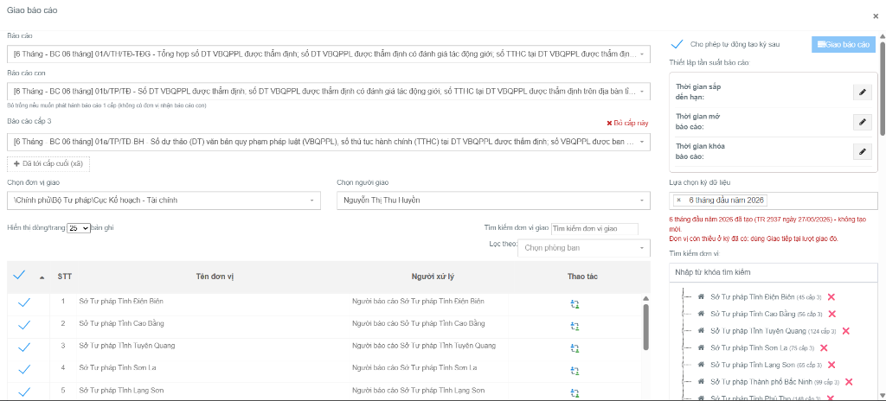
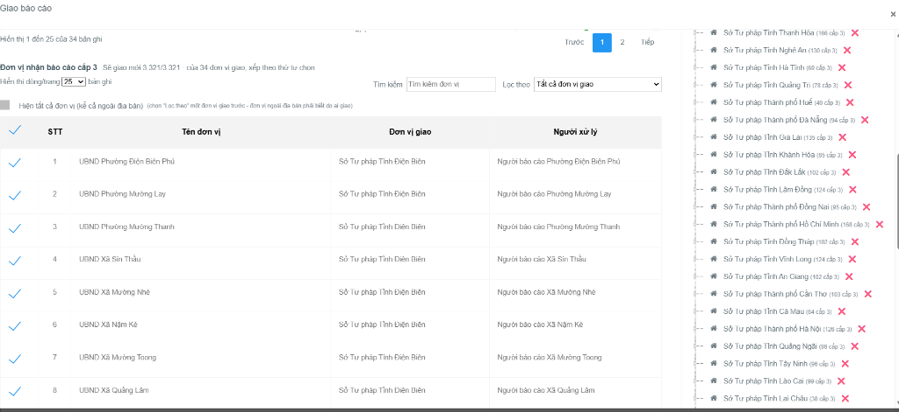
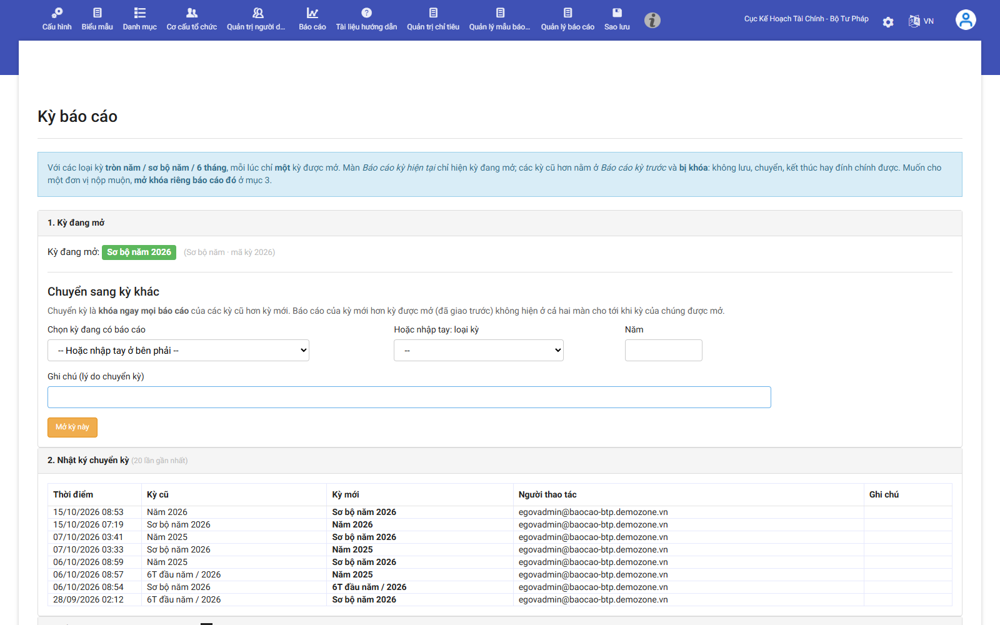
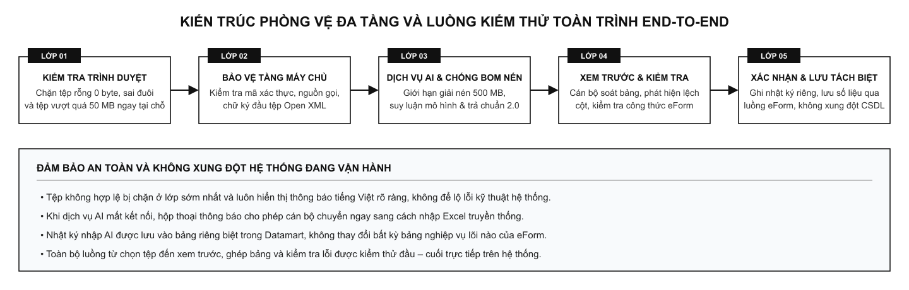
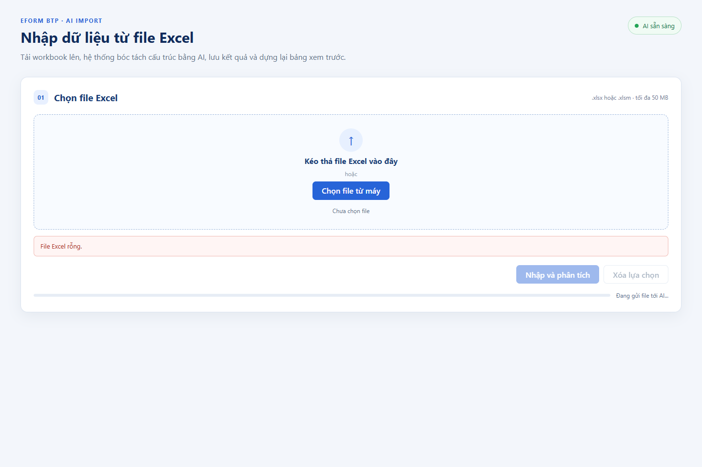
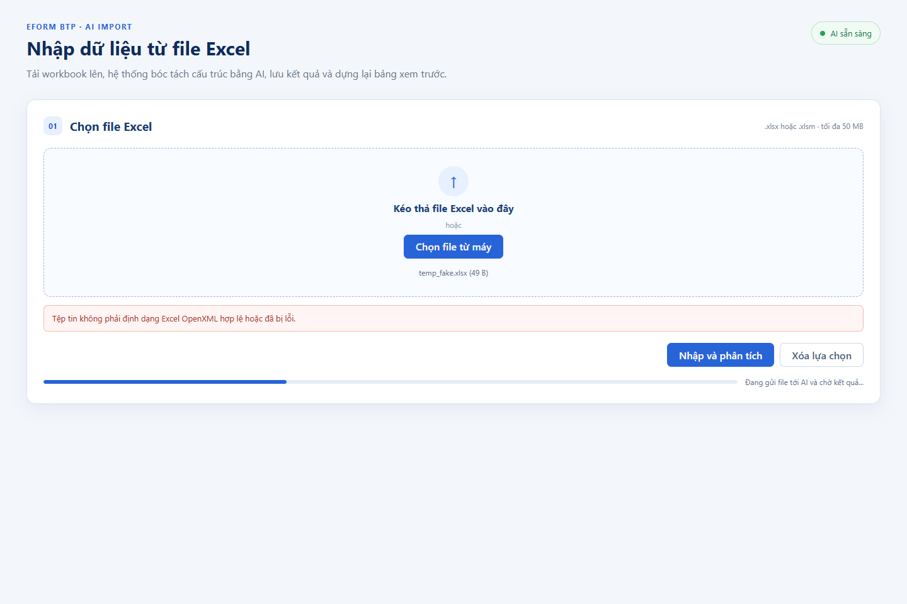
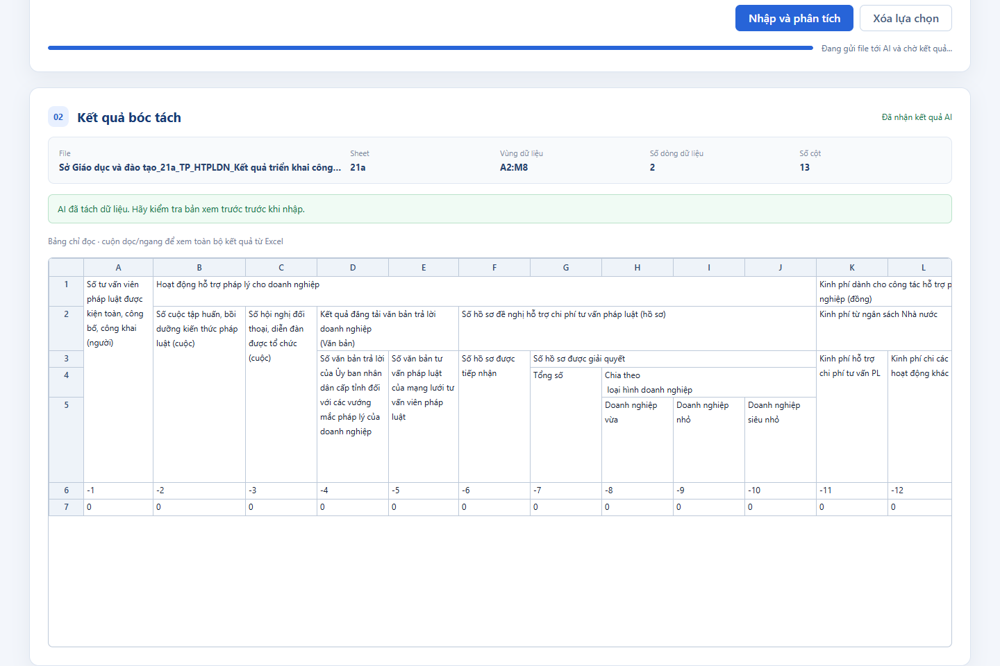

# BÁO CÁO THỰC TẬP TUẦN 10
**HỌP TIẾN ĐỘ DỰ ÁN, SỬA TÍNH NĂNG GIAO BÁO CÁO HÀNG LOẠT 3 CẤP, THIẾT LẬP MÔI TRƯỜNG KỲ BÁO CÁO THỬ NGHIỆM VÀ HOÀN TẤT XỬ LÝ NGOẠI LỆ, KIỂM THỬ TOÀN TRÌNH MODULE AI IMPORT**

---

## BẢNG THÔNG TIN SINH VIÊN VÀ ĐỀ TÀI

| Thông tin | Chi tiết |
|---|---|
| **Sinh viên thực hiện** | **Trần Văn Hoàng** |
| **Mã số sinh viên (MSSV)** | **0034467** |
| **Lớp chuyên ngành** | 67CS – Khóa K67 |
| **Đơn vị thực tập** | Công ty Cổ phần BEDX |
| **Bộ phận công tác** | Trung tâm Nền tảng chuyển đổi số |
| **Cán bộ hướng dẫn tại đơn vị** | **Đào Đức Văn** |
| **Dự án tham gia** | Hệ thống báo cáo điện tử eForm |
| **Đề tài nghiên cứu** | Nghiên cứu và ứng dụng AI xây dựng Module Import file Excel thông minh, tự động ánh xạ dữ liệu cho hệ thống Báo cáo thống kê eForm. |

---

## I. THÔNG TIN CHUNG VÀ KẾ HOẠCH THỰC HIỆN TUẦN 10

Trong tuần thực tập thứ 10, em tập trung chuẩn bị cho đợt mở kỳ báo cáo thử nghiệm diện rộng trên Dự án chính eForm BTP và hoàn thiện kiến trúc xử lý ngoại lệ đa tầng, luồng xác nhận lưu kết quả cho Module AI Import Excel.

### Bảng tổng hợp công việc Tuần 10

| STT | Nội dung công việc được giao | Kết quả thực hiện | Đánh giá |
|:---:|---|---|:---:|
| **Nhiệm vụ 1** | Họp bàn về tiến độ dự án eForm và nhận nhiệm vụ tuần 10 | Đã báo cáo kết quả tuần 8, 9; nắm bắt kế hoạch mở kỳ báo cáo thử nghiệm và tiếp nhận phân công mới. | **Hoàn thành** |
| **Nhiệm vụ 2** | Sửa lại tính năng giao báo cáo hàng loạt đa cấp | Hoàn thiện luồng phân bổ 3 cấp (cấp cha 01 → cấp con 01b → cấp 3 01a), giao thành công từ Cục Kế hoạch - Tài chính xuống 34 Sở Tư pháp và 3.321 xã/phường. | **Hoàn thành** |
| **Nhiệm vụ 3** | Thiết lập môi trường thử nghiệm: 3 tài khoản cục, 3 tài khoản xã, mở kỳ sơ bộ và tạo báo cáo mẫu | Khởi tạo hoàn chỉnh 3 nhóm tài khoản cấp cục, 3 nhóm tài khoản cấp xã, kích hoạt kỳ báo cáo sơ bộ và tạo đầy đủ báo cáo mẫu phục vụ kiểm thử. | **Hoàn thành** |
| **Nhiệm vụ 4** | Kiểm thử tệp rỗng, sai định dạng, hỏng cấu trúc và tiêu đề phức tạp (Module AI Import) | Hoàn thiện cơ chế phòng vệ đa tầng, chặn chính xác tệp 0 byte và tệp hỏng cấu trúc OpenXML bằng thông báo tiếng Việt thân thiện. | **Hoàn thành** |
| **Nhiệm vụ 5** | Hoàn thiện hộp thoại xác nhận lưu kết quả và kiểm thử toàn trình Module AI Import | Hoàn thành bước xác nhận, lưu vết giao dịch an toàn không xung đột hệ thống cũ, vượt qua 4/4 ca kiểm thử đầu – cuối (12/12 ca từ Tuần 8–10). | **Hoàn thành** |

---

## II. MỤC 1: QUÁ TRÌNH THỰC TẬP TẠI DỰ ÁN CHÍNH CỦA CÔNG TY (HỆ THỐNG eFORM BTP)

### 1. Họp bàn tiến độ và tiếp nhận nhiệm vụ chuẩn bị mở kỳ báo cáo thử nghiệm

Tại phiên họp giao ban tuần 10, em đã báo cáo toàn bộ kết quả đạt được trong tuần 8 và tuần 9. Trước yêu cầu mở kỳ báo cáo thử nghiệm toàn quốc, nhóm dự án xác định hai công việc ưu tiên cao nhất là khắc phục lỗi chức năng giao báo cáo hàng loạt 3 cấp và thiết lập môi trường thử nghiệm biệt lập đầy đủ tài khoản các cấp.

---

### 2. Khắc phục tính năng giao báo cáo hàng loạt 3 cấp trên hệ thống eForm

#### 2.1. Hiện trạng và yêu cầu nghiệp vụ
Chức năng giao báo cáo hàng loạt cho phép cơ quan chủ quản phát hành đồng loạt cây báo cáo 3 cấp liên hoàn trong một lần thiết lập: từ biểu tổng hợp cấp Bộ (`01/V/TH/TĐ-TĐG`), xuống biểu cấp tỉnh (`01b/TP/TĐ`) tại các Sở Tư pháp và phân rã tới biểu cấp cơ sở (`01a/TP/TĐ-BH`) tại 3.321 UBND xã/phường trên toàn quốc, với đơn vị giao là Cục Kế hoạch - Tài chính (cán bộ phụ trách Nguyễn Thị Thu Huyền) cho kỳ dữ liệu 6 tháng đầu năm 2026. Trước khi sửa lỗi, chức năng này bị đứt gãy chuỗi liên kết ở cấp 3 nên không thể phân rã danh sách xã/phường.

#### 2.2. Giải pháp khắc phục
- Khôi phục liên kết đồng bộ chuỗi báo cáo 3 cấp và xử lý chính xác cờ đánh dấu đã tới cấp cuối (cấp xã).
- Bổ sung cơ chế phân rã đệ quy cây tổ chức từ danh sách 34 Sở Tư pháp xuống đúng 3.321 đơn vị cấp xã/phường trực thuộc.
- Ánh xạ nhất quán thông tin đơn vị giao, người giao, kỳ báo cáo và các mốc thời gian hạn nộp cho toàn bộ bản ghi phát sinh trong một giao dịch an toàn.

#### 2.3. Kết quả nghiệm thu và minh chứng thực tế

 
*Hình 1: Màn hình thiết lập giao báo cáo hàng loạt 3 cấp từ Cục Kế hoạch - Tài chính tới các Sở Tư pháp.*

 
*Hình 2: Danh sách 3.321 đơn vị cấp xã/phường trực thuộc 34 Sở Tư pháp được phân bổ tự động thành công.*

---

### 3. Thiết lập môi trường thử nghiệm và kích hoạt kỳ báo cáo sơ bộ

Em đã khởi tạo hoàn chỉnh môi trường thử nghiệm biệt lập gồm 3 nhóm tài khoản cấp Cục (Cục Kế hoạch - Tài chính, Cục Trợ giúp pháp lý, Cục Bổ trợ tư pháp), 3 nhóm tài khoản cấp xã đại diện cho các địa bàn khác nhau, mở kỳ báo cáo thử nghiệm sơ bộ và tạo sẵn bộ báo cáo mẫu có dữ liệu mô phỏng để các đơn vị trải nghiệm trọn vẹn quy trình nhập, duyệt và tổng hợp mà không ảnh hưởng dữ liệu sản xuất.

 
*Hình 3: Thiết lập và kích hoạt thành công kỳ báo cáo thử nghiệm sơ bộ trên cổng quản trị hệ thống.*

---

## III. MỤC 2: NGHIÊN CỨU VÀ PHÁT TRIỂN MODULE AI IMPORT EXCEL THÔNG MINH

### 4. Xây dựng kiến trúc phòng vệ đa tầng xử lý ngoại lệ đầu vào

Để module vận hành an toàn tuyệt đối trước các tệp đầu vào bất thường, em đã hoàn thiện cơ chế phòng vệ đa tầng: kiểm tra định dạng và dung lượng tệp ngay trên trình duyệt (chặn ngay tệp 0 byte và tệp vượt giới hạn dung lượng), thẩm định chữ ký cấu trúc nén OpenXML tại tầng dịch vụ trung gian để phát hiện tệp đổi đuôi giả mạo hoặc hỏng cấu trúc, và chuẩn hóa toàn bộ ngoại lệ thành thông báo tiếng Việt thân thiện.

 
*Hình 4: Sơ đồ cơ chế phòng vệ đầu vào đa tầng và quy trình xác nhận lưu kết quả toàn trình.*

 
*Hình 5: Hệ thống phát hiện và chặn ngay tệp Excel rỗng dung lượng 0 byte trước khi gửi lên máy chủ.*

 
*Hình 6: Cảnh báo rõ ràng khi người dùng tải lên tệp sai định dạng hoặc hỏng cấu trúc nén bảng tính.*

---

### 5. Hoàn thiện bước xác nhận lưu kết quả và kiểm thử toàn trình End-to-End

Bước cuối của quy trình hiển thị hộp thoại xác nhận tổng kết tên tệp, biểu mẫu đích và kết quả đối soát trước khi ghi dữ liệu vào biểu mẫu và lưu vết giao dịch trong cơ sở dữ liệu độc lập, bảo đảm hoàn toàn không xung đột với cấu trúc dữ liệu lõi của eForm.

 
*Hình 7: Bước xác nhận tổng kết thông tin và lưu nhận kết quả an toàn trước khi hoàn tất chu trình nhập.*

| Mã kiểm thử | Nội dung kiểm thử tự động | Kết quả ghi nhận | Đánh giá |
|:---:|---|---|:---:|
| **T10.01** | Bắt lỗi tệp Excel rỗng dung lượng 0 byte | Chặn ngay trên trình duyệt kèm thông báo tiếng Việt rõ ràng | **ĐẠT** |
| **T10.02** | Bắt lỗi tệp hỏng cấu trúc nén hoặc đổi đuôi giả mạo | Từ chối an toàn tại tầng thẩm định đầu vào, không gây lỗi hệ thống | **ĐẠT** |
| **T10.03** | Xác nhận và lưu vết kết quả giao dịch nhập liệu | Lưu thành công đầy đủ thông tin truy vết, không xung đột CSDL cũ | **ĐẠT** |
| **T10.04** | Kiểm thử toàn trình liên tục từ chọn tệp đến hoàn tất | Toàn bộ 12/12 ca kiểm thử tự động từ Tuần 8 đến Tuần 10 đều đạt 100% | **ĐẠT** |

---

## IV. TỔNG KẾT TUẦN 10 VÀ KẾ HOẠCH TUẦN 11

Em đã hoàn thành 100% các đầu việc Tuần 10 trên cả hai nhánh công việc. Sang Tuần 11, em sẽ xử lý các lỗi hiển thị và phân quyền phát sinh từ đợt dùng thử thực tế (thanh điều hướng báo cáo con, phân quyền báo cáo bị trả lại) và tổ chức buổi trình diễn nội bộ (Showcase) Module AI Import Excel trước nhóm phát triển và cán bộ hướng dẫn.
