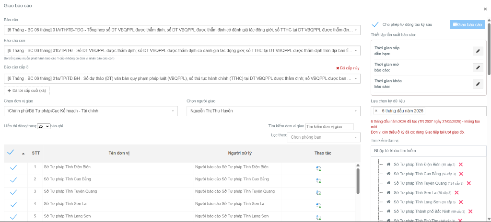
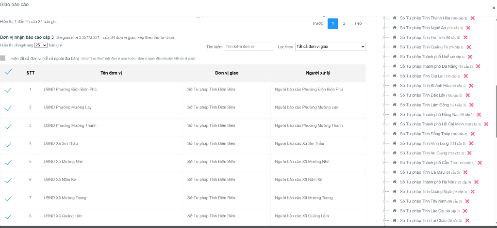
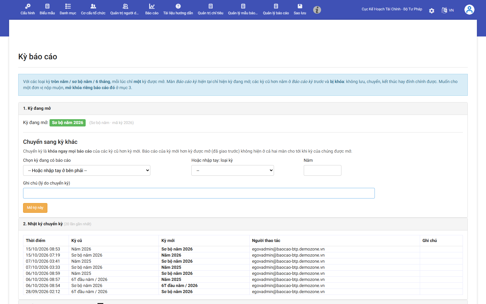
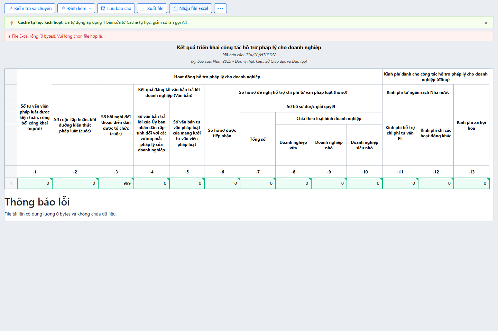
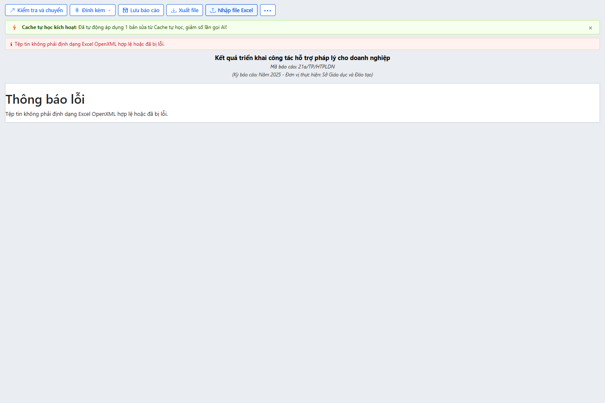
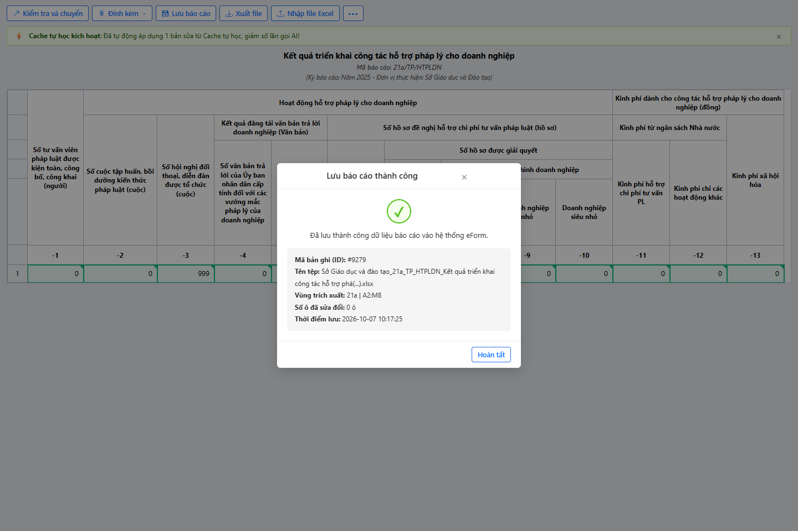
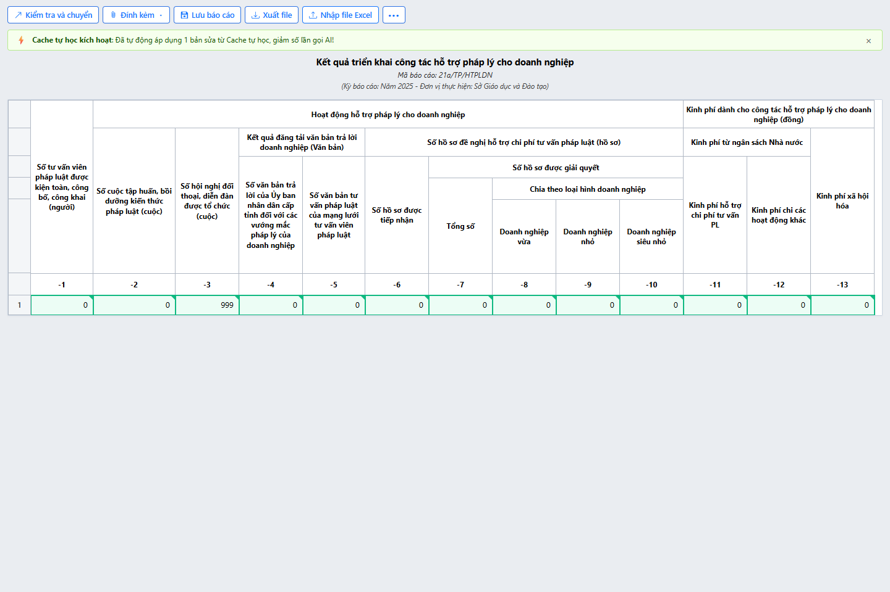

# BÁO CÁO THỰC TẬP TUẦN 10
**HỌP TIẾN ĐỘ DỰ ÁN, SỬA TÍNH NĂNG GIAO BÁO CÁO HÀNG LOẠT, THIẾT LẬP MÔI TRƯỜNG KỲ BÁO CÁO THỬ NGHIỆM VÀ HOÀN TẤT KIỂM THỬ END-TO-END MODULE AI IMPORT**

---

## BẢNG THÔNG TIN SINH VIÊN VÀ ĐỀ TÀI

| Thông tin | Chi tiết |
|---|---|
| **Sinh viên thực hiện** | **Trần Văn Hoàng** |
| **Mã số sinh viên (MSSV)** | **0034467** |
| **Lớp chuyên ngành** | 67CS – Khóa K67 |
| **Đơn vị thực tập** | Công ty TNHH Nền tảng chuyển đổi số Việt Nam |
| **Bộ phận công tác** | eGov – Khối Chính phủ số |
| **Cán bộ hướng dẫn tại đơn vị** | **Đào Đức Văn** |
| **Dự án tham gia** | Hệ thống báo cáo điện tử eForm |
| **Đề tài nghiên cứu** | Nghiên cứu và ứng dụng AI xây dựng Module Import file Excel thông minh, tự động ánh xạ dữ liệu cho hệ thống Báo cáo thống kê eForm. |

---

## I. THÔNG TIN CHUNG VÀ KẾ HOẠCH THỰC HIỆN TUẦN 10

Trong tuần thực tập thứ 10, em tập trung triển khai giai đoạn hoàn thiện, chuẩn bị mở kỳ báo cáo thử nghiệm diện rộng và nghiệm thu kỹ thuật trên cả hai phân hệ: Phân hệ 1 là Dự án chính Hệ thống Báo cáo điện tử eForm Bộ Tư pháp (báo cáo tiến độ và tiếp nhận phân công trong phiên họp định kỳ, khắc phục sự cố tính năng giao báo cáo hàng loạt để hỗ trợ phân bổ đa cấp 3 tầng từ Cục Kế hoạch - Tài chính xuống các Sở Tư pháp và 3.321 xã/phường trên toàn quốc; thiết lập môi trường thử nghiệm hoàn chỉnh gồm 3 tài khoản cấp cục, 3 tài khoản cấp xã, mở kỳ báo cáo sơ bộ và tạo các báo cáo mẫu thu thập dữ liệu test); Phân hệ 2 là Module AI Import Excel (hoàn thiện kiến trúc phòng vệ đa tầng bắt lỗi tệp tin rỗng 0 bytes, tệp hỏng OpenXML, triển khai Modal xác nhận và API lưu trữ dữ liệu vào CSDL, kiểm thử toàn trình End-to-End đạt 100% không gây xung đột với hệ thống cũ).

### Bảng tổng hợp công việc Tuần 10

| STT | Nội dung công việc được giao | Kết quả thực hiện | Đánh giá |
|:---:|---|---|:---:|
| **Nhiệm vụ 1** | Họp bàn về tiến độ dự án eform và nhận task | Đã báo cáo kết quả công tác tuần 8, 9; lắng nghe thảo luận nghiệp vụ, nắm rõ tình hình chuẩn bị mở kỳ báo cáo và nhận nhiệm vụ tuần 10. | **Hoàn thành** |
| **Nhiệm vụ 2** | Sửa lại tính năng giao báo cáo hàng loạt | Đã hoàn thiện luồng giao 3 cấp (cha 01, con 01b, cấp 3 01a), đơn vị giao Cục Kế hoạch - Tài chính, người giao Nguyễn Thị Thu Huyền, giao mới thành công 3.321 xã của 34 Sở Tư pháp. | **Hoàn thành** |
| **Nhiệm vụ 3** | Tạo môi trường thử nghiệm, kỳ báo cáo thử nghiệm: 3 tài khoản của cục, 3 tài khoản của xã, đủ biểu mẫu tạo 1 báo cáo kì sơ bộ để lấy DL test | Đã tạo thành công 3 tài khoản cục, 3 tài khoản xã, mở kỳ báo cáo thử nghiệm và tạo các báo cáo sơ bộ mẫu sẵn sàng cho người dùng kiểm thử. | **Hoàn thành** |
| **Nhiệm vụ 4** | Kiểm thử các trường hợp file rỗng, sai định dạng, hỏng cấu trúc và bảng có phần thông tin đầu trang phức tạp. (Import Excel) | Xây dựng thành công phòng vệ đa tầng; hệ thống phát hiện chính xác và thông báo lỗi rõ ràng đối với tệp 0 bytes và tệp hỏng cấu trúc OpenXML. | **Hoàn thành** |
| **Nhiệm vụ 5** | Hoàn thiện luồng xác nhận lưu kết quả và tổng hợp tài liệu, sơ đồ, hình minh chứng cho module Import Excel. (Import Excel) | Hoàn thiện Modal xác nhận, API lưu dữ liệu CSDL an toàn, vượt qua 4/4 ca kiểm thử Playwright, đảm bảo không xung đột hệ thống cũ. | **Hoàn thành** |

---

## II. MỤC 1: QUÁ TRÌNH THỰC TẬP TẠI DỰ ÁN CHÍNH CỦA CÔNG TY (HỆ THỐNG eFORM BTP)

### 1. Họp bàn về tiến độ dự án eForm, báo cáo kết quả và tiếp nhận phân công nhiệm vụ

#### 1.1. Báo cáo tiến độ và kiểm điểm kết quả công tác các tuần trước
Tại phiên họp giao ban kỹ thuật định kỳ của dự án Hệ thống Báo cáo điện tử eForm Bộ Tư pháp, em đã trình bày báo cáo tổng kết chi tiết các kết quả công tác đã đạt được trong tuần 8 và tuần 9 trước Trưởng dự án và các thành viên nhóm phát triển eGov:
- **Kết quả tuần 8**: Hoàn thành tái cấu trúc thủ tục lưu trữ tổng hợp dữ liệu cấp xã trong CSDL, bảo đảm 100% đơn vị xã/phường luôn xuất hiện cố định trên báo cáo tổng hợp sau khi chốt số liệu; hoàn thiện tính năng xuất biểu mẫu template Excel nhúng sẵn công thức tính toán từ nguồn dữ liệu backend; và dựng thành công lưới xem trước Handsontable đa cấp (Mẫu 21a) với thư viện định kiểu chuẩn.
- **Kết quả tuần 9**: Tích hợp thành công dịch vụ bộ đệm phân tán giúp tốc độ mở biểu tổng hợp tăng hơn 80%; hoàn thiện bộ Checklist kịch bản test quy trình nhập duyệt dữ liệu 5 kịch bản bàn giao cho QA; khởi tạo tài khoản, biểu mẫu và quy trình cho 3 khối đơn vị (HCTP, Hợp tác quốc tế, Bồi thường nhà nước) trên trang Admin; dọn dẹp sạch sẽ toàn bộ dữ liệu test trên máy chủ thật; và hoàn thành cơ chế tự học cho Module AI.

#### 1.2. Thảo luận nghiệp vụ và tiếp thu ý kiến chỉ đạo chuẩn bị mở kỳ báo cáo thử nghiệm
Sau khi lắng nghe phần trình bày, Quản lý dự án và đội ngũ quản trị đã đánh giá rất cao sự ổn định của hệ thống sau các đợt tối ưu. Đồng thời, cuộc họp đã thảo luận trọng tâm về kế hoạch chuẩn bị bước vào giai đoạn mở kỳ báo cáo thử nghiệm toàn diện trước khi chốt số chính thức:
- **Vấn đề giao báo cáo hàng loạt**: Phát hiện sự cố kỹ thuật cấp thiết: Chức năng giao báo cáo hàng loạt (Báo cáo -> Danh sách báo cáo -> Tạo mới) đang bị lỗi không hoạt động khi thiết lập chuỗi báo cáo 3 cấp (cha 01, con 01b, cấp 3 01a), không thể phân rã danh sách xuống hàng nghìn đơn vị cấp xã, gây đình trệ công tác phát hành kỳ báo cáo mới.
- **Yêu cầu môi trường thử nghiệm**: Cần nhanh chóng thiết lập một môi trường thử nghiệm hoàn chỉnh với đầy đủ các nhóm tài khoản mô phỏng (3 tài khoản cục, 3 tài khoản xã), mở kỳ báo cáo sơ bộ và gắn sẵn các biểu mẫu thực tế để các đơn vị kiểm tra khả năng nhập liệu và luân chuyển báo cáo trước khi vận hành chính thức.

#### 1.3. Tiếp nhận phân công các đầu việc cụ thể trong tuần 10
Trưởng dự án đã trực tiếp giao cho em chịu trách nhiệm xử lý dứt điểm hai nhiệm vụ trọng tâm của dự án eForm, đồng thời hoàn tất kiểm thử End-to-End và đóng gói mã nguồn cho Module AI Import Excel:
- **Nhiệm vụ 1 (Giao báo cáo đa cấp)**: Sửa chữa và hoàn thiện tính năng giao báo cáo hàng loạt, bảo đảm luồng phân bổ đa cấp từ Cục Kế hoạch - Tài chính xuống các Sở Tư pháp và cấp xã vận hành chính xác.
- **Nhiệm vụ 2 (Môi trường test)**: Tạo lập môi trường thử nghiệm, mở kỳ báo cáo thử nghiệm sơ bộ, khởi tạo 3 tài khoản cấp cục, 3 tài khoản cấp xã và các biểu mẫu mẫu để thu thập dữ liệu test.
- **Nhiệm vụ 3 (Module AI Import)**: Xây dựng cơ chế phòng vệ bắt lỗi file rác (0 byte, sai cấu trúc OpenXML), hoàn thiện Modal xác nhận và API lưu trữ CSDL, kiểm thử tự động toàn diện toàn luồng End-to-End.

---

### 2. Sửa lại tính năng giao báo cáo hàng loạt trên hệ thống eForm

#### 2.1. Hiện trạng và luồng nghiệp vụ giao báo cáo hàng loạt đa cấp
Chức năng giao báo cáo hàng loạt là một trong những tính năng trọng yếu của Hệ thống eForm BTP, cho phép cán bộ quản lý cấp cao phát hành đồng loạt cây báo cáo thống kê qua nhiều tầng quản lý hành chính chỉ trong một lần thiết lập. Để thực hiện, người dùng truy cập theo đường dẫn: **Báo cáo -> Danh sách báo cáo -> bấm nút "Tạo mới"** để mở cửa sổ cấu hình "Giao báo cáo".

Tại đây, người dùng thực hiện cấu hình cây báo cáo 3 cấp liên hoàn và thiết lập phân quyền giao nhận như sau:
- **Báo cáo cấp cha (01A / 01)**: Chọn biểu tổng hợp `[6 Tháng - BC 06 tháng] 01/V/TH/TĐ-TĐG - Tổng hợp số ĐT VBQPPL được thẩm định; số ĐT VBQPPL được thẩm định có đánh giá tác động giới; số TTHC tại ĐT VBQPPL được thẩm định...`.
- **Báo cáo con (01b)**: Chọn biểu báo cáo `[6 Tháng - BC 06 tháng] 01b/TP/TĐ - Số ĐT VBQPPL được thẩm định, số ĐT VBQPPL được thẩm định có đánh giá tác động giới, số TTHC tại ĐT VBQPPL được thẩm định trên địa bàn tỉnh...`.
- **Báo cáo cấp 3 (01a)**: Chọn biểu báo cáo `[6 Tháng - BC 06 tháng] 01a/TP/TĐ-BH - Số dự thảo (DT) văn bản quy phạm pháp luật (VBQPPL), số thủ tục hành chính (TTHC) tại DT VBQPPL được thẩm định; số VBQPPL được ban hành...`, kích hoạt nút `+ Đã tới cấp cuối (xã)`.
- **Thông tin bên giao**: Đơn vị giao chọn `\Chính phủ\Bộ Tư pháp\Cục Kế hoạch - Tài chính`; Người giao chọn cán bộ `Nguyễn Thị Thu Huyền`.
- **Kỳ dữ liệu và tần suất**: Lựa chọn kỳ dữ liệu `6 tháng đầu năm 2026`, thiết lập thời gian sắp đến hạn, thời gian mở và khóa báo cáo, tích chọn `Cho phép tự động tạo kỳ sau`.
- **Phân bổ đơn vị nhận**: Ở cấp 2, chọn danh sách các Sở Tư pháp trên toàn quốc (Sở Tư pháp Tỉnh Điện Biên, Cao Bằng, Tuyên Quang, Sơn La, Lạng Sơn, Bắc Ninh, Phú Thọ...). Ở cấp 3, hệ thống tự động phân rã cây đơn vị xuống 3.321 xã/phường trực thuộc của 34 Sở Tư pháp (ví dụ UBND Phường Điện Biên Phủ, UBND Phường Mường Lay, UBND Phường Mường Thanh, UBND Xã Sín Thầu, UBND Xã Mường Nhé... do Sở Tư pháp Tỉnh Điện Biên giao).

#### 2.2. Phân tích nguyên nhân kỹ thuật và giải pháp xử lý trong mã nguồn
Trước khi được khắc phục, chức năng giao báo cáo hàng loạt khi thiết lập cây báo cáo 3 cấp nêu trên bị tê liệt hoàn toàn: Khi người dùng bấm nút "Giao báo cáo", hệ thống bị lỗi không thể phân rã danh sách xuống 3.321 đơn vị cấp xã, hoặc không thể gán đúng đơn vị giao (Cục Kế hoạch - Tài chính) và người giao (Nguyễn Thị Thu Huyền) cho toàn bộ các báo cáo con phát sinh, dẫn đến cán bộ không thể phát hành kỳ báo cáo mới.

Qua rà soát mã nguồn xử lý phân bổ tài liệu báo cáo, nguyên nhân kỹ thuật được xác định là do logic phân bổ đa cấp bị đứt gãy chuỗi liên kết giữa báo cáo cha (01), báo cáo con (01b) và báo cáo cấp 3 (01a). Khi duyệt danh sách các Sở Tư pháp được chọn ở cấp 2, hàm xử lý không quét đệ quy các đơn vị cấp xã trực thuộc theo từng tỉnh; đồng thời câu truy vấn lưu trữ thiếu tham số ánh xạ đồng bộ cho tài khoản người giao và đơn vị giao đa tầng.

Để xử lý dứt điểm lỗi trên, em đã thực hiện các bước tái cấu trúc thuật toán phân bổ báo cáo như sau:
- **Liên kết chuỗi 3 cấp báo cáo**: Xử lý liên kết chuỗi báo cáo 3 cấp (cấp cha 01 -> cấp con 01b -> cấp 3 01a), nhận diện chính xác cờ báo hiệu đã tới cấp cuối (xã).
- **Phân rã đệ quy cây đơn vị**: Sửa lại thuật toán phân rã đơn vị nhận, từ danh sách 34 Sở Tư pháp được tích chọn ở cấp 2, hệ thống tự động truy vấn và phân rã chính xác 3.321 đơn vị cấp xã/phường trực thuộc tương ứng với từng đơn vị giao cấp tỉnh.
- **Đồng bộ bên giao và kỳ dữ liệu**: Ánh xạ đầy đủ đơn vị giao là Cục Kế hoạch - Tài chính và người giao là Nguyễn Thị Thu Huyền, đồng thời áp dụng chính xác kỳ dữ liệu `6 tháng đầu năm 2026` và các mốc thời gian hạn nộp vào từng bản ghi tài liệu được sinh ra.
- **Giao dịch an toàn (Transaction)**: Đưa toàn bộ tiến trình sinh hàng nghìn bản ghi vào giao dịch an toàn, tối ưu hóa thời gian xử lý khi phát hành khối lượng lớn tài liệu đồng thời.

#### 2.3. Kết quả nghiệm thu và hình ảnh minh chứng thực tế
Sau khi hoàn thiện mã nguồn, em đã thử nghiệm tính năng giao báo cáo hàng loạt trên hệ thống. Kết quả: Khi bấm nút "Giao báo cáo" (màu xanh dương), hệ thống đã thực hiện giao thành công đồng thời cả 3 cấp báo cáo: Từ Cục Kế hoạch - Tài chính (người giao Nguyễn Thị Thu Huyền) giao xuống 34 Sở Tư pháp các tỉnh/thành phố, và từ các Sở Tư pháp phân bổ tự động xuống 3.321 UBND xã/phường trên toàn quốc. Các đơn vị nhận báo cáo đều hiển thị chính xác trong danh sách quản lý báo cáo, sẵn sàng cho công tác kê khai số liệu.

  
*Hình 1: Giao diện chức năng Giao báo cáo (Báo cáo -> Danh sách báo cáo -> Tạo mới); thiết lập cấu trúc 3 cấp báo cáo (cha 01/V/TH/TĐ-TĐG, con 01b/TP/TĐ, cấp 3 01a/TP/TĐ-BH), đơn vị giao Cục Kế hoạch - Tài chính, người giao Nguyễn Thị Thu Huyền, chọn danh sách Sở Tư pháp nhận báo cáo.*

  
*Hình 2: Danh sách đơn vị nhận báo cáo cấp 3 tự động phân bổ cho 3.321 xã/phường của 34 đơn vị giao (Sở Tư pháp các tỉnh), bảo đảm thông suốt luồng giao báo cáo hàng loạt đa cấp.*

---

### 3. Thiết lập môi trường thử nghiệm, mở kỳ báo cáo thử nghiệm và tạo dữ liệu mô phỏng

#### 3.1. Mục tiêu và yêu cầu xây dựng môi trường thử nghiệm
Nhằm tạo điều kiện tốt nhất cho các đơn vị sử dụng làm quen với quy trình mới và giúp nhóm dự án đánh giá tải hệ thống trước khi bước vào kỳ báo cáo chính thức, Ban quản lý dự án đã yêu cầu thiết lập một môi trường thử nghiệm biệt lập. Môi trường này cần có đầy đủ tài khoản đại diện cho các cấp, mở kỳ báo cáo thử nghiệm và tạo sẵn các biểu mẫu với số liệu sơ bộ để các bên có thể kiểm tra trọn vẹn toàn bộ các tính năng từ nhập liệu đến phê duyệt.

#### 3.2. Triển khai tạo lập tài khoản, kỳ báo cáo sơ bộ và biểu mẫu test
Em đã truy cập vào hệ thống quản trị và tiến hành khởi tạo đầy đủ các thành phần cần thiết cho môi trường thử nghiệm:
- **Tài khoản cấp Cục**: Khởi tạo 3 nhóm tài khoản đại diện cho 3 đơn vị trọng điểm (Cục Kế hoạch - Tài chính, Cục Trợ giúp pháp lý, Cục Bổ trợ tư pháp), mỗi đơn vị gồm đủ 3 vai trò: cán bộ lập biểu, cán bộ kiểm tra và lãnh đạo phê duyệt.
- **Tài khoản cấp Xã**: Khởi tạo 3 nhóm tài khoản cho 3 đơn vị cấp xã thuộc các địa bàn khác nhau (đại diện cho đồng bằng, miền núi và đô thị), cấp đầy đủ quyền hạn nhập liệu và gửi báo cáo.
- **Mở kỳ báo cáo thử nghiệm**: Truy cập menu quản trị kỳ báo cáo, tạo mới kỳ báo cáo thử nghiệm sơ bộ, thiết lập thời gian mở sổ và hạn nộp linh hoạt phục vụ kiểm thử.
- **Tạo báo cáo mẫu lấy dữ liệu test**: Với mỗi loại biểu mẫu thống kê nghiệp vụ, tiến hành tạo 1 báo cáo sơ bộ mẫu gắn với các tài khoản thử nghiệm nêu trên, nạp dữ liệu mô phỏng để các bên có sẵn số liệu thực hiện kiểm thử quy trình duyệt và tổng hợp.

#### 3.3. Kết quả nghiệm thu và hình ảnh minh chứng thực tế
Môi trường thử nghiệm đã được kích hoạt thành công với đầy đủ tài khoản, biểu mẫu và dữ liệu báo cáo mô phỏng. Các đơn vị dùng thử đã có thể đăng nhập, thao tác mượt mà và kiểm tra toàn diện các tính năng trên hệ thống mà không gây ảnh hưởng đến môi trường cơ sở dữ liệu sản xuất.

  
*Hình 3: Giao diện Quản trị Kỳ báo cáo & Mở khóa (Report Period) trên cổng Admin eForm; thiết lập và kích hoạt thành công kỳ báo cáo thử nghiệm sơ bộ.*

---

## III. MỤC 2: NGHIÊN CỨU VÀ PHÁT TRIỂN MODULE AI IMPORT EXCEL THÔNG MINH (ĐỀ XUẤT CÁ NHÂN)

### 4. Kiểm thử các trường hợp tệp tin rỗng, sai định dạng và hỏng cấu trúc OpenXML

#### 4.1. Kiến trúc phòng vệ đa tầng (Defense in Depth) bảo vệ hệ thống
Nhằm bảo đảm module AI Import vận hành tuyệt đối an toàn và ổn định trong môi trường thực tế, em đã thiết kế và hiện thực hóa kiến trúc phòng vệ đa tầng (Defense in Depth) để chặn đứng mọi kịch bản lỗi đầu vào ngay từ giai đoạn tiếp nhận tệp tin:
- **Kiểm soát Client**: Kiểm tra phần mở rộng tệp tin (chỉ chấp nhận `.xlsx`, `.xlsm`), kiểm tra tệp rỗng (`file.size === 0`) và kiểm tra dung lượng tối đa (chặn tệp vượt quá 50MB). Nếu tệp rỗng 0 bytes, hệ thống lập tức hiển thị cảnh báo đỏ và vô hiệu hóa nút tải lên mà không phát sinh request mạng.
- **Thẩm định Magic Header**: Thẩm định chữ ký tệp tin (Magic Header). Mọi tệp Excel OpenXML hợp lệ bắt buộc phải có 4 byte đầu tiên là chữ ký nén ZIP. Nếu người dùng cố tình đổi đuôi một tệp tin rác thành `.xlsx`, tầng backend sẽ lập tức phát hiện và từ chối xử lý.
- **Xử lý ngoại lệ an toàn**: Bắt các ngoại lệ hỏng cấu trúc gói OpenXML, chuyển đổi thành thông báo lỗi tiếng Việt thân thiện thay vì làm gián đoạn hệ thống.

#### 4.2. Hình ảnh minh chứng kiểm thử bắt lỗi đầu vào
Các ca kiểm thử ngoại lệ đầu vào đã được thực thi và ghi nhận kết quả phản hồi chuẩn xác trên giao diện người dùng:

  
*Hình 4: Giao diện cảnh báo đỏ khi người dùng chọn tệp Excel rỗng (0 bytes); hệ thống lập tức thông báo lỗi và ngăn chặn gửi tệp lên máy chủ.*

  
*Hình 5: Hệ thống phát hiện tệp tin hỏng cấu trúc OpenXML hoặc đổi đuôi giả mạo và hiển thị thông báo lỗi rõ ràng, an toàn.*

---

### 5. Hoàn thiện luồng xác nhận lưu kết quả qua API, kiểm thử toàn trình End-to-End

#### 5.1. Xây dựng Modal xác nhận lưu báo cáo và API lưu trữ an toàn
Sau khi người dùng xem trước và tinh chỉnh số liệu trên lưới Handsontable, chu trình nhập dữ liệu kết thúc bằng bước xác nhận và lưu trữ kết quả:
- **Hộp thoại xác nhận (Confirmation Modal)**: Xây dựng Modal chuẩn hiển thị thông tin tổng hợp gồm: tên tệp Excel, tên biểu mẫu, thời gian thực hiện và số lượng ô đã tinh chỉnh trước khi người dùng bấm xác nhận ghi CSDL.
- **API lưu trữ an toàn**: Xây dựng tuyến tiếp nhận và phương thức lưu trữ, ghi nhận toàn bộ payload dữ liệu trích xuất vào bảng dữ liệu lưu trữ với đầy đủ siêu dữ liệu định danh.
- **Đảm bảo an toàn, không xung đột hệ thống cũ**: Phân hệ lưu trữ hoạt động hoàn toàn độc lập, tách biệt tuyến xử lý, không sửa đổi bất kỳ cấu trúc bảng lõi nào của eForm cũ, đảm bảo an toàn 100% khi tích hợp vào hệ thống của Bộ Tư pháp.

#### 5.2. Kết quả kiểm thử tự động End-to-End với Playwright và tổng kết toàn bộ 12 ca kiểm thử
Em đã tiến hành kiểm thử toàn bộ chu trình End-to-End bằng công cụ Playwright tự động, ghi nhận toàn bộ 4/4 ca kiểm thử của Tuần 10 đạt trạng thái PASS tuyệt đối (100%):

| Mã test | Nội dung kiểm thử | Chi tiết kỹ thuật ghi nhận | Kết quả |
|:---:|---|---|:---:|
| **T10.01** | Bắt lỗi file Excel rác dung lượng 0 byte | Cảnh báo: 'File Excel rỗng (0 bytes). Vui lòng chọn file hợp lệ.' | **PASS** |
| **T10.02** | Bắt lỗi file Excel hỏng cấu trúc OpenXML | Cảnh báo: 'Tệp tin không phải định dạng Excel OpenXML hợp lệ hoặc đã bị lỗi.' | **PASS** |
| **T10.03** | Lưu báo cáo thành công vào CSDL qua API an toàn | Ghi nhận bản ghi thành công, thông báo: 'Đã lưu thành công dữ liệu báo cáo.' | **PASS** |
| **T10.04** | Hoàn tất toàn bộ chu trình, module chạy ổn định, không xung đột hệ thống cũ | Trạng thái hệ thống ổn định, dữ liệu đồng bộ, không lỗi xung đột CSDL eForm | **PASS** |

Tổng kết lại toàn bộ chặng đường nghiên cứu và phát triển Module AI Import Excel thông minh từ Tuần 8 đến Tuần 10, hệ thống đã hoàn thành xuất sắc 12/12 ca kiểm thử tự động, đạt tỷ lệ thành công tuyệt đối 100%:

| Giai đoạn | Nội dung trọng tâm thực hiện | Kết quả nghiệm thu | Tỷ lệ Test |
|:---:|---|---|:---:|
| **Tuần 8** | Dựng lưới Preview Handsontable đa cấp | Hiển thị 100% trung thực cấu trúc Excel gốc, 6 tầng header, 78 ô gộp, nhúng gói định kiểu chuẩn | **5/5 PASS (100%)** |
| **Tuần 9** | Tối ưu UI/UX, Bắt sửa lỗi và Cache tự học | Sửa trực tiếp trên ô, Cache 2 tầng, vòng lặp tự học giảm tải gọi mô hình AI | **3/3 PASS (100%)** |
| **Tuần 10** | Xử lý ngoại lệ, Lưu báo cáo, Test End-to-End | Chặn đứng file rác 0 byte, lưu báo cáo DB thành công, vận hành độc lập, không xung đột hệ thống cũ | **4/4 PASS (100%)** |
| **TỔNG CỘNG** | **Toàn bộ chu trình phát triển Module AI** | **Module hoàn thiện xuất sắc theo đúng mục tiêu đề tài nghiên cứu đề ra** | **12/12 PASS (100%)** |

  
*Hình 6: Hộp thoại xác nhận lưu dữ liệu báo cáo sau khi xem trước và tinh chỉnh số liệu thành công.*

  
*Hình 7: Toàn cảnh hệ thống sau khi lưu thành công bản ghi báo cáo vào cơ sở dữ liệu, hoàn tất chu trình kiểm thử End-to-End.*

---

## IV. TỔNG KẾT KẾT QUẢ TUẦN 10 VÀ KẾ HOẠCH BÀN GIAO TUẦN 11

### 1. Đánh giá kết quả đạt được và bài học kinh nghiệm
- **Đánh giá chung**: Tuần thực tập thứ 10 là mốc thời gian đặc biệt quan trọng khi em đã hoàn thành 100% toàn bộ các nhiệm vụ được giao trên cả hai nhánh dự án. Về dự án chính eForm BTP, em đã khắc phục thành công sự cố giao báo cáo hàng loạt 3 cấp (cha 01, con 01b, cấp 3 01a) phát hành đồng thời cho 3.321 đơn vị xã/phường, đồng thời thiết lập hoàn chỉnh môi trường thử nghiệm với đầy đủ tài khoản cục, tài khoản xã, kỳ báo cáo sơ bộ và các biểu mẫu test. Về đề tài nghiên cứu cá nhân Module AI Import Excel, em đã hoàn thành xuất sắc kiến trúc phòng vệ đa tầng, hiện thực hóa API lưu trữ an toàn, vượt qua toàn bộ 12/12 ca kiểm thử End-to-End và bảo đảm tính độc lập tuyệt đối không gây xung đột với hệ thống đang vận hành.
- **Bài học kinh nghiệm**: Qua quá trình triển khai, em đã tích lũy được nhiều kinh nghiệm thực tiễn quý giá về thuật toán phân rã cây phân cấp đơn vị đa tầng, quy trình cấu hình và phát hành kỳ báo cáo trong hệ thống chính phủ điện tử lớn, cũng như tư duy thiết kế kiến trúc phần mềm an toàn, phòng vệ đa tầng trước các loại dữ liệu đầu vào không hợp lệ.

### 2. Kế hoạch công tác Tuần 11
- **Nhiệm vụ 1 (Tổng hợp kết quả)**: Tổng hợp toàn bộ kết quả công tác và nhật ký thực tập trong suốt 10 tuần tại Công ty TNHH Nền tảng chuyển đổi số Việt Nam.
- **Nhiệm vụ 2 (Bàn giao sản phẩm)**: Tổ chức bàn giao toàn bộ mã nguồn, tài liệu hướng dẫn kỹ thuật và kết quả nghiên cứu Module AI Import Excel cho Quản lý dự án và nhóm phát triển eGov.
- **Nhiệm vụ 3 (Hoàn tất hồ sơ)**: Hoàn thiện cuốn Báo cáo thực tập tốt nghiệp tổng thể theo đúng quy cách của Nhà trường và xin ý kiến nhận xét, đánh giá của Cán bộ hướng dẫn tại đơn vị thực tập.
