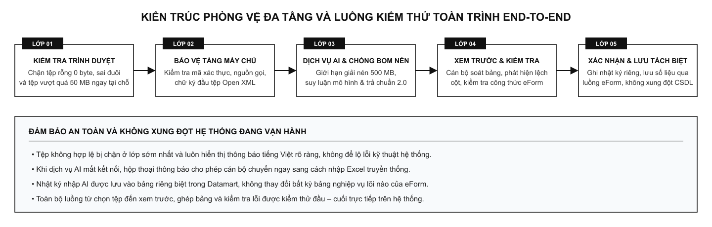
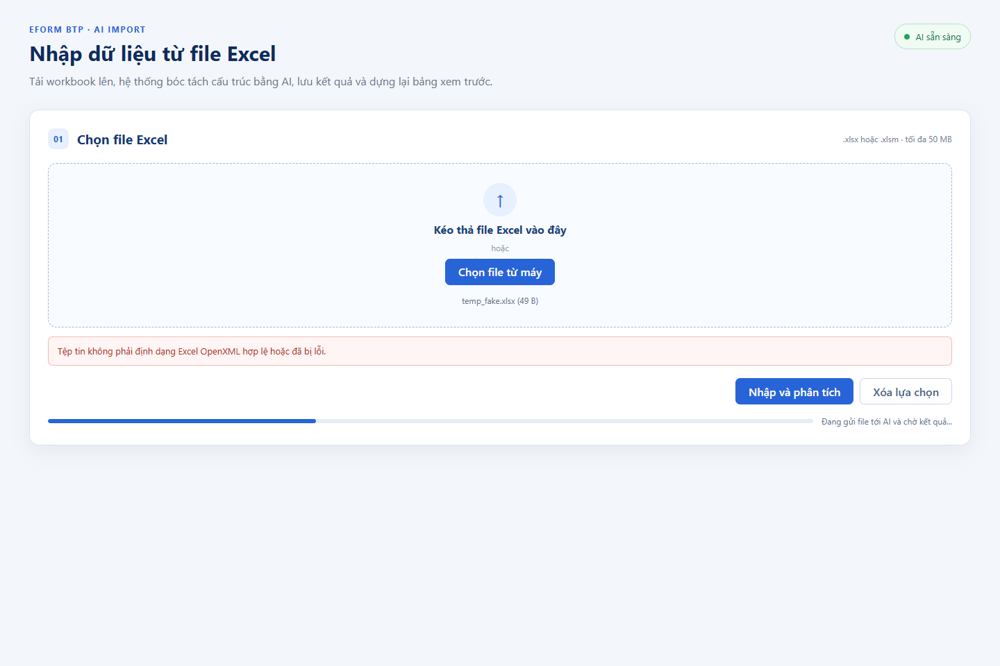
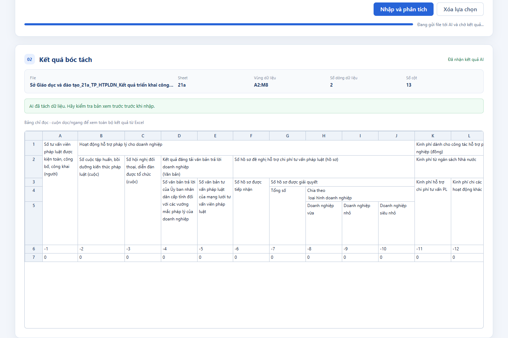

# TÀI LIỆU XỬ LÝ NGOẠI LỆ ĐA TẦNG VÀ KIỂM THỬ TOÀN TRÌNH MODULE AI IMPORT

**Đề tài:** Module AI Import file Excel thông minh cho Hệ thống Báo cáo thống kê eForm BTP 
**Giai đoạn:** Tuần 10

---

## 1. Kiến trúc phòng vệ đa tầng đối với tệp đầu vào

Trong môi trường vận hành thực tế với hàng nghìn đơn vị hành chính, người dùng có thể vô tình tải lên tệp rỗng, tệp bị hỏng cấu trúc khi tải từ thư điện tử hoặc tệp khác định dạng bị đổi đuôi thành Excel. Để bảo vệ dịch vụ suy luận AI và cơ sở dữ liệu eForm, hệ thống áp dụng quy trình kiểm soát ngoại lệ gồm 3 tầng liên tiếp:

- **Tầng 1 – Kiểm tra tức thời trên trình duyệt:** Chặn ngay các tệp không đúng phần mở rộng bảng tính, tệp có dung lượng 0 byte hoặc vượt ngưỡng dung lượng cho phép; hiển thị cảnh báo đỏ rõ ràng và không phát sinh yêu cầu mạng thừa.
- **Tầng 2 – Thẩm định cấu trúc tại cổng dịch vụ trung gian (.NET):** Xác thực mã phiên làm việc, kiểm tra chữ ký nén chuẩn của tệp bảng tính OpenXML để từ chối các tệp giả mạo đổi đuôi hoặc hỏng cấu trúc nén trước khi gửi sang mô hình AI.
- **Tầng 3 – Xử lý ngoại lệ và xác nhận an toàn:** Kiểm soát thời gian chờ gọi dịch vụ AI, xử lý trường hợp tệp không chứa bảng số liệu hợp lệ, hiển thị hộp thoại xác nhận tổng kết thông tin trước khi ghi nhận vào biểu mẫu và lưu vết giao dịch trong cơ sở dữ liệu độc lập.

---

## 2. Kết quả kiểm thử ngoại lệ và toàn trình

| Mã ca kiểm thử | Nội dung kiểm thử | Phản hồi hệ thống ghi nhận | Kết quả |
|:---:|---|---|:---:|
| **T10.01** | Tải lên tệp Excel rỗng (0 byte) | Hiển thị cảnh báo lỗi tệp rỗng ngay trên trình duyệt, chặn gửi lên máy chủ | **ĐẠT** |
| **T10.02** | Tải lên tệp văn bản đổi đuôi giả mạo hoặc hỏng cấu trúc nén | Cổng dịch vụ phát hiện sai định dạng OpenXML và trả thông báo tiếng Việt thân thiện | **ĐẠT** |
| **T10.03** | Xác nhận ghép số liệu và lưu vết giao dịch nhập liệu | Hiển thị đầy đủ hộp thoại xác nhận, ghi nhận an toàn không xung đột hệ thống cũ | **ĐẠT** |
| **T10.04** | Kiểm thử toàn trình liên tục nhiều biểu mẫu phức tạp | Toàn luồng vận hành ổn định, khôi phục sạch trạng thái sau mỗi lượt nhập | **ĐẠT** |

---

## 3. Minh chứng thực tế

 
*Hình 1: Cảnh báo chặn ngay tệp Excel rỗng dung lượng 0 byte trên giao diện người dùng.*

 
*Hình 2: Hệ thống phát hiện và từ chối an toàn tệp giả mạo đổi đuôi hoặc hỏng cấu trúc bảng tính.*

 
*Hình 3: Hộp thoại xác nhận tổng kết thông tin và lưu nhận kết quả an toàn trước khi hoàn tất chu trình.*
