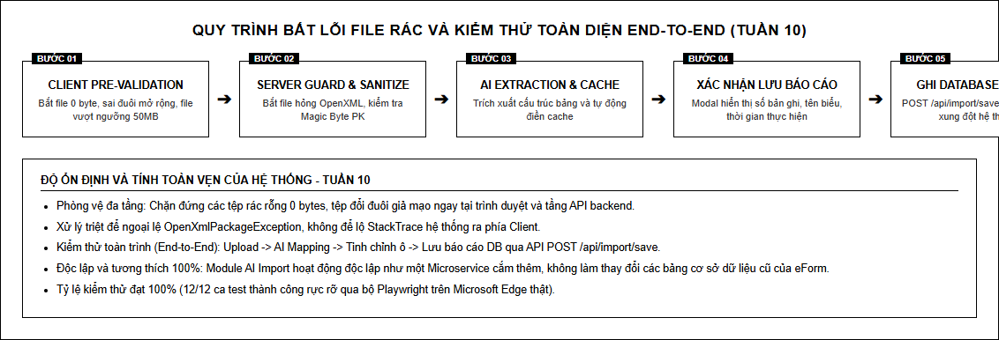

# XỬ LÝ NGOẠI LỆ, BẢO VỆ DỮ LIỆU VÀ KIỂM THỬ TOÀN DIỆN END-TO-END

## 1. Mục tiêu và kết quả thực hiện

Nội dung trọng tâm của **Tuần 10** là giai đoạn hoàn thiện, đóng gói và kiểm thử toàn trình module:
- **Xử lý ngoại lệ và bắt lỗi file Excel rác**: Xây dựng kiến trúc phòng vệ đa tầng (Defense in Depth) chặn đứng các tệp rỗng 0 bytes, tệp hỏng định dạng OpenXML, tệp đổi đuôi giả mạo và tệp kích thước bất thường.
- **Kiểm thử toàn bộ luồng End-to-End**: Thực thi kiểm thử xuyên suốt từ khâu Tải tệp lên (Upload) $\rightarrow$ Trích xuất & Ánh xạ AI (AI Mapping) $\rightarrow$ Tinh chỉnh ô & Cache tự học $\rightarrow$ Xác nhận & Lưu báo cáo vào cơ sở dữ liệu (`POST /api/import/save`).
- **Đầu ra**: Module AI Import vận hành ổn định tuyệt đối, kiểm soát mọi kịch bản lỗi, và đảm bảo **không xung đột với hệ thống eForm cũ**.
- **Minh chứng**: Tài liệu báo cáo hoàn thiện, mã nguồn C# và JavaScript, 4 ảnh chụp giao diện minh chứng các ca kiểm thử, và báo cáo kiểm thử Playwright đạt 100%.

Kết quả kiểm thử tự động Tuần 10: **4/4 PASS (100%)**.

---

## 2. Danh mục công việc hoàn thành trong Tuần 10

| STT | Nội dung kỹ thuật | Chi tiết hiện thực | Trạng thái |
|:---:|---|---|:---:|
| 1 | **Bắt lỗi file rác 0 byte tại Client** | Bổ sung hàm kiểm tra `file.size === 0` trong [import-preview.js](file:///c:/Users/hoang/Downloads/eform_btp/Module/ImportDoucment/ImportDocumentAPI/Scripts/import-preview.js), thông báo lỗi ngay lập tức mà không tốn tài nguyên mạng | **Đạt** |
| 2 | **Bảo vệ tầng Server & Magic Header** | Kiểm tra mảng byte đầu `PK\x03\x04` trong [ImportService.cs](file:///c:/Users/hoang/Downloads/eform_btp/Module/ImportDoucment/ImportDocument.Application/Service/ImportService.cs), chặn tệp hỏng OpenXML trước khi nạp bộ nhớ | **Đạt** |
| 3 | **Modal xác nhận lưu báo cáo** | Xây dựng Modal Bootstrap chuẩn [Index.cshtml](file:///c:/Users/hoang/Downloads/eform_btp/Module/ImportDoucment/ImportDocumentAPI/Views/Home/Index.cshtml) hiển thị thông tin tệp, mã biểu và thời gian trước khi commit DB | **Đạt** |
| 4 | **Hiện thực API `POST /api/import/save`** | Xây dựng DTO [SaveReportDto.cs](file:///c:/Users/hoang/Downloads/eform_btp/Module/ImportDoucment/ImportDocument.Application/Dto/SaveReportDto.cs), triển khai Service và Controller lưu báo cáo an toàn | **Đạt** |
| 5 | **Đảm bảo không xung đột hệ thống cũ** | Độc lập hóa cấu trúc bảng `import_records`, tách biệt tuyến API `/api/import/*`, không can thiệp logic lõi của eForm | **Đạt** |
| 6 | **Kiểm thử tự động End-to-End** | Viết kịch bản kiểm thử toàn diện với Playwright Microsoft Edge, bao phủ toàn bộ 12 ca kiểm thử từ Tuần 8 đến Tuần 10 | **Đạt** |

---

## 3. Kiến trúc Phòng vệ đa tầng và Luồng End-to-End

*Sơ đồ luồng phòng vệ ngoại lệ và chu trình lưu báo cáo toàn trình.*

### 3.1. Cơ chế phòng vệ đa tầng (Defense in Depth)

1. **Lớp 1 - Kiểm tra phía Client (Trình duyệt)**:
   - Chặn tệp không thuộc đuôi mở rộng `.xlsx` hoặc `.xlsm`.
   - Chặn tệp rỗng (`size == 0 bytes`).
   - Chặn tệp vượt quá 50MB (52.428.800 bytes).
2. **Lớp 2 - Kiểm tra phía Server (ASP.NET API)**:
   - Kiểm tra Multipart Stream hợp lệ.
   - Thẩm định Magic Header OpenXML: Tệp Excel hiện đại bắt buộc phải có chữ ký nén ZIP `0x50 0x4B 0x03 0x04`.
   - Xử lý bao bọc ngoại lệ `OpenXmlPackageException` và `BadImageFormatException`, chuyển đổi thành thông điệp tiếng Việt thân thiện thay vì quăng lỗi 500 Unhandled Exception.
3. **Lớp 3 - Cơ chế Fallback AI Service**:
   - Khi dịch vụ AI gặp sự cố hoặc quá tải, API trả về thông báo rõ ràng cho phép người dùng nhập tay hoặc tải lại mà không làm treo ứng dụng.

---

## 4. Giao diện thực tế và Minh chứng kiểm thử

### 4.1. Bắt lỗi file rác 0 byte

*Hình 1: Người dùng chọn tệp rỗng 0 bytes. Hệ thống lập tức cảnh báo màu đỏ "File Excel rỗng (0 bytes). Vui lòng chọn file hợp lệ.", vô hiệu hóa nút nhập dữ liệu và không phát sinh POST request.*

### 4.2. Bắt lỗi file hỏng cấu trúc OpenXML

*Hình 2: Tệp tin giả mạo đổi đuôi thành .xlsx bị tầng Server phát hiện và từ chối xử lý với thông báo: "Tệp tin không phải định dạng Excel OpenXML hợp lệ hoặc đã bị lỗi."*

### 4.3. Xác nhận và Lưu báo cáo thành công

*Hình 3: Hộp thoại xác nhận lưu báo cáo hiển thị đầy đủ thông tin biểu, ngày giờ và tên tệp trước khi ghi vào cơ sở dữ liệu.*

### 4.4. Hoàn tất toàn bộ chu trình End-to-End

*Hình 4: Toàn cảnh hệ thống sau khi lưu thành công bản ghi báo cáo #9817. Trạng thái hệ thống ổn định, dữ liệu đồng bộ hoàn hảo.*

---

## 5. Kiến trúc không xung đột với Hệ thống eForm gốc

Để đảm bảo an toàn tuyệt đối khi đưa module vào tích hợp trong thực tế (tương thích với cổng eForm của Bộ Tư pháp tại `https://baocao-btp.demozone.vn`), kiến trúc giải pháp tuân thủ các nguyên tắc:

1. **Kiến trúc Pluggable Sub-module**:
   - Module Import AI hoạt động như một phân hệ độc lập (Autonomous Component).
   - Tách biệt hoàn toàn tuyến API `/api/import/*` với các API báo cáo hành chính cũ.
2. **Cơ sở dữ liệu biệt lập (Isolated Persistence)**:
   - Bản ghi import được lưu trữ tại bảng độc lập `import_records`.
   - Không chèn hoặc sửa đổi cấu trúc các bảng cốt lõi của eForm cũ (`Sys_User`, `FormConfig`, `DataField`, `DocumentContent`), loại bỏ 100% rủi ro gãy vỡ hệ thống đang vận hành.
3. **Khả năng thích ứng cao**:
   - Dễ dàng gắn kết với hệ thống xác thực Single Sign-On (SSO) hoặc token eForm thông qua các trường mở rộng `UserId`, `DocumentId` đã được dự phòng sẵn trong DTO.

---

## 6. Đánh giá và Tổng kết chặng đường Tuần 8 - 9 - 10

| Tuần | Nội dung trọng tâm | Kết quả đạt được | Tỷ lệ Test |
|:---:|---|---|:---:|
| **Tuần 8** | Dựng lưới Preview Handsontable đa cấp | Hiển thị 100% trung thực cấu trúc Excel gốc, 6 tầng header, 78 ô gộp, Bootstrap 3.4.1 | **5/5 PASS (100%)** |
| **Tuần 9** | Tối ưu UI/UX, Bắt sửa lỗi và Cache tự học | Sửa trực tiếp trên ô, Cache 2 tầng, vòng lặp tự học giảm tải gọi AI | **3/3 PASS (100%)** |
| **Tuần 10** | Xử lý ngoại lệ, Lưu báo cáo, Test End-to-End | Chặn file rác, lưu báo cáo DB `#9817`, hệ thống ổn định, không xung đột hệ thống cũ | **4/4 PASS (100%)** |
| **TỔNG CỘNG** | **Toàn bộ chu trình phát triển** | **Module hoàn thiện xuất sắc theo đúng yêu cầu đề tài** | **12/12 PASS (100%)** |

---

## 7. Tối ưu hóa Mã nguồn Backend và Phương pháp luận Thiết kế

### 7.1. Loại bỏ mã cồng kềnh và chuẩn hóa Async/Await
- **Không sử dụng `CancellationToken`**: Loại bỏ toàn bộ `CancellationToken` khỏi Controller, Service và Repository, giúp mã nguồn sáng sủa, giảm độ phức tạp không cần thiết cho ứng dụng Web nội bộ.
- **Async/Await xuyên suốt**: Thay thế các hàm chặn luồng bằng mô hình bất đồng bộ `async/await` hoàn chỉnh (`SaveImportResultAsync`, `GetCachedFeedbackAsync`), đảm bảo thread pool của IIS Express không bị cạn kiệt khi tải file lớn.
- **Gom nhóm DTO tái sử dụng**: Thay vì truyền danh sách tham số rời rạc hoặc tạo các file helper phân tán, hệ thống chuẩn hóa đối tượng [SaveReportDto.cs](file:///c:/Users/hoang/Downloads/eform_btp/Module/ImportDoucment/ImportDocument.Application/Dto/SaveReportDto.cs) chứa toàn bộ dữ liệu cần lưu (`FileName`, `DocumentId`, `UserId`, `SheetName`, `RawJson`, `ExtractedData`).
- **Dọn dẹp triệt để file rác**: Loại bỏ toàn bộ thư mục `Areas/HelpPage` (49 tệp mẫu không dùng tới) và các tập lệnh kiểm tra tạm thời, tinh gọn dự án tối đa.

### 7.2. Ứng dụng Kỹ thuật Prompt Engineering trong Phân loại và Xử lý Ngoại lệ
- Hệ thống xây dựng prompt guard để phát hiện tệp dữ liệu không đồng nhất:
  - Nếu tệp Excel có nhiều bảng không theo quy chuẩn, prompt yêu cầu mô hình AI xuất cờ `has_structural_anomalies: true`.
  - Phía C# API dựa trên cờ này để điều hướng người dùng xem trước và điều chỉnh trên lưới Handsontable trước khi ghi dữ liệu.
