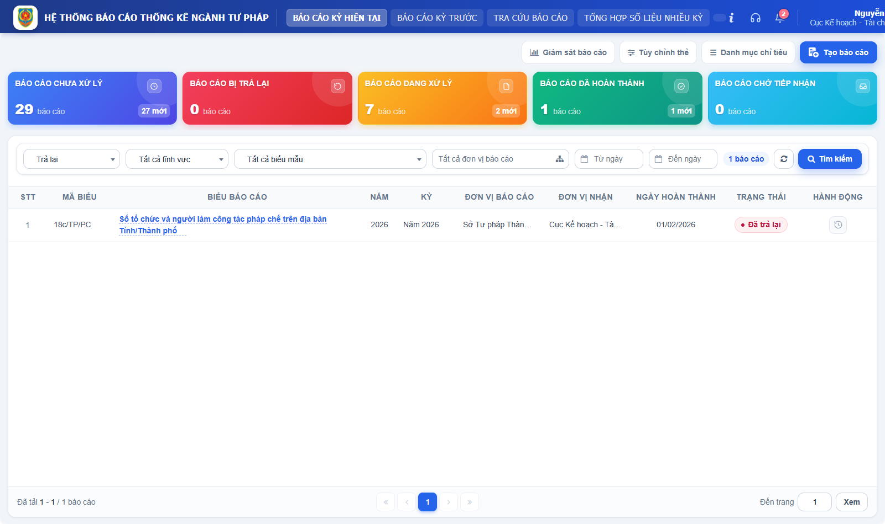
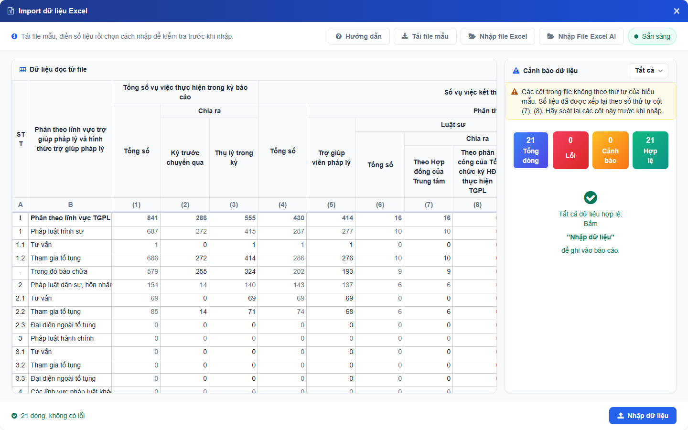
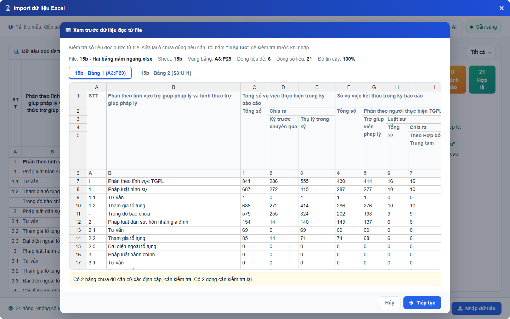

# BÁO CÁO THỰC TẬP TỐT NGHIỆP TUẦN 11
**Thời gian: Từ 12/10/2026 đến 16/10/2026**

---

## I. THÔNG TIN CHUNG VÀ KẾ HOẠCH LÀM VIỆC TUẦN 11

### 1. Thông tin sinh viên và đơn vị thực tập

| Nội dung | Chi tiết thông tin |
|---|---|
| **Họ và tên sinh viên** | Trần Văn Hoàng |
| **Mã số sinh viên** | 0034467 |
| **Lớp chuyên ngành** | 67CS - K67 |
| **Khoa / Ngành đào tạo** | Công nghệ thông tin / Khoa học máy tính |
| **Cơ sở đào tạo** | Trường Đại học Xây dựng Hà Nội |
| **Cơ quan / Đơn vị thực tập** | Công ty Cổ phần BEDX |
| **Bộ phận thực tập** | Trung tâm Nền tảng chuyển đổi số |
| **Dự án tham gia** | Hệ thống Quản trị Báo cáo điện tử ngành Tư pháp (eForm BTP) |
| **Cán bộ hướng dẫn tại đơn vị** | Đào Đức Văn – Tổng giám đốc Trung tâm Nền tảng chuyển đổi số |
| **Giảng viên hướng dẫn học thuật** | TS. Hoàng Nam Thắng - Giảng viên Khoa Công nghệ thông tin |
| **Thời gian thực tập tuần 11** | Từ ngày 12/10/2026 đến ngày 16/10/2026 |

---

### 2. Kế hoạch công tác và nhật ký thực hiện Tuần 11

| Thời gian | Thứ | Nội dung công việc theo kế hoạch | Kết quả thực hiện thực tế | Trạng thái |
|:---:|:---:|---|---|:---:|
| 12/10/2026 | Thứ 2 | Họp bàn về tiến độ dự án eForm và nhận nhiệm vụ | Nắm bắt phản hồi từ đợt dùng thử và tiếp nhận hai lỗi giao diện/phân quyền trọng tâm | Hoàn thành |
| 13/10/2026 | Thứ 3 | Xử lý lỗi thanh điều hướng mất vệt chọn sáng và không hiển thị số lượng báo cáo con | Tái thiết lập cơ chế đồng bộ số đếm độc lập và cố định trạng thái chọn trên thanh điều hướng | Hoàn thành |
| 14/10/2026 | Thứ 4 | Kiểm thử ổn định thanh điều hướng trên tài khoản thật | Các mục báo cáo con duy trì vệt sáng và hiển thị đúng đủ số lượng 91 báo cáo con | Hoàn thành |
| 15/10/2026 | Thứ 5 | Khắc phục lỗi người duyệt có quyền sửa trên danh sách báo cáo bị trả lại | Đối chiếu định danh người đang đăng nhập với người khởi tạo báo cáo, khóa chặt quyền sửa của người duyệt | Hoàn thành |
| 16/10/2026 | Thứ 6 | Trình bày trình diễn tính năng (Showcase) nội bộ với nhóm và Mentor | Trình diễn trực tiếp quy trình Nhập File Excel AI tích hợp trên eForm, tiếp nhận góp ý nâng cấp lõi mô hình cho Tuần 12 | Hoàn thành |

---

## II. QUÁ TRÌNH THỰC TẬP VÀ GIẢI QUYẾT CÁC ĐẦU VIỆC TẠI CÔNG TY (DỰ ÁN eFORM BTP)

### 1. Họp rà soát tiến độ và tiếp nhận phản hồi từ đợt vận hành thử nghiệm (Thứ 2, 12/10/2026)

Trong phiên họp đầu tuần cùng anh Đào Đức Văn và nhóm dự án eForm BTP, nhóm đã tổng hợp hai vấn đề thực tế phát sinh từ tài khoản Cục Kế hoạch - Tài chính sau khi mở kỳ báo cáo sơ bộ: lỗi thanh điều hướng bên trái bị mất trạng thái tô sáng kèm mất số đếm báo cáo con khi mở lâu, và lỗi tài khoản người duyệt vẫn thấy nút chỉnh sửa khi mở báo cáo bị trả lại. Em đã tiếp nhận xử lý dứt điểm cả hai vấn đề này, đồng thời chuẩn bị phiên trình diễn tính năng Nhập File Excel AI tích hợp trên eForm vào chiều thứ Sáu.

---

### 2. Khắc phục sự cố mất trạng thái chọn và mất số lượng báo cáo con trên thanh điều hướng (Thứ 3–4, 13–14/10/2026)

Qua rà soát luồng làm mới dữ liệu nền trên trình duyệt, nguyên nhân được xác định là quá trình cập nhật lại vùng nội dung chính đã xóa tạm huy hiệu số đếm khi dữ liệu chưa kịp phản hồi và làm mất lớp đánh dấu mục đang chọn trên cây danh mục. Em đã tách cơ chế đồng bộ số đếm báo cáo con thành chu kỳ độc lập không làm ảnh hưởng trạng thái hiển thị của mục danh mục đang chọn. Kiểm thử thực tế trên tài khoản Cục Kế hoạch - Tài chính xác nhận thanh điều hướng luôn giữ vững vệt sáng và hiển thị chính xác toàn bộ 91 báo cáo con tiếp nhận từ các Bộ, ngành.

 
*Hình 1: Thanh điều hướng sau khi khắc phục lỗi, luôn duy trì trạng thái chọn và hiển thị đầy đủ số lượng báo cáo con.*

 
*Hình 2: Bảng danh sách chi tiết các báo cáo con gửi từ các Bộ, ngành về Cục Kế hoạch - Tài chính.*

---

### 3. Khóa quyền sửa của người duyệt trên danh sách báo cáo bị trả lại (Thứ 5, 15/10/2026)

Theo quy chuẩn pháp lý của hệ thống thống kê, khi báo cáo bị trả lại thì chỉ đơn vị lập báo cáo mới có quyền chỉnh sửa số liệu để nộp bổ sung, còn người duyệt chỉ được xem nội dung và thực hiện thao tác phê duyệt hoặc trả lại. Em đã bổ sung cơ chế so khớp định danh cán bộ đang đăng nhập với người khởi tạo báo cáo ngay tại tầng giao diện: nếu không trùng khớp, hệ thống tự động ẩn nút chỉnh sửa và khóa toàn bộ bảng tính ở chế độ chỉ đọc. Đồng thời, em đã kiểm thử hoàn chỉnh luồng bấm duyệt báo cáo con trên màn hình xem xét số liệu.

 
*Hình 3: Giao diện xem xét chi tiết báo cáo con với nút phê duyệt dành riêng cho cán bộ có thẩm quyền.*

 
*Hình 4: Hệ thống xác nhận phê duyệt báo cáo con thành công trong quy trình khép kín.*

 
*Hình 5: Danh sách báo cáo bị trả lại đã khóa chặt quyền chỉnh sửa đối với tài khoản người duyệt.*

---

## III. TRÌNH DIỄN TÍNH NĂNG NHẬP FILE EXCEL AI TÍCH HỢP TRÊN eFORM (THỨ 6, 16/10/2026)

### 1. Nội dung trình diễn thực tế trước nhóm dự án và Mentor

Chiều thứ Sáu ngày 16/10/2026, em đã tổ chức buổi trình diễn (Showcase) phiên bản tích hợp hoàn chỉnh tính năng **Nhập File Excel AI** ngay trong hộp thoại nhập dữ liệu của hệ thống eForm BTP trước nhóm phát triển Trung tâm Nền tảng chuyển đổi số và anh Đào Đức Văn:

1. **Tải tệp và bóc tách cấu trúc tự động:** Thử nghiệm các biểu mẫu thống kê tư pháp có nhiều tầng tiêu đề, bảng phụ nằm ngang và cột số liệu bị đảo thứ tự; hệ thống tự tách bảng, hiển thị lưới xem trước đa cấp sắc nét kèm cảnh báo cấu trúc.
2. **Tự động xếp lại cột và đối soát nghiệp vụ:** Trình diễn khả năng tự động hoán đổi cột bị đảo về đúng vị trí biểu mẫu đích, ghép số liệu vào lưới đối soát và chạy kiểm tra ràng buộc công thức với 0 lỗi.
3. **Phòng vệ đầu vào và xác nhận an toàn:** Kiểm chứng khả năng chặn tệp rỗng 0 byte, tệp giả mạo đổi đuôi và hiển thị hộp thoại xác nhận trước khi ghi nhận vào biểu mẫu.

 
*Hình 6: Giao diện tính năng Nhập File Excel AI tích hợp trực tiếp trên eForm tự động sắp xếp lại cột bị đảo và đạt 21/21 dòng hợp lệ (0 lỗi).*

 
*Hình 7: Cửa sổ xem trước đa cấp hiển thị rõ tọa độ vùng bảng, thẻ tách bảng phụ và cho phép kiểm tra trực tiếp trước khi ghép biểu.*

---

### 2. Đánh giá của cán bộ hướng dẫn và định hướng hoàn thiện Tuần 12

Cán bộ hướng dẫn và nhóm dự án đánh giá cao giao diện tích hợp mạch lạc, tính an toàn và giá trị thực tiễn của phân hệ. Đồng thời, qua thử nghiệm mở rộng với bộ tình huống cực khó (như hai bảng nằm ngang, tiêu đề lặp giữa bảng, bảng nằm rất xa góc và ghi chú bên phải bảng), nhóm thống nhất giao thêm Tuần 12 để em tập trung **tái cấu trúc toàn diện mô hình AI** (loại bỏ hoàn toàn quy tắc cứng khi suy luận, làm giàu tập huấn luyện bằng tệp Excel biến thể thật, đóng gói mô hình tự chứa để FastAPI nạp trực tiếp) và **kiểm thử tự động toàn diện trên toàn bộ 219 tình huống khó** trước khi chốt bàn giao tổng thể.
