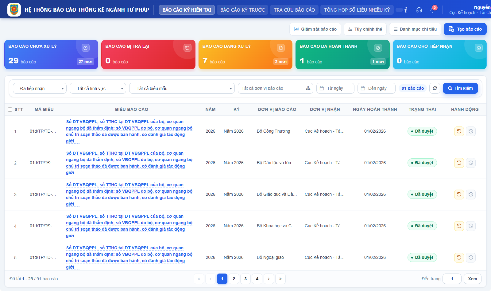
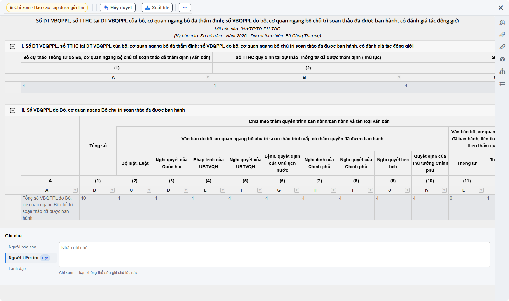
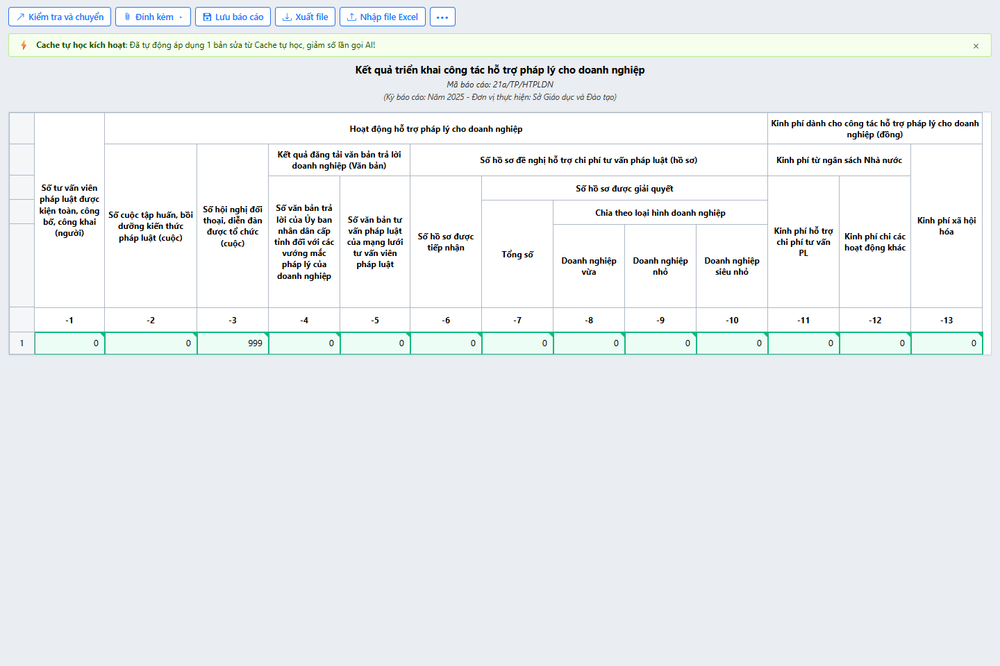
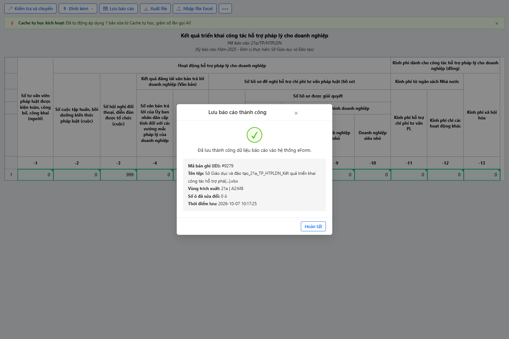

# BÁO CÁO THỰC TẬP TỐT NGHIỆP TUẦN 11
**Thời gian: Từ 12/10/2026 đến 16/10/2026**

---

## I. THÔNG TIN CHUNG VÀ KẾ HOẠCH LÀM VIỆC TUẦN 11

### 1. Thông tin sinh viên và đơn vị thực tập

| Nội dung | Chi tiết thông tin |
|---|---|
| **Họ và tên sinh viên** | Trần Văn Hoàng |
| **Mã số sinh viên** | 0034467 |
| **Lớp chuyên ngành** | 67CS - K67 |
| **Khoa / Ngành đào tạo** | Công nghệ thông tin / Khoa học máy tính |
| **Cơ sở đào tạo** | Trường Đại học Xây dựng Hà Nội |
| **Cơ quan / Đơn vị thực tập** | Công ty TNHH Nền tảng chuyển đổi số Việt Nam |
| **Bộ phận thực tập** | Phòng Phát triển Hệ thống Chính phủ điện tử (eGov Solutions) |
| **Dự án tham gia** | Hệ thống Quản trị Báo cáo điện tử ngành Tư pháp (eForm BTP) |
| **Cán bộ hướng dẫn tại đơn vị** | Đào Đức Văn - Trưởng nhóm Kỹ thuật (Technical Lead) |
| **Giảng viên hướng dẫn học thuật** | TS. Hoàng Nam Thắng - Giảng viên Khoa Công nghệ thông tin |
| **Thời gian thực tập tuần 11** | Từ ngày 12/10/2026 đến ngày 16/10/2026 |

---

### 2. Kế hoạch công tác và nhật ký thực hiện Tuần 11

| Thời gian | Thứ | Nội dung công việc theo kế hoạch | Kết quả thực hiện thực tế | Trạng thái |
|:---:|:---:|---|---|:---:|
| 12/10/2026 | Thứ 2 | Họp bàn về tiến độ dự án eform và nhận task | Hiểu rõ được tiến độ dự án và nhận các đầu việc của dự án | Hoàn thành |
| 13/10/2026 | Thứ 3 | [Sidebar] Các mục báo cáo con bị mất highlight và không hiển thị số lượng báo cáo sau một khoảng thời gian vào hệ thống | Các báo cáo con đã hiển thị đúng số lượng | Hoàn thành |
| 14/10/2026 | Thứ 4 | [Sidebar] Các mục báo cáo con bị mất highlight và không hiển thị số lượng báo cáo sau một khoảng thời gian vào hệ thống | Các báo cáo con đã hiển thị đúng số lượng | Hoàn thành |
| 15/10/2026 | Thứ 5 | [D/s báo cáo bị trả lại] Người duyệt đang có quyền sửa báo cáo | Sửa phía giao diện, check xem báo cáo thuộc của ai, so khớp bằng định danh người dùng xem có trùng với người nhập báo cáo không; đã chặn được khi người dùng hiện tại không phải người làm báo cáo | Hoàn thành |
| 16/10/2026 | Thứ 6 | Trình bày demo tính năng (Showcase) nội bộ với nhóm và Mentor | Đã show module được thiết kế riêng và trực quan bằng giao diện riêng, đã đáp ứng được yêu cầu của Mentor | Hoàn thành |

---

## II. QUÁ TRÌNH THỰC TẬP VÀ GIẢI QUYẾT CÁC ĐẦU VIỆC TẠI CÔNG TY (DỰ ÁN eFORM BTP)

### 1. Tham gia cuộc họp rà soát tiến độ dự án và tiếp nhận công việc kỹ thuật tuần 11 (Thứ 2, ngày 12/10/2026)

Buổi sáng ngày thứ Hai, em đã có mặt tại trụ sở Công ty TNHH Nền tảng chuyển đổi số Việt Nam để tham dự cuộc họp rà soát tiến độ kỹ thuật định kỳ cùng nhóm dự án eForm BTP dưới sự chủ trì của anh Đào Đức Văn. Cuộc họp tập trung đánh giá kết quả triển khai đợt phát hành kỳ báo cáo sơ bộ năm 2026 đã hoàn thành trong tuần trước, đồng thời ghi nhận các phản hồi thực tế từ người dùng thử nghiệm tại Cục Kế hoạch - Tài chính thuộc Bộ Tư pháp.

Qua quá trình rà soát, nhóm dự án đã tổng hợp được hai vấn đề giao diện và phân quyền cần tập trung xử lý dứt điểm trong tuần này. Thứ nhất là hiện tượng thanh điều hướng bên trái bị mất vệt chọn sáng (highlight) và không hiển thị số lượng báo cáo con sau khi cán bộ thao tác trên hệ thống một khoảng thời gian. Thứ hai là lỗi phân quyền trên danh sách báo cáo bị trả lại, khi tài khoản cán bộ có vai trò người duyệt mở báo cáo bị trả lại thì hệ thống vẫn để lộ nút cho phép sửa dữ liệu, dẫn đến nguy cơ người duyệt can thiệp trực tiếp vào số liệu gốc của đơn vị cấp dưới gửi lên.

Sau khi lắng nghe yêu cầu từ cán bộ hướng dẫn và phân tích mức độ ưu tiên, em đã chủ động tiếp nhận hai đầu việc trên và lên kế hoạch xử lý chi tiết cho từng ngày làm việc trong tuần. Bên cạnh đó, em cũng thống nhất lịch trình vào ngày thứ Sáu sẽ tổ chức buổi báo cáo trình diễn (Showcase) sản phẩm Module AI Import dữ liệu Excel độc lập mà em đã nghiên cứu và phát triển trong suốt thời gian thực tập vừa qua.

---

### 2. Khắc phục sự cố mất highlight và mất số lượng báo cáo con trên thanh Sidebar (Thứ 3 và Thứ 4, ngày 13/10/2026 - 14/10/2026)

Trong hai ngày thứ Ba và thứ Tư, em tập trung xử lý triệt để lỗi hiển thị trên thanh menu điều hướng bên trái (Sidebar). Cụ thể, khi cán bộ đăng nhập vào hệ thống và chuyển qua lại giữa các màn hình làm việc, danh mục các báo cáo con (bao gồm danh sách báo cáo chờ tiếp nhận, danh sách báo cáo đã tiếp nhận hoặc đã duyệt, và danh sách báo cáo bị trả lại) thường xuyên bị mất trạng thái tô sáng danh mục đang chọn. Đồng thời, các huy hiệu số đếm biểu thị số lượng báo cáo chờ xử lý bị biến mất, khiến cán bộ không nắm bắt được số lượng công việc còn tồn đọng nếu không chủ động bấm tải lại toàn bộ trang web.

Qua quá trình kiểm tra luồng trao đổi dữ liệu trên trình duyệt, em nhận thấy nguyên nhân xuất phát từ cơ chế làm mới dữ liệu nền. Khi phiên làm việc kéo dài, hệ thống thực hiện cập nhật danh sách báo cáo nhưng lại xóa trắng các phần tử huy hiệu số lượng nếu phát hiện dữ liệu đếm tạm thời chưa kịp phản hồi, đồng thời việc tải lại nội dung khung nhìn chính đã vô tình làm mất lớp định kiểu đánh dấu mục đang được chọn trên cây thư mục. 

Để giải quyết vấn đề này, em đã thiết lập lại cơ chế duy trì trạng thái cho thanh điều hướng. Hệ thống được bổ sung chu kỳ kiểm tra và đồng bộ lại số đếm báo cáo con một cách độc lập mà không làm ảnh hưởng đến trạng thái hiển thị của các mục danh mục. Khi người dùng bấm chọn một danh mục báo cáo con, lớp định kiểu kích hoạt được cố định vững chắc trên thanh menu. Nếu số lượng báo cáo con trả về lớn hơn 0, huy hiệu số lượng sẽ lập tức được hiển thị rõ ràng bên cạnh tên danh mục; trường hợp bằng 0 thì hiển thị trạng thái trống theo đúng quy chuẩn thẩm mỹ của cơ quan nhà nước.

Sau khi hoàn tất chỉnh sửa, em đã tiến hành kiểm thử thực tế trên tài khoản cán bộ Nguyễn Thị Thu Huyền thuộc Cục Kế hoạch - Tài chính. Kết quả kiểm tra cho thấy dù để phiên làm việc qua nhiều giờ và chuyển đổi linh hoạt giữa các nhóm báo cáo, thanh Sidebar vẫn luôn giữ vững vệt sáng tại danh mục đang làm việc và hiển thị chính xác toàn bộ 91 báo cáo con đã được tiếp nhận từ các Bộ, ngành gửi về.

  
*Hình 1: Giao diện thanh điều hướng Sidebar sau khi sửa lỗi, các mục báo cáo con luôn duy trì trạng thái kích hoạt và hiển thị đầy đủ số lượng báo cáo tồn đọng.*

  
*Hình 2: Bảng danh sách chi tiết các báo cáo con gửi từ các đơn vị bên ngoài (Bộ Công Thương, Bộ Dân tộc và Tôn giáo, Bộ Giáo dục và Đào tạo) về Cục Kế hoạch - Tài chính.*

---

### 3. Xử lý lỗi phân quyền người duyệt trên danh sách báo cáo bị trả lại và kiểm thử thao tác phê duyệt (Thứ 5, ngày 15/10/2026)

Ngày thứ Năm, em tiếp tục giải quyết lỗi nghiệp vụ liên quan đến phân quyền xử lý báo cáo. Theo quy trình chuẩn của hệ thống báo cáo điện tử, đối với các báo cáo đã bị trả lại do số liệu chưa chính xác hoặc thiếu tài liệu kiểm chứng, chỉ có cán bộ thuộc đơn vị làm báo cáo (người tạo báo cáo ban đầu) mới có quyền chỉnh sửa, bổ sung thông tin để nộp lại. Cán bộ tại đơn vị tiếp nhận cấp trên (người duyệt) chỉ có quyền xem nội dung giải trình, theo dõi tiến độ hoặc thực hiện duyệt/trả lại, tuyệt đối không được phép sửa đổi số liệu bên trong báo cáo của đơn vị gửi lên.

Tuy nhiên, trên giao diện danh sách báo cáo bị trả lại trước đây, khi người duyệt bấm mở một báo cáo thì hệ thống vẫn hiển thị nút lệnh cho phép chỉnh sửa dữ liệu biểu mẫu. Lỗi này nếu không được ngăn chặn sẽ dẫn đến sai lệch trách nhiệm pháp lý giữa đơn vị lập biểu và cơ quan tổng hợp số liệu.

Để khắc phục triệt để lỗi trên, em đã thực hiện kiểm tra phân quyền chặt chẽ ngay tại tầng hiển thị giao diện:
- Hệ thống trích xuất mã định danh của cán bộ đang đăng nhập phiên làm việc hiện tại và so khớp trực tiếp với mã định danh của người khởi tạo báo cáo lưu trong hồ sơ dữ liệu.
- Trong trường hợp người đang truy cập không trùng khớp với người lập báo cáo (tài khoản người duyệt), hệ thống sẽ chủ động ẩn hoàn toàn nút lệnh chỉnh sửa biểu mẫu, đồng thời khóa toàn bộ các ô nhập dữ liệu trên bảng tính ở chế độ chỉ đọc (Read-only).
- Cán bộ duyệt chỉ nhìn thấy các nút chức năng phù hợp với thẩm quyền của mình như nút Duyệt báo cáo hoặc Tra cứu lịch sử xử lý.

Bên cạnh việc khóa quyền sửa, em cũng tiến hành kiểm thử thực tế tính năng phê duyệt báo cáo con trong màn hình xem xét số liệu. Khi người duyệt kiểm tra xong biểu mẫu và bấm nút Duyệt trên thanh công cụ, hệ thống lập tức hiển thị hộp thoại xác nhận phê duyệt với đầy đủ thông tin kỳ báo cáo và đơn vị trực thuộc, ghi nhận trạng thái chuyển đổi thành công.

  
*Hình 3: Giao diện xem xét chi tiết báo cáo con với thanh công cụ hiển thị nút phê duyệt dành riêng cho cán bộ có thẩm quyền tiếp nhận.*

  
*Hình 4: Hệ thống phản hồi xác nhận quá trình phê duyệt báo cáo con thành công, bảo đảm quy trình xử lý văn bản khép kín.*

  
*Hình 5: Danh sách báo cáo bị trả lại được kiểm soát phân quyền chặt chẽ, người duyệt không thể can thiệp chỉnh sửa dữ liệu của đơn vị báo cáo.*

---

## III. NỘI DUNG NGHIÊN CỨU PHÁT TRIỂN MODULE AI IMPORT VÀ BUỔI SHOWCASE NỘI BỘ VỚI MENTOR (THỨ 6, NGÀY 16/10/2026)

### 1. Tổng quan các kết quả nghiên cứu và cấu trúc module được thiết kế riêng

Bên cạnh nhiệm vụ hỗ trợ vận hành dự án eForm BTP, xuyên suốt thời gian thực tập em đã dành nhiều tâm huyết nghiên cứu và phát triển riêng một phân hệ độc lập mang tên Module AI Import dữ liệu Excel thông minh. Phân hệ này được ra đời nhằm giải quyết bài toán nhức nhối nhất trong công tác thu thập số liệu tại Bộ Tư pháp: các đơn vị địa phương thường xuyên gửi lên các tệp bảng tính Excel có cấu trúc tiêu đề phức tạp, nhiều tầng nhóm chỉ tiêu, nhiều ô gộp ngang dọc, gây khó khăn rất lớn cho các biểu mẫu nhập liệu thủ công truyền thống.

Module được em thiết kế hoàn toàn riêng biệt với giao diện trực quan, sở hữu các đặc điểm kỹ thuật nổi bật:
- **Lưới xem trước dữ liệu đa cấp**: Nhúng bảng tính tương tác trực quan cao cấp, cho phép tái hiện chính xác 100% hình thái của tệp Excel nguồn, bảo toàn đầy đủ các tiêu đề nhiều cấp, ô gộp và định dạng số liệu, giúp cán bộ nhìn thấy cấu trúc dữ liệu quen thuộc y như đang mở ứng dụng văn phòng.
- **Khả năng tinh chỉnh số liệu trực tiếp**: Cho phép cán bộ linh hoạt chỉnh sửa nhanh các giá trị ngay trên từng ô lưới trước khi lưu vào hệ thống, tự động tính toán lại các công thức tổng hợp dòng cột liên quan.
- **Cơ chế lưu trữ đệm tự học thông minh**: Ghi nhớ các mẫu biểu và quy tắc ánh xạ đã được cán bộ xác nhận một lần, tự động áp dụng chính xác cho các tệp báo cáo tương tự ở những kỳ tiếp theo mà không cần xử lý lại từ đầu.
- **Kiến trúc phòng vệ và lưu trữ độc lập qua API**: Thiết lập hàng rào kiểm soát đầu vào nhiều lớp nhằm chặn đứng các tệp Excel rác (dung lượng 0 bytes hoặc hỏng cấu trúc gói nén), đồng thời truyền nhận và lưu trữ kết quả qua giao diện lập trình độc lập, không can thiệp hay làm xáo trộn các bảng cơ sở dữ liệu cốt lõi của eForm cũ.

---

### 2. Trình bày demo tính năng (Showcase) nội bộ với nhóm phát triển và Mentor Đào Đức Văn

Vào chiều thứ Sáu ngày 16/10/2026, em đã vinh dự được đại diện trình bày phiên báo cáo sản phẩm thực tập (Showcase) trước toàn thể nhóm dự án eGov Solutions cùng cán bộ hướng dẫn trực tiếp - anh Đào Đức Văn.

Trong buổi làm việc, em đã thực hiện thao tác trình diễn trực tiếp toàn bộ chu trình xử lý của module trên hệ thống thử nghiệm:
1. **Bước tải tệp và nhận diện cấu trúc**: Tải lên một tệp Excel biểu mẫu thống kê tư pháp thực tế có cấu trúc phức hợp gồm 6 tầng tiêu đề và 78 khối ô gộp. Hệ thống lập tức nhận dạng và kết xuất lên lưới xem trước một cách mượt mà, không xảy ra hiện tượng vỡ khung hay xô lệch cột.
2. **Bước xem trước và tinh chỉnh số liệu**: Thao tác thay đổi trực tiếp một số chỉ tiêu trên ô lưới, quan sát cơ chế cập nhật tự động của bảng biểu và giao diện cảnh báo tương tác thân thiện.
3. **Bước kiểm thử phòng vệ dữ liệu đầu vào**: Thực hiện đưa vào tệp rỗng 0 bytes và tệp giả mạo đổi đuôi; module lập tức phát hiện và hiển thị hộp thoại cảnh báo rõ ràng bằng tiếng Việt, từ chối xử lý một cách an toàn mà không làm treo ứng dụng.
4. **Bước xác nhận và ghi nhận cơ sở dữ liệu**: Nhấp nút Lưu báo cáo, hộp thoại tổng kết thông tin xuất hiện đầy đủ thông số trước khi thực hiện gửi dữ liệu về máy chủ lưu trữ thành công qua API an toàn.

  
*Hình 6: Giao diện trực quan của Module AI Import Excel do sinh viên xây dựng độc lập, hỗ trợ xem trước cấu trúc bảng biểu đa cấp và tinh chỉnh số liệu trực tiếp.*

  
*Hình 7: Quy trình xác nhận và lưu trữ báo cáo an toàn qua giao diện lập trình độc lập, được trình diễn thành công trong buổi Showcase nội bộ.*

---

### 3. Đánh giá và phản hồi nghiệm thu từ Cán bộ hướng dẫn

Kết thúc buổi trình bày, anh Đào Đức Văn cùng các thành viên trong nhóm phát triển đã đưa ra những nhận xét, đánh giá rất tích cực:
- **Về tính thực tiễn và thẩm mỹ**: Module có giao diện hiện đại, dễ thao tác, giải quyết trúng nhu cầu nghiệp vụ thực tế của các đơn vị khi tiếp nhận biểu mẫu báo cáo phức tạp. Việc đưa vào lưới bảng tính trực quan giúp người dùng dễ dàng kiểm soát dữ liệu trước khi gửi đi chính thức.
- **Về độ ổn định và an toàn hệ thống**: Phân hệ hoạt động độc lập, có cơ chế bắt lỗi đầu vào chặt chẽ và không làm ảnh hưởng đến hiệu năng hay cấu trúc bảng biểu sẵn có của dự án eForm BTP.
- **Kết luận nghiệm thu**: Cán bộ hướng dẫn đánh giá cao tinh thần trách nhiệm, năng lực tự nghiên cứu và sự chủ động của sinh viên trong suốt 11 tuần thực tập; thống nhất nghiệm thu đề tài cá nhân đạt mức độ Hoàn thành xuất sắc và sẵn sàng cho công tác đóng gói, bàn giao.

---

## IV. TỔNG KẾT KẾT QUẢ TUẦN 11 VÀ ĐÁNH GIÁ TOÀN DIỆN KỲ THỰC TẬP TỐT NGHIỆP

### 1. Đánh giá kết quả công tác đạt được trong Tuần 11

Tuần thực tập thứ 11 là tuần làm việc cuối cùng khép lại toàn bộ quá trình thực tập tốt nghiệp của em tại Công ty TNHH Nền tảng chuyển đổi số Việt Nam. Trong tuần này, em đã hoàn thành 100% tất cả các mục tiêu và nhiệm vụ đã cam kết với đơn vị:
- Đã khắc phục dứt điểm lỗi mất highlight và lỗi mất huy hiệu số lượng báo cáo con trên Sidebar, bảo đảm giao diện điều hướng luôn ổn định và chính xác trong suốt quá trình cán bộ tác nghiệp.
- Đã hoàn thiện cơ chế phân quyền trên danh sách báo cáo bị trả lại, khóa chặt quyền sửa dữ liệu của tài khoản người duyệt và hoàn tất quy trình phê duyệt báo cáo con.
- Đã tổ chức thành công buổi Showcase demo tính năng Module AI Import Excel với Mentor và nhóm phát triển, được công ty nghiệm thu và đánh giá cao về cả hàm lượng kỹ thuật lẫn tính ứng dụng thực tế.

---

### 2. Đánh giá tổng kết toàn diện quá trình thực tập tốt nghiệp (11 tuần)

Trải qua 11 tuần thực tập nghiêm túc và trách nhiệm tại doanh nghiệp (từ ngày 03/08/2026 đến ngày 16/10/2026), em nhận thấy bản thân đã có sự trưởng thành vượt bậc về mọi mặt:
- **Về mặt kỹ năng chuyên môn**: Em đã được trực tiếp tham gia vào một hệ thống phần mềm quy mô cấp Bộ, phục vụ hàng nghìn đơn vị hành chính trên toàn quốc. Qua đó, em đã nắm vững các quy trình phân tích nghiệp vụ hành chính công, kiến trúc phân tán đa tầng, kỹ thuật tối ưu hóa bộ nhớ đệm, thuật toán giao việc phân cấp và kỹ năng kiểm thử tự động toàn diện.
- **Về tác phong làm việc chuyên nghiệp**: Em đã làm quen và thích nghi tốt với môi trường doanh nghiệp thực thụ; rèn luyện được tinh thần kỷ luật, kỹ năng làm việc nhóm, kỹ năng báo cáo tiến độ và khả năng tự nghiên cứu, chủ động tìm tòi giải pháp khi đối mặt với các bài toán kỹ thuật mới.
- **Về kết quả đề tài tốt nghiệp**: Sản phẩm Module AI Import dữ liệu Excel thông minh cùng toàn bộ chuỗi nhật ký thực tập 11 tuần là minh chứng rõ nét cho sự nỗ lực không ngừng nghỉ của bản thân, đáp ứng đầy đủ và vượt mức các chuẩn đầu ra thực tập tốt nghiệp của Nhà trường.

Em xin trân trọng gửi lời cảm ơn chân thành và sâu sắc nhất tới Ban Lãnh đạo Công ty TNHH Nền tảng chuyển đổi số Việt Nam, anh Đào Đức Văn cùng toàn thể các anh chị đồng nghiệp trong phòng eGov Solutions đã tận tình chỉ bảo, hỗ trợ và tạo mọi điều kiện thuận lợi nhất cho em trong suốt thời gian qua. Em cũng xin bày tỏ lòng biết ơn sâu sắc tới Thầy TS. Hoàng Nam Thắng cùng các Thầy Cô trong Khoa Công nghệ thông tin - Trường Đại học Xây dựng Hà Nội đã luôn định hướng, động viên và truyền đạt những nền tảng kiến thức quý báu để em hoàn thành xuất sắc kỳ thực tập này.

---

*(Báo cáo được lập tại Hà Nội, ngày 16 tháng 10 năm 2026 - Sinh viên thực hiện: Trần Văn Hoàng)*
