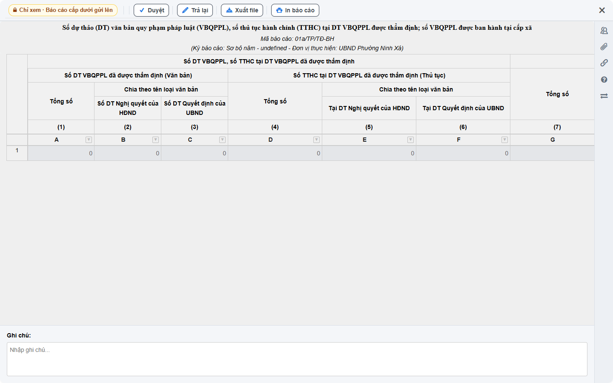
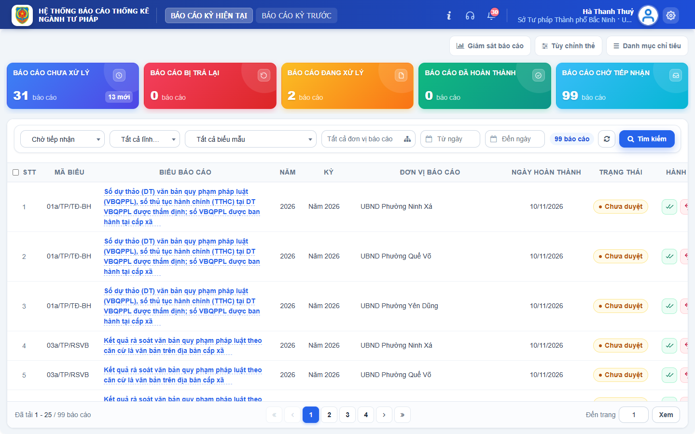
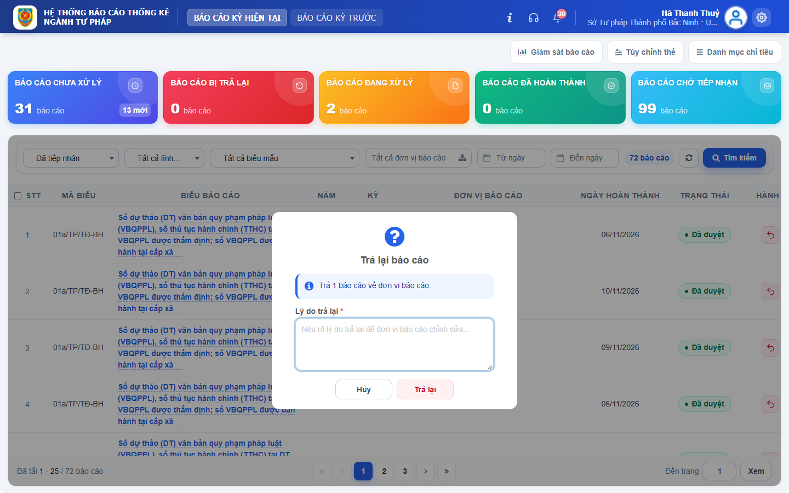
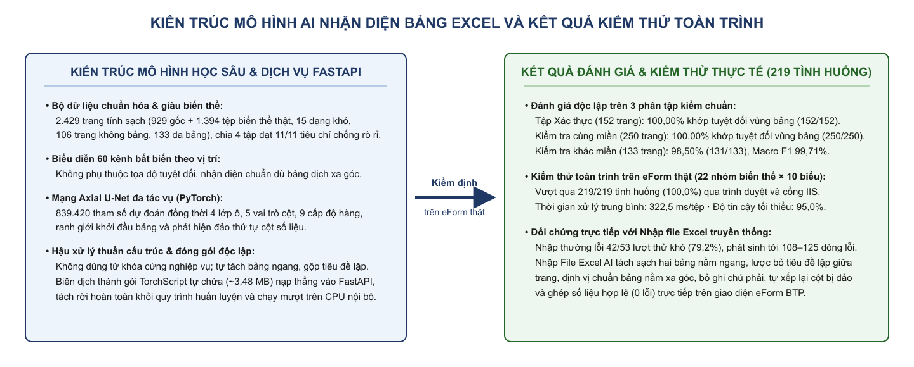
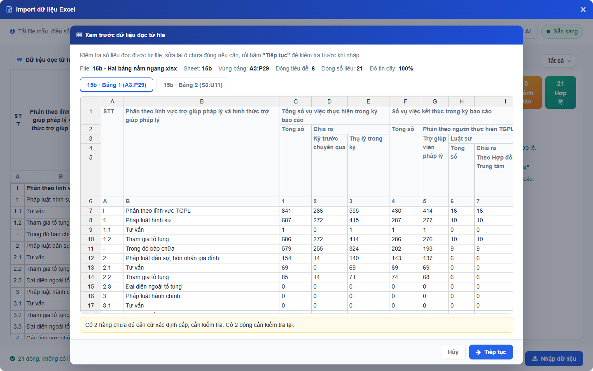
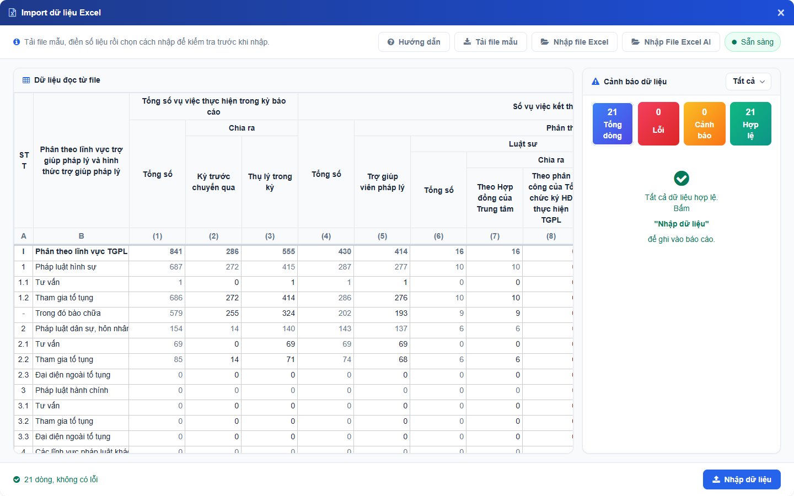

# BÁO CÁO THỰC TẬP TỐT NGHIỆP TUẦN 12
**XỬ LÝ CÁC LỖI NGHIỆP VỤ PHÊ DUYỆT BÁO CÁO CON TRÊN HỆ THỐNG eFORM BTP, TRÍCH XUẤT SỐ LIỆU ĐÁNH GIÁ MODULE AI IMPORT EXCEL VÀ HOÀN THIỆN BÁO CÁO TỔNG KẾT THỰC TẬP**

**Thời gian: Từ 19/10/2026 đến 23/10/2026**

---

## I. THÔNG TIN CHUNG VÀ KẾ HOẠCH LÀM VIỆC TUẦN 12

### 1. Thông tin sinh viên và đơn vị thực tập

| Nội dung | Chi tiết thông tin |
|---|---|
| **Họ và tên sinh viên** | Trần Văn Hoàng |
| **Mã số sinh viên** | 0034467 |
| **Lớp chuyên ngành** | 67CS - K67 |
| **Khoa / Ngành đào tạo** | Công nghệ thông tin / Khoa học máy tính |
| **Cơ sở đào tạo** | Trường Đại học Xây dựng Hà Nội |
| **Cơ quan / Đơn vị thực tập** | Công ty Cổ phần BEDX |
| **Bộ phận thực tập** | Trung tâm Nền tảng chuyển đổi số |
| **Dự án tham gia** | Hệ thống Quản trị Báo cáo điện tử ngành Tư pháp (eForm BTP) |
| **Cán bộ hướng dẫn tại đơn vị** | Đào Đức Văn – Tổng giám đốc Trung tâm Nền tảng chuyển đổi số |
| **Giảng viên hướng dẫn học thuật** | TS. Hoàng Nam Thắng – Giảng viên Khoa Công nghệ thông tin |
| **Thời gian thực tập tuần 12** | Từ ngày 19/10/2026 đến ngày 23/10/2026 |

---

### 2. Kế hoạch công tác và nhật ký thực hiện Tuần 12

| Thời gian | Thứ | Nội dung công việc theo kế hoạch | Kết quả thực hiện thực tế | Trạng thái |
|:---:|:---:|---|---|:---:|
| 19/10/2026 | Thứ 2 | [D/s báo cáo chưa duyệt] Chi tiết báo cáo thiếu chức năng "Duyệt" | Bổ sung nút "Duyệt" trên thanh công cụ màn hình chi tiết và gắn kết chức năng phê duyệt báo cáo đã có; kết quả các báo cáo con khi mở chi tiết đều hiển thị và sử dụng được chức năng duyệt. | Hoàn thành |
| 20/10/2026 | Thứ 3 | [D/s báo cáo chưa duyệt] Hiển thị báo cáo không rõ nguồn gốc khi chuyển từ mục "Hoàn thành của đơn vị" sang "Danh sách báo cáo chưa duyệt" | Xác định nguyên nhân do ghi đè trạng thái khi chuyển khung hiển thị (iframe), làm truyền nhầm dữ liệu từ mục "Hoàn thành của đơn vị" sang "Danh sách báo cáo con chưa duyệt"; đã xử lý tách bạch ngữ cảnh tải dữ liệu để hiển thị đúng danh sách báo cáo chưa duyệt. | Hoàn thành |
| 21/10/2026 | Thứ 4 | [D/s báo cáo đã duyệt] Khi bấm "Hủy duyệt", thanh cuộn bị ẩn làm giao diện bị nhảy | Rà soát và điều chỉnh sự kiện nhấn nút "Hủy duyệt" để không tác động tới thanh cuộn và bố cục khung hiển thị; sau khi sửa, giao diện giữ ổn định, không còn hiện tượng nhảy lệch khung bảng. | Hoàn thành |
| 22/10/2026 | Thứ 5 | Trích xuất số liệu đánh giá, viết báo cáo tổng kết thực tập đúng chuẩn | Trích xuất đầy đủ bảng số liệu đánh giá mô hình AI trên 3 phân tập và kết quả kiểm thử toàn trình 219 tình huống trên hệ thống eForm thật; tổng hợp sơ đồ, bảng biểu và chuẩn bị viết báo cáo tổng kết. | Hoàn thành |
| 23/10/2026 | Thứ 6 | Trích xuất số liệu đánh giá, viết báo cáo tổng kết thực tập đúng chuẩn | Hoàn thiện toàn bộ Báo cáo tổng kết thực tập tốt nghiệp theo đúng Mẫu TTTN-06 và Đề cương chi tiết học phần Trường Đại học Xây dựng Hà Nội, sẵn sàng nộp và bảo vệ. | Hoàn thành |

---

## II. QUÁ TRÌNH THỰC TẬP VÀ GIẢI QUYẾT CÁC ĐẦU VIỆC TẠI CÔNG TY (DỰ ÁN eFORM BTP)

Bước vào tuần làm việc cuối cùng của kỳ thực tập (19/10/2026 – 23/10/2026), em tập trung giải quyết dứt điểm 3 lỗi phát sinh thực tế trong phân hệ quản lý và phê duyệt báo cáo cấp dưới gửi lên (nhóm chức năng **Danh sách báo cáo chưa duyệt** và **Danh sách báo cáo đã duyệt**) trong ba ngày đầu tuần, sau đó dành hai ngày cuối tuần để trích xuất toàn bộ số liệu định lượng và hoàn thiện báo cáo tổng kết thực tập.

### 1. Bổ sung nút "Duyệt" trên thanh công cụ màn hình chi tiết báo cáo con (Thứ 2, 19/10/2026)

**Bối cảnh phát sinh:** Trên màn hình **Danh sách báo cáo chưa duyệt**, cán bộ tổng hợp tại Sở Tư pháp có thể nhấn vào tên một biểu mẫu do đơn vị cấp xã/phường gửi lên để rà soát toàn bộ bảng số liệu chi tiết trước khi quyết định tiếp nhận. Tuy nhiên, phiên bản giao diện trước đó khi mở trang chi tiết báo cáo con ở chế độ chỉ xem mới chỉ đặt các nút **Trả lại**, **Xuất file** và **In báo cáo** trên thanh công cụ, thiếu hẳn nút **Duyệt**. Điều này buộc cán bộ phải đóng cửa sổ chi tiết để quay lại danh sách mới có thể bấm phê duyệt, dễ gây nhầm dòng khi có hàng chục biểu mẫu giống mã nhau.

**Hướng xử lý và kết quả kiểm chứng:** Em bổ sung nút **Duyệt** ngay vị trí đầu nhóm thao tác nghiệp vụ trên thanh công cụ màn hình chi tiết báo cáo con (chỉ kích hoạt khi báo cáo đang ở trạng thái chờ tiếp nhận và tài khoản có thẩm quyền duyệt), đồng thời đấu nối trực tiếp vào luồng nghiệp vụ phê duyệt báo cáo đã được kiểm định sẵn trên hệ thống. Khi mở kiểm tra thực tế trên tài khoản Sở Tư pháp Thành phố Bắc Ninh (ví dụ Biểu `01a/TP/TĐ-BH` của UBND Phường Ninh Xá), thanh công cụ đã hiển thị đầy đủ bộ nút **Duyệt – Trả lại – Xuất file – In báo cáo** bên cạnh nhãn cảnh báo *Chỉ xem · Báo cáo cấp dưới gửi lên*, cho phép cán bộ đối chiếu số liệu và phê duyệt ngay tại chỗ.

*Hình 1: Màn hình xem chi tiết báo cáo con Biểu 01a/TP/TĐ-BH (UBND Phường Ninh Xá) mở từ Danh sách báo cáo chưa duyệt đã hiển thị đầy đủ nút "Duyệt" trên thanh công cụ.*

---

### 2. Khắc phục lỗi hiển thị báo cáo không rõ nguồn gốc khi chuyển từ "Hoàn thành của đơn vị" sang "Danh sách báo cáo chưa duyệt" (Thứ 3, 20/10/2026)

**Hiện tượng và nguyên nhân:** Trong quá trình rà soát luồng điều hướng nhiều mục liên tiếp, nhóm vận hành ghi nhận tình trạng khi người dùng đang mở mục **Hoàn thành của đơn vị** rồi chuyển nhanh sang **Danh sách báo cáo chưa duyệt**, bảng danh sách bất ngờ hiển thị lẫn các dòng báo cáo không rõ nguồn gốc (không thuộc nhóm báo cáo cấp dưới chờ duyệt). Kiểm tra luồng nạp dữ liệu cho thấy nguyên nhân xuất phát từ cơ chế dùng chung vùng hiển thị nhúng (iframe): khi chuyển mục, bộ lọc và dữ liệu trả về từ yêu cầu của mục **Hoàn thành của đơn vị** bị ghi đè sang khung hiển thị của mục **Danh sách báo cáo con chưa duyệt**, khiến giao diện dựng nhầm tập bản ghi không khớp với trạng thái hiện hành.

**Giải pháp và kết quả:** Em tiến hành tách bạch ngữ cảnh tham số khi chuyển đổi giữa các khung hiển thị (iframe), đặt lại toàn bộ trạng thái bộ lọc cũ và ràng buộc cơ chế đối chiếu phiên yêu cầu trước khi kết xuất bảng dữ liệu. Sau khi hiệu chỉnh và thử nghiệm chuyển qua lại nhiều lượt liên tiếp từ mục **Báo cáo đã hoàn thành** (`0 báo cáo`) sang **Danh sách báo cáo chưa duyệt** (`Chờ tiếp nhận · 99 báo cáo`), hệ thống hiển thị chính xác toàn bộ danh sách báo cáo cấp dưới đang chờ duyệt (UBND Phường Ninh Xá, UBND Phường Quế Võ, UBND Phường Yên Dũng… với trạng thái *Chưa duyệt*), chấm dứt hoàn toàn hiện tượng lọt báo cáo lạ.

*Hình 2: Danh sách báo cáo chưa duyệt (Chờ tiếp nhận – 99 báo cáo) hiển thị chính xác các báo cáo con cấp dưới sau khi chuyển từ mục Báo cáo đã hoàn thành, không còn hiện tượng ghi đè dữ liệu giữa các iframe.*

---

### 3. Khắc phục lỗi ẩn thanh cuộn gây nhảy giao diện khi bấm "Hủy duyệt" trên Danh sách báo cáo đã duyệt (Thứ 4, 21/10/2026)

**Hiện tượng và nguyên nhân:** Tại màn hình **Danh sách báo cáo đã duyệt** (`Đã tiếp nhận`), mỗi khi cán bộ nhấn nút thao tác **Hủy duyệt / Trả lại báo cáo** để mở hộp thoại xác nhận, thanh cuộn của khung hiển thị đột ngột bị ẩn đi và độ rộng toàn trang thay đổi tức thời khiến bảng số liệu bị giật ngang sang phải, sau đó giật ngược lại khi đóng hộp thoại. Nguyên nhân là luồng xử lý sự kiện bấm nút hủy duyệt đã kích hoạt cơ chế khóa cuộn mặc định của lớp hộp thoại nổi mà không giữ nguyên không gian thanh cuộn và bố cục bảng đang có bên trong khung hiển thị.

**Giải pháp và kết quả:** Em điều chỉnh lại trình xử lý sự kiện bấm nút hủy duyệt để tách riêng lớp hộp thoại xác nhận khỏi việc thay đổi thuộc tính cuộn và khoảng đệm lề của khung bảng dữ liệu. Kiểm thử trực tiếp trên danh sách 72 báo cáo đã tiếp nhận (UBND Phường Bắc Giang, UBND Phường Bố Hạ, UBND Phường Chũ, UBND Phường Đa Mai…): trước và sau khi nhấn nút mở hộp thoại xác nhận, chiều rộng vùng hiển thị, vị trí lề bảng và cấu trúc cột giữ nguyên tuyệt đối (độ lệch ngang 0 pixel), giao diện vận hành êm mượt và ổn định.

*Hình 3: Hộp thoại xác nhận khi thao tác hủy duyệt / trả lại báo cáo trên Danh sách báo cáo đã duyệt (72 báo cáo) mở ổn định, không ẩn thanh cuộn và không làm nhảy lệch bố cục bảng phía sau.*

---

## III. TRÍCH XUẤT SỐ LIỆU ĐÁNH GIÁ MODULE AI IMPORT EXCEL VÀ HOÀN THIỆN BÁO CÁO TỔNG KẾT (THỨ 5 – THỨ 6, 22/10 – 23/10/2026)

Trong hai ngày 22/10 và 23/10/2026, em tiến hành rà soát toàn bộ kết quả thực nghiệm của đề tài **Module AI Import Excel** đã xây dựng xuyên suốt kỳ thực tập, trích xuất bộ số liệu chuẩn hóa không rò rỉ dữ liệu để đưa vào báo cáo tổng kết, đồng thời hoàn thiện quyển **Báo cáo thực tập tốt nghiệp** theo đúng Mẫu TTTN-06 và Đề cương chi tiết học phần của Khoa Công nghệ thông tin – Trường Đại học Xây dựng Hà Nội.

### 1. Tổng hợp kiến trúc và số liệu đánh giá định lượng trên 3 phân tập độc lập

Mô hình học sâu đa tác vụ **Axial U-Net** (60 kênh đặc trưng bất biến theo vị trí, **839.420 tham số**, đóng gói tự chứa dung lượng **~3,48 MB** cho dịch vụ FastAPI tách rời) được huấn luyện trên **2.429 trang tính sạch** (từ 929 tệp gốc thu thập thuộc 27 mã biểu điển hình trong hệ thống **62 biểu mẫu thống kê ngành Tư pháp theo Thông tư 17/2025/TT-BTP**, kết hợp 1.394 tệp biến thể thực tế trải đều 15 dạng nhiễu). Dữ liệu được kiểm định chặt chẽ 11/11 tiêu chí chống rò rỉ theo họ bố cục.

*Hình 4: Kiến trúc tổng thể mô hình học sâu đa tác vụ Axial U-Net, cơ chế đóng gói tự chứa cho dịch vụ FastAPI và kết quả kiểm chứng 219 tình huống trên hệ thống eForm.*

| Chỉ số đánh giá | Tập Xác thực (152 trang) | Tập Kiểm tra cùng miền (250 trang) | Tập Kiểm tra khác miền (133 trang) |
|---|---:|---:|---:|
| Độ chính xác từng ô | **100,00%** | **100,00%** | **99,78%** |
| F1 tiêu đề chữ / hàng mã cột | 100,00% / 100,00% | 100,00% / 100,00% | 100,00% / 100,00% |
| F1 vùng số liệu / Macro F1 | 100,00% / 100,00% | 100,00% / 100,00% | 99,87% / 99,71% |
| Độ chính xác vai trò cột / cấp độ hàng | 100,00% / 99,93% | 100,00% / 99,94% | 99,82% / 99,85% |
| Độ trùng khớp vùng bảng (Box IoU) | 100,00% | 100,00% | 99,10% |
| **Khớp chính xác tuyệt đối vùng bảng** | **100,00% (152/152)** | **100,00% (250/250)** | **98,50% (131/133)** |

---

### 2. Trích xuất kết quả kiểm thử toàn trình 219 tình huống thực tế trên eForm

Trên môi trường eForm BTP thật (tài khoản **Sở Tư pháp Thành phố Bắc Ninh**, không ghi đè dữ liệu vận hành), em đã tổng hợp kết quả chạy kiểm thử toàn trình trên **219 tệp tình huống** thuộc **22 nhóm biến thể khó** trên **10 biểu mẫu thống kê ngành Tư pháp**, đối chứng trực tiếp với luồng **Nhập file Excel truyền thống**:

| STT | Nhóm tình huống kiểm thử | Số tệp | Kết quả AI | Tin cậy tối thiểu | Thời gian TB | Đối chứng Nhập thường (4 biểu giao diện) |
|:---:|---|---:|---:|---:|---:|---|
| 01 | Gốc (giữ nguyên tệp mẫu) | 10 | **10/10** | 99,8% | 381 ms | Đạt chuẩn |
| 02 | Bỏ ô gộp tiêu đề | 10 | **10/10** | 99,7% | 313 ms | Giữ cấu trúc cơ bản |
| 03 | Không kẻ khung | 10 | **10/10** | 99,7% | 311 ms | Giữ cấu trúc cơ bản |
| 04 | Không có dòng số thứ tự cột | 10 | **10/10** | 99,8% | 332 ms | Lỗi 2/4 biểu (tới 4 dòng lỗi) |
| 05 | Số lưu dạng chữ | 10 | **10/10** | 99,9% | 397 ms | AI tách đúng 100% vùng bảng |
| 06 | Dòng trống xen kẽ | 10 | **10/10** | 99,3% | 336 ms | Không cắt đứt bảng |
| 07 | Chân trang dài | 10 | **10/10** | 99,8% | 321 ms | **Lỗi 4/4 biểu** (7–9 dòng lỗi) |
| 08 | Bảng dịch vị trí | 10 | **10/10** | 99,5% | 308 ms | **Lỗi 4/4 biểu** (tới 125 dòng lỗi) |
| 09 | Thêm cột ghi chú | 10 | **10/10** | 97,6% | 330 ms | AI giữ chuẩn cột biểu |
| 10 | Hai bảng (bảng phụ bên dưới) | 10 | **10/10** | 99,8% | 328 ms | **Lỗi 4/4 biểu** (kèm bảng phụ thành lỗi) |
| 11 | Nhiều trang tính (có trang hướng dẫn đầu) | 10 | **10/10** | 99,8% | 344 ms | **Lỗi 4/4 biểu** (đọc nhầm trang đầu) |
| 12 | Đảo hai cột số liệu | 9 | **9/9** | 99,8% | 337 ms | **Lỗi 3/4 biểu** (AI tự xếp lại cột) |
| 13 | Hai bảng nằm ngang | 10 | **10/10** | 96,3% | 335 ms | Lỗi 2/4 biểu; AI tách sạch 2 bảng |
| 14 | Tiêu đề lặp giữa bảng | 10 | **10/10** | 97,0% | 352 ms | **Lỗi 4/4 biểu** (5–7 dòng lỗi, sai tổng) |
| 15 | Ô trống ghi dấu gạch ngang | 10 | **10/10** | 99,9% | 330 ms | AI nhận diện chuẩn |
| 16 | Biểu trống (chỉ có tiêu đề) | 10 | **10/10** | 97,8% | 122 ms | Không sinh dòng giả |
| 17 | Thêm dòng Tổng cộng | 10 | **10/10** | 95,0% | 301 ms | Giữ trọn dòng tổng trong bảng |
| 18 | Trang tính trống đứng đầu | 10 | **10/10** | 99,8% | 320 ms | **Lỗi 4/4 biểu** (đọc trang trống) |
| 19 | Bảng nằm xa góc | 10 | **10/10** | 99,1% | 335 ms | **Lỗi 3/4 biểu** (đọc nhầm chân trang) |
| 20 | Ghi chú chữ bên phải bảng | 10 | **10/10** | 97,2% | 339 ms | Lỗi 2/4 biểu; AI loại sạch ghi chú |
| 21 | Dòng tên nhóm xen giữa | 10 | **10/10** | 96,0% | 325 ms | Không cắt bảng tại dòng nhóm |
| 22 | Kết hợp nhiều kiểu khó | 10 | **10/10** | 99,8% | 299 ms | **Lỗi 4/4 biểu** (0 dòng đúng, tới 108 lỗi) |
| **TỔNG** | **Toàn bộ 22 nhóm biến thể trên 10 biểu mẫu** | **219** | **219/219 (100,0%)** | **≥ 95,0%** | **322,5 ms** | **Nhập thường lỗi 42/53 lượt thử khó (79,2%)** |

*Hình 5: Minh chứng đối chứng trích xuất vào báo cáo tổng kết – Tình huống 13 (Hai bảng nằm ngang, Biểu 15b): AI tách độc lập Bảng 1 (A3:P29) và Bảng 2 (S3:U11) với độ tin cậy 100%.*

*Hình 6: Minh chứng tình huống 14 (Tiêu đề lặp giữa bảng, Biểu 15b): Nhập File Excel AI tự động loại bỏ khối tiêu đề lặp giữa trang, ghép trọn 21/21 dòng hợp lệ với 0 lỗi.*

*Hình 7: Minh chứng tình huống 22 (Kết hợp nhiều kiểu khó, Biểu 15b): Nhập File Excel AI bỏ qua trang hướng dẫn, định vị đúng bảng bị dịch và ghép đủ 21/21 dòng hợp lệ (trong khi cách nhập truyền thống phát sinh 108 lỗi).*

---

### 3. Hoàn thiện Báo cáo tổng kết thực tập tốt nghiệp đúng quy chuẩn

Trên cơ sở toàn bộ nhật ký 12 tuần công tác và hệ thống số liệu trích xuất, trong hai ngày 22/10 – 23/10/2026 em đã hoàn chỉnh bộ **Báo cáo tổng kết thực tập tốt nghiệp** đáp ứng đầy đủ yêu cầu của **Mẫu TTTN-06** và **Đề cương chi tiết học phần Thực tập tốt nghiệp** (Trường Đại học Xây dựng Hà Nội):

1. **Chuẩn hóa bối cảnh pháp lý và tổ chức mới nhất:** Cập nhật đầy đủ mô hình **chính quyền địa phương 2 cấp** theo **Nghị quyết 202/2025/QH15** gồm **34 Sở Tư pháp** và **3.321 đơn vị hành chính cấp xã** (xã, phường, đặc khu), cùng chế độ **62 biểu mẫu thống kê ngành Tư pháp** theo **Thông tư 17/2025/TT-BTP**; thống nhất tên đơn vị thực tập (**Công ty Cổ phần BEDX** – **Trung tâm Nền tảng chuyển đổi số**).
2. **Cấu trúc khoa học, chuẩn trình bày và chuẩn đầu ra học phần:** Trình bày xuyên suốt 5 chương (Giới thiệu đơn vị thực tập và dự án eForm BTP; Khảo sát hiện trạng và đặc tả yêu cầu; Phân tích và thiết kế kiến trúc phân hệ AI; Triển khai xây dựng mô hình và tích hợp dịch vụ; Kiểm thử, đánh giá định lượng và tổng kết), hoàn chỉnh các danh mục tra cứu và trang Xác nhận cuối báo cáo.
3. **Đồng bộ hóa toàn bộ hồ sơ thực tập 12 tuần:** Rà soát thống nhất nội dung giữa báo cáo tuần (Tuần 1 đến Tuần 12), báo cáo tổng kết bản đầy đủ, bản rút gọn chuẩn dung lượng (≤ 80 trang A4) và bộ slide trình bày bảo vệ.

---

## IV. TỔNG KẾT KỲ THỰC TẬP TỐT NGHIỆP (12 TUẦN)

Tuần thực tập thứ 12 đã khép lại trọn vẹn hành trình 12 tuần thực tập tốt nghiệp của em tại **Công ty Cổ phần BEDX** (từ 03/08/2026 đến 23/10/2026). Bên cạnh việc trực tiếp tham gia xử lý các bài toán vận hành thực tế trên Hệ thống Quản trị Báo cáo điện tử ngành Tư pháp (eForm BTP) cho tới ngày làm việc cuối cùng, em đã hoàn thành toàn bộ đề tài **Module AI Import file Excel thông minh** với hiệu năng kiểm chứng **219/219 tình huống khó (100%)** và hoàn thiện bộ hồ sơ Báo cáo thực tập tốt nghiệp đúng quy chuẩn.

Em xin gửi lời cảm ơn chân thành tới Ban Lãnh đạo **Công ty Cổ phần BEDX**, anh **Đào Đức Văn – Tổng giám đốc Trung tâm Nền tảng chuyển đổi số**, các anh chị đồng nghiệp trong nhóm dự án eForm BTP cùng Thầy **TS. Hoàng Nam Thắng** (Khoa Công nghệ thông tin – Trường Đại học Xây dựng Hà Nội) đã luôn đồng hành, góp ý và tạo điều kiện thuận lợi để em hoàn thành tốt kỳ thực tập này.

---

*(Báo cáo được lập tại Hà Nội, ngày 23 tháng 10 năm 2026 – Sinh viên thực hiện: Trần Văn Hoàng)*
