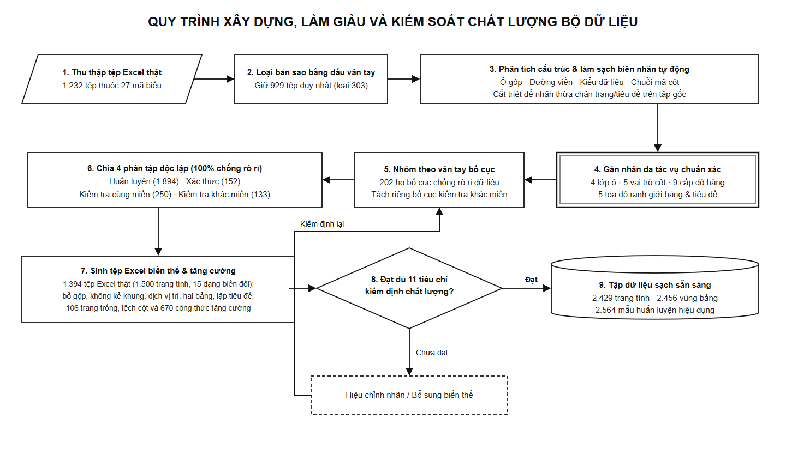

# BÁO CÁO XÂY DỰNG, LÀM SẠCH VÀ LÀM GIÀU BỘ DỮ LIỆU HUẤN LUYỆN AI

**Đề tài:** Nghiên cứu và ứng dụng AI xây dựng Module Import file Excel thông minh cho hệ thống Báo cáo thống kê eForm BTP 
**Giai đoạn:** Tuần 4

---

## 1. Mục tiêu xây dựng bộ dữ liệu

Đặc thù của các biểu mẫu thống kê ngành Tư pháp là cấu trúc tiêu đề nhiều tầng (3 đến 6 tầng ô gộp), xen kẽ nhiều loại dòng phân cấp (nhóm La Mã, mục cha, mục con, dòng phụ, dòng tổng cộng) và thường xuyên bị biến đổi định dạng khi cán bộ địa phương tự chỉnh sửa hoặc kết xuất từ phần mềm ngoài. Do đó, bộ dữ liệu huấn luyện cần đáp ứng đồng thời ba yêu cầu:

- **Đủ tính chân thực:** Xuất phát hoàn toàn từ các tệp báo cáo Excel thực tế của hệ thống eForm BTP.
- **Đủ tính đa dạng cấu trúc:** Bao phủ đầy đủ các biến thể lỗi bố cục thường gặp ngoài thực tế (bảng bị đẩy lệch vị trí, mất khung viền, bỏ ô gộp, lặp tiêu đề giữa trang, có nhiều bảng ngang hoặc dọc, đảo thứ tự cột, trang hướng dẫn không chứa bảng).
- **Tuyệt đối không rò rỉ dữ liệu:** Chia tách theo họ bố cục để đánh giá trung thực khả năng tổng quát hóa của mô hình trên các biểu mẫu chưa từng thấy trong quá trình huấn luyện.

---

## 2. Quy trình 9 bước xây dựng và kiểm soát chất lượng dữ liệu

Quy trình chuẩn bị bộ dữ liệu gồm 9 công đoạn khép kín:

1. **Thu thập nguồn Excel gốc:** Tập hợp **1.232 tệp Excel thực tế** thuộc **27 mã biểu mẫu điển hình** trong hệ thống **62 biểu mẫu** thống kê ngành Tư pháp (Thông tư 17/2025/TT-BTP) (như các biểu nhóm 01, 02, 04, 05, 08, 09, 10, 11, 15, 21…).
2. **Loại bỏ bản sao trùng lặp:** Tính dấu vân tay nội dung để loại bỏ **303 tệp trùng lặp**, giữ lại **929 tệp gốc duy nhất** (0 lỗi đọc cấu trúc).
3. **Phân tích cấu trúc và làm sạch biên nhãn tự động:** Trích xuất đồng thời cấu trúc ô gộp, hệ thống đường viền, kiểu dữ liệu, chuỗi mã cột chuẩn và rà soát cắt bỏ triệt để **12 nhãn chân trang/tiêu đề thừa** còn sót lại trên tập gốc (đưa số lỗi biên nhãn về 0).
4. **Gán nhãn đa tác vụ chuẩn xác:** Mỗi trang tính được gán đồng thời nhiều lớp nhãn: 4 lớp ô (nền, tiêu đề chữ, hàng mã cột, số liệu), 5 vai trò cột (nhãn STT, tên chỉ tiêu, cột số liệu, cột ghi chú, ngoài bảng), 9 cấp độ phân cấp hàng và 5 tọa độ ranh giới bảng/tiêu đề.
5. **Nhóm theo vân tay bố cục:** Gom toàn bộ trang tính vào **202 họ bố cục độc lập** (trong đó có 95 họ đơn lẻ) dựa trên hình thái tiêu đề và số cột.
6. **Phân chia 4 tập độc lập chống rò rỉ:** Phân bổ theo nguyên tắc toàn bộ các trang thuộc cùng một họ bố cục chỉ nằm trong một phân tập duy nhất, tách riêng phân tập kiểm tra khác miền gồm các họ bố cục hoàn toàn mới.
7. **Sinh tệp Excel biến thể thật và công thức tăng cường:** Tạo mới **1.394 tệp Excel biến thể thật** (gồm **1.500 trang tính** trải đều trên **15 dạng biến đổi cấu trúc thực tế**: bỏ ô gộp, xóa kẻ khung, xóa hàng mã cột, số lưu dạng chữ, chèn dòng trống, chân trang dài, dịch vị trí bảng, bảng nằm xa góc, thêm cột ghi chú, hai bảng dọc, hai bảng nằm ngang, tiêu đề lặp giữa bảng, đảo hai cột số liệu, biểu chỉ có tiêu đề, và **106 trang hướng dẫn/trống không có bảng**), kèm **670 công thức tăng cường dữ liệu** khi huấn luyện.
8. **Kiểm định chất lượng tự động 11 tiêu chí:** Xác minh không trùng lặp tệp nguồn giữa các phân tập, không rò rỉ họ bố cục sang tập kiểm tra khác miền, khớp 100% ranh giới vùng bảng và không còn nhãn biên bẩn.
9. **Chốt bộ dữ liệu sạch sẵn sàng huấn luyện:** Tổng hợp thành **2.429 trang tính sạch** với **2.456 vùng bảng** và **2.564 mẫu huấn luyện hiệu dụng**.

---

## 3. Phân bố chi tiết bộ dữ liệu

| Hạng mục thống kê | Giá trị đạt được | Ghi chú nghiệp vụ |
|---|---:|---|
| Tệp Excel gốc thu thập ban đầu | 1.232 tệp | Thuộc 27 mã biểu điển hình (trong 62 biểu mẫu TT 17/2025/TT-BTP) |
| Tệp gốc duy nhất sau lọc trùng | 929 tệp | Loại 303 bản sao, 0 lỗi đọc |
| Tệp Excel biến thể thật được sinh bổ sung | 1.394 tệp (1.500 trang) | Bao phủ 15 dạng biến đổi cấu trúc khó |
| Tổng số trang tính sạch trong bộ dữ liệu | **2.429 trang** | 2.456 vùng bảng được gán nhãn đầy đủ |
| Số trang không có bảng (hướng dẫn/trống) | 106 trang | Giúp mô hình tránh nhận nhầm trang rác |
| Số trang đa bảng (ngang & dọc) | 133 trang | Phục vụ tách bảng phụ độc lập |
| Số trang bị đảo thứ tự cột | 60 trang | Phục vụ nhánh cảnh báo lệch cột |
| Tổng số họ bố cục chống rò rỉ | 202 họ | Trong đó 95 họ đơn lẻ |
| Số mẫu huấn luyện hiệu dụng | **2.564 mẫu** | Kết hợp 1.894 trang huấn luyện + 670 công thức tăng cường |

| Phân tập dữ liệu | Số trang tính | Tỷ lệ | Mục đích sử dụng |
|---|---:|---:|---|
| Tập Huấn luyện | 1.894 | 78,0% | Tối ưu hóa tham số mạng nơ-ron đa tác vụ |
| Tập Xác thực | 152 | 6,3% | Giám sát quá trình học và chọn điểm dừng tối ưu |
| Tập Kiểm tra cùng miền | 250 | 10,3% | Đánh giá hiệu năng trên biểu mẫu cùng hệ thống nhưng tệp mới hoàn toàn |
| Tập Kiểm tra khác miền | 133 | 5,5% | Đánh giá khả năng tổng quát hóa trên các họ bố cục hoàn toàn chưa từng gặp |
| **Tổng cộng** | **2.429** | **100,0%** | **Đạt 11/11 tiêu chí kiểm định, 0% rò rỉ** |
