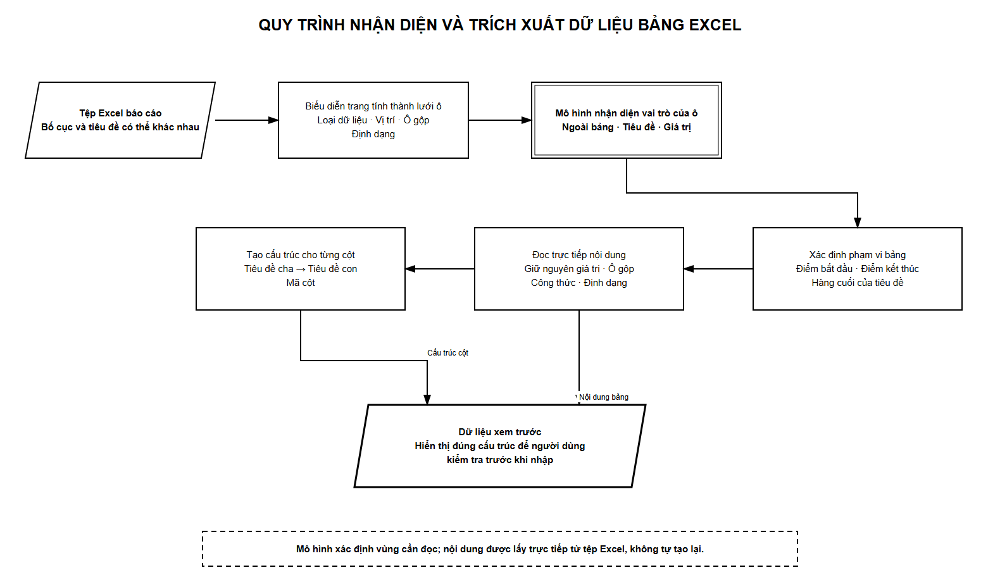
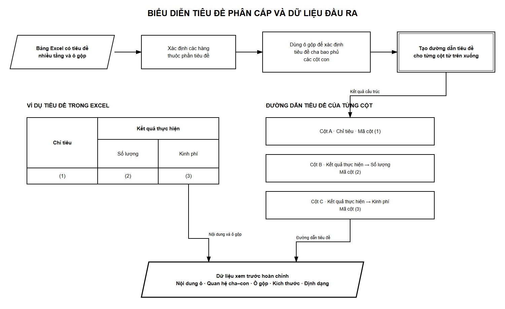

# ĐẶC TẢ CẤU TRÚC BIỂU DIỄN DỮ LIỆU VÀ CHUẨN ĐẦU RA PHÂN CẤP

**Đề tài:** Module AI Import file Excel thông minh cho Hệ thống Báo cáo thống kê eForm BTP 
**Giai đoạn:** Tuần 4

---

## 1. Luồng tổng quát từ bảng tính Excel sang cấu trúc dữ liệu chuẩn hóa

Thay vì phụ thuộc vào các bộ quy tắc từ khóa cố định hoặc gửi dữ liệu sang mô hình ngôn ngữ lớn bên ngoài (vốn tồn tại rủi ro bảo mật số liệu nhà nước và chi phí vận hành cao), hệ thống biểu diễn trực tiếp mỗi trang tính Excel thành một lưới hai chiều giàu ngữ nghĩa gồm **60 kênh đặc trưng bất biến theo vị trí**.

---

## 2. Thiết kế 60 kênh đặc trưng bất biến theo vị trí

Bộ đặc trưng cho từng ô bảng tính được chuẩn hóa trong khoảng giá trị ổn định và **loại bỏ hoàn toàn tọa độ hàng/cột tuyệt đối**, nhằm bảo đảm mô hình nhận diện chính xác dù bảng nằm ở góc trên trái hay bị dịch chuyển xa xuống giữa trang tính:

| Nhóm đặc trưng | Nội dung thông tin trích xuất | Ý nghĩa đối với bài toán |
|---|---|---|
| **Kiểu nội dung ô** | Ô trống, số nguyên, số thập phân, số lưu dạng chuỗi có dấu phân cách, dấu gạch ngang, ngày tháng, văn bản ngắn/dài. | Phân biệt rõ vùng tiêu đề chữ với vùng số liệu thống kê, kể cả khi số bị định dạng thành chuỗi văn bản. |
| **Hình học ô gộp** | Ô có thuộc khối gộp hay không, chiều rộng/chiều cao khối gộp, vị trí biên trên/dưới/trái/phải của khối gộp. | Tái tạo cây tiêu đề nhiều tầng và nhận diện các dòng tiêu đề nhóm gộp ngang. |
| **Định dạng trực quan** | Đường viền 4 cạnh (trên, dưới, trái, phải), chữ đậm, chữ nghiêng, cỡ chữ tương đối, căn lề ngang/dọc, mức độ thụt đầu dòng và tô màu nền. | Giữ độ chính xác cao khi tệp có kẻ khung chuẩn, đồng thời kết hợp nhóm nội dung để vẫn nhận diện tốt khi tệp bị xóa sạch kẻ khung. |
| **Dấu hiệu mã cột & chỉ mục** | Nhận dạng mẫu mã chỉ số cột trong ngoặc như `(1)`, `(2)`, `A`, `B`, ký hiệu số La Mã, chỉ mục phân cấp `1.1`, `1.2`, dấu gạch đầu dòng. | Định vị chính xác hàng mã cột ngăn cách giữa tiêu đề và vùng số liệu, hỗ trợ phát hiện cột bị đảo thứ tự và phân cấp hàng cha–con. |
| **Ngữ cảnh lân cận & mật độ hàng/cột** | Tỷ lệ ô có chữ và ô có số trên cùng hàng/cột, khoảng trống ngăn cách xung quanh, sự thay đổi mật độ giữa hàng trước và hàng sau. | Tách dứt khoát phần quốc hiệu/tiêu đề hành chính phía trên, chân trang ký duyệt phía dưới, cột ghi chú bên phải và các bảng phụ đặt song song. |

---

## 3. Cấu trúc nhãn đa tác vụ và biểu diễn tiêu đề phân cấp

Trên cùng một lượt suy luận, mô hình dự đoán đồng thời 5 nhóm đầu ra cấu trúc:

1. **Nhãn lớp ô (4 lớp):** Ô nền ngoài bảng, ô tiêu đề chữ nhiều tầng, ô thuộc hàng mã cột, và ô thuộc vùng dữ liệu.
2. **Nhãn vai trò cột (5 lớp):** Ngoài bảng, cột số thứ tự, cột tên chỉ tiêu, cột số liệu thống kê, và cột ghi chú/mở rộng.
3. **Nhãn cấp độ hàng (9 lớp):** Ngoài bảng, hàng tiêu đề chữ, hàng mã cột, hàng nhóm cấp 1 (La Mã), hàng chỉ tiêu cấp 1, cấp 2, cấp 3, hàng chi tiết/phụ, và hàng tổng cộng.
4. **Điểm khởi đầu bảng & biên ranh giới:** Cho phép tách nhiều bảng độc lập nằm dọc hoặc nằm ngang trên cùng một trang tính.
5. **Tín hiệu đảo thứ tự cột:** Cảnh báo khi chuỗi mã số cột không tăng dần theo thứ tự chuẩn của biểu mẫu.

Kết quả sau hậu xử lý thuần cấu trúc được đóng gói thành cấu trúc JSON chuẩn hóa phiên bản 2.0, bao gồm: danh sách các trang tính hợp lệ, tọa độ vùng bảng theo chuẩn bảng tính, mảng ô gộp tiêu đề đầy đủ, cây đường dẫn tiêu đề cha–con cho từng cột, danh sách dòng số liệu giữ nguyên kiểu giá trị, độ tin cậy tổng hợp và danh sách cảnh báo cấu trúc để giao diện eForm hiển thị cho người dùng rà soát.
