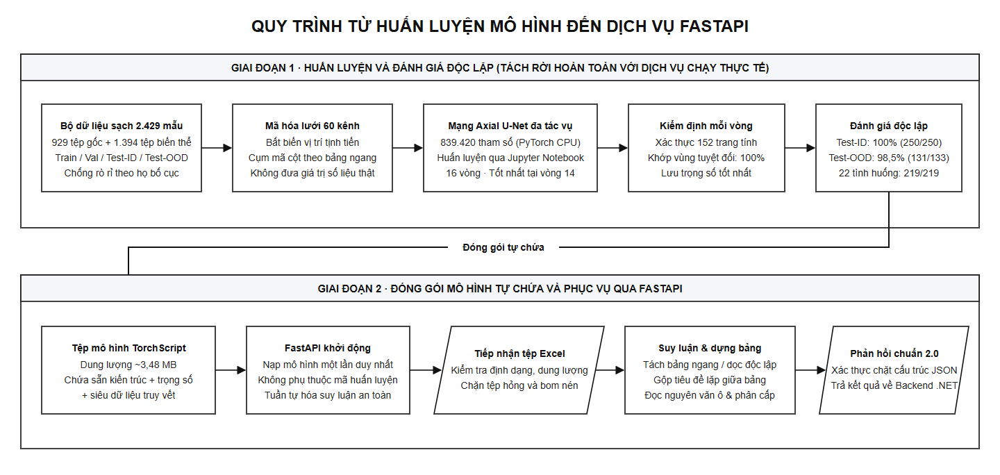
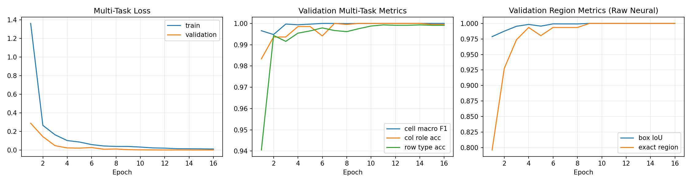
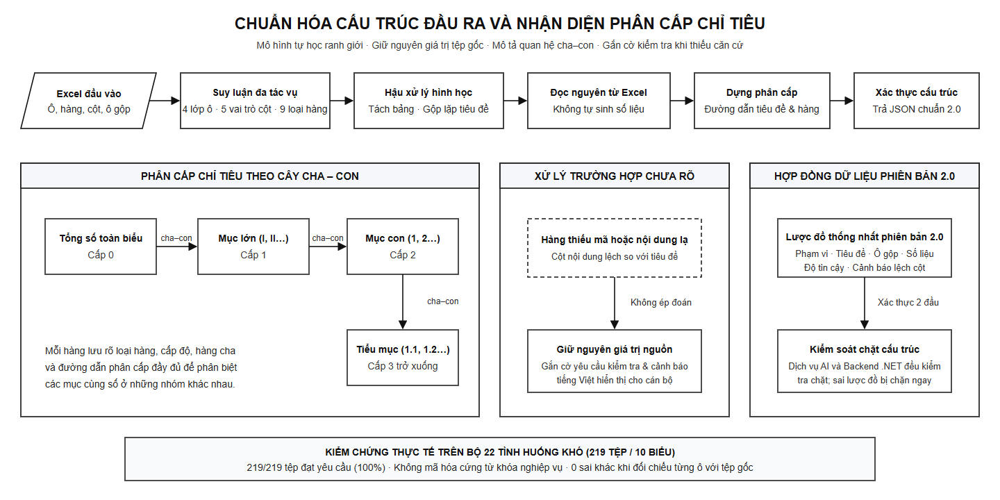

# TÀI LIỆU THIẾT KẾ, HUẤN LUYỆN VÀ ĐÓNG GÓI MÔ HÌNH AI BÓC TÁCH EXCEL

**Đề tài:** Module AI Import file Excel thông minh cho Hệ thống Báo cáo thống kê eForm BTP 
**Giai đoạn:** Tuần 5

---

## 1. Mục tiêu tối ưu hóa mô hình và quy trình triển khai

Trong giai đoạn phát triển lõi trí tuệ nhân tạo, yêu cầu đặt ra là xây dựng một mô hình học sâu gọn nhẹ, chạy ổn định ngay trên máy chủ CPU thông thường (không phụ thuộc GPU đắt tiền), phản hồi dưới 0,5 giây mỗi tệp, không chứa quy tắc từ khóa cứng đặc thù nghiệp vụ khi suy luận và được đóng gói độc lập để dịch vụ FastAPI nạp trực tiếp khi khởi động.

---

## 2. Kiến trúc mạng nơ-ron học sâu đa tác vụ

Mô hình được xây dựng trên nền tảng **PyTorch** theo kiến trúc mạng tích chập hai chiều kết hợp cơ chế chú ý theo trục hàng và trục cột (Axial U-Net đa tác vụ):

- **Đầu vào:** Ma trận đặc trưng 2 chiều gồm **60 kênh bất biến theo vị trí**, mô tả đầy đủ kiểu dữ liệu, cấu trúc ô gộp, đường viền, định dạng văn bản, mẫu mã cột và mật độ hàng/cột xung quanh.
- **Bộ mã hóa – giải mã kết hợp chú ý theo trục:** Các khối tích chập cục bộ nắm bắt đặc trưng lân cận của từng ô, trong khi các lớp chú ý dọc theo toàn hàng và toàn cột cho phép mỗi ô hiểu ngữ cảnh toàn cục của cả dòng chỉ tiêu lẫn cả cột số liệu.
- **5 nhánh đầu ra song song:**
 1. Phân loại 4 lớp ô (nền, tiêu đề chữ, hàng mã cột, số liệu).
 2. Phân loại 5 vai trò cột.
 3. Phân loại 9 cấp độ phân cấp hàng.
 4. Dự đoán ranh giới khởi đầu bảng (phục vụ tách đa bảng).
 5. Phát hiện tín hiệu lệch hoặc đảo thứ tự cột.
- **Quy mô gọn nhẹ:** Tổng số tham số chỉ **839.420 tham số**, sau khi biên dịch sang gói mô hình tự chứa TorchScript có dung lượng chỉ **~3,48 MB**.

---

## 3. Quy trình huấn luyện trực quan và kết quả hội tụ

Quá trình huấn luyện được thực hiện qua sổ tay huấn luyện trực quan (Jupyter Notebook) chạy trên PyTorch 2.12 (CPU), sử dụng bộ tối ưu AdamW (tốc độ học khởi tạo `0,002`, hiệu chuẩn trọng số `0,0001`, kích thước lô `12`, cố định hạt giống ngẫu nhiên) trên tập **1.894 trang tính huấn luyện** (mở rộng thành **2.564 mẫu hiệu dụng** nhờ 670 công thức tăng cường).

- **Thời gian huấn luyện:** Hoàn thành **16 chu kỳ huấn luyện** trong tổng thời gian **21,9 phút** trên CPU.
- **Điểm dừng tối ưu:** Mô hình hội tụ mượt và đạt hàm mất mát xác thực thấp nhất (**0,0022**) tại **chu kỳ 14**, không có dấu hiệu học vẹt (overfitting).
- **Độ chính xác đạt được:**
 - Tập Xác thực (`152` trang): **100,00%** khớp chính xác tuyệt đối vùng bảng (`152/152`), Macro F1 **100,00%**.
 - Tập Kiểm tra cùng miền (`250` trang): **100,00%** khớp chính xác tuyệt đối vùng bảng (`250/250`), Macro F1 **100,00%**.
 - Tập Kiểm tra khác miền (`133` trang): **98,50%** khớp chính xác tuyệt đối vùng bảng (`131/133`), Macro F1 **99,71%**, IoU vùng bảng **99,10%**.

---

## 4. Hậu xử lý thuần cấu trúc và chuẩn hóa đầu ra JSON 2.0

Sau khi mạng nơ-ron đưa ra bản đồ xác suất cho toàn trang tính, tầng hậu xử lý thực hiện hoàn toàn dựa trên cấu trúc hình học và phân phối xác suất (không dùng danh sách từ khóa nghiệp vụ viết cứng):

1. **Lọc trang không có bảng:** Loại bỏ các trang hướng dẫn hoặc trang trắng khi xác suất hiện diện bảng không đạt ngưỡng tin cậy.
2. **Tách bảng theo chiều ngang và chiều dọc:** Phân cụm các thành phần liên thông theo cột để tách riêng bảng phụ đặt bên phải hoặc khối ghi chú rời khỏi bảng chính; tách riêng các bảng đặt nối tiếp bên dưới.
3. **Gộp bảng có tiêu đề lặp lại giữa trang:** Khi phát hiện hai đoạn bảng liên tiếp cùng độ rộng và có khối tiêu đề giống nhau lặp lại ở giữa, hệ thống loại bỏ phần tiêu đề lặp và nối liền số liệu của cả hai nửa thành một bảng thống nhất.
4. **Dựng cây tiêu đề phân cấp và đánh dấu cảnh báo:** Tái tạo đầy đủ mảng ô gộp tiêu đề, ghép đường dẫn tiêu đề cha–con cho từng cột, tính độ tin cậy tổng hợp và gắn cờ cảnh báo nếu phát hiện cột bị đảo thứ tự hoặc hàng chưa đủ căn cứ phân cấp.

---

## 5. Đóng gói tách rời và tích hợp dịch vụ FastAPI

Mô hình tốt nhất tại chu kỳ 14 được biên dịch thành một gói mô hình tự chứa duy nhất (~3,48 MB). Dịch vụ web FastAPI chỉ cần nạp trực tiếp gói mô hình này vào bộ nhớ một lần khi khởi động, cung cấp hai giao diện lập trình chính gồm kiểm tra trạng thái sẵn sàng và tiếp nhận tệp Excel trả về dữ liệu JSON 2.0. Thiết kế này giúp tách biệt hoàn toàn môi trường vận hành khỏi mã nguồn huấn luyện, dễ dàng kiểm thử tự động và cập nhật mô hình mới mà không cần sửa đổi tầng tích hợp phía trên.
