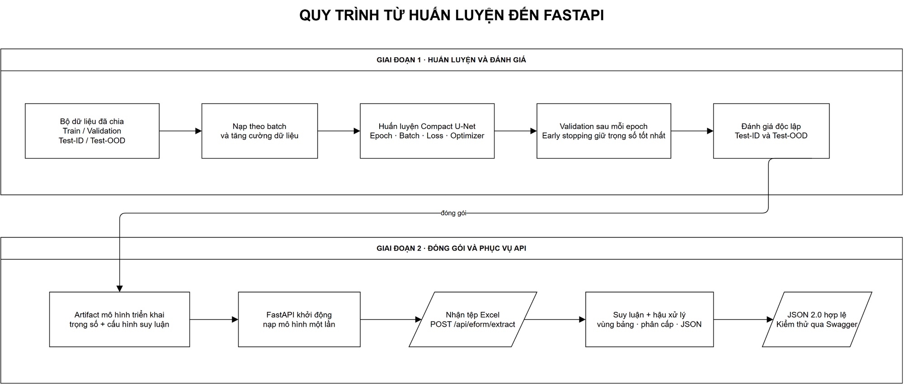
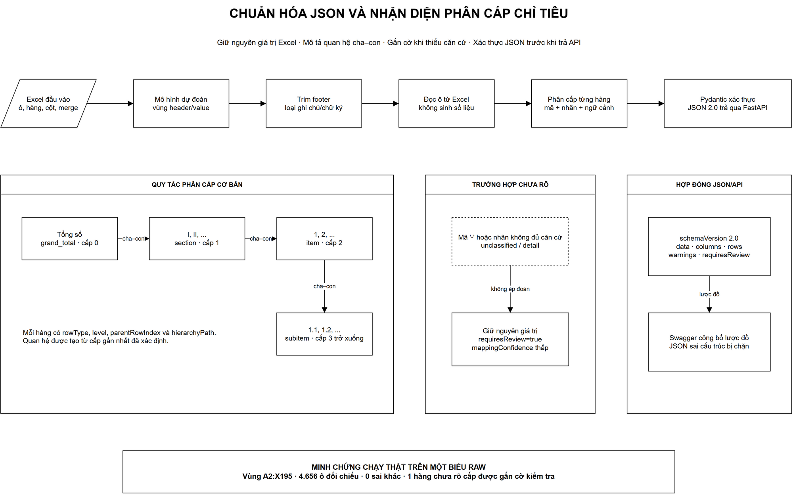
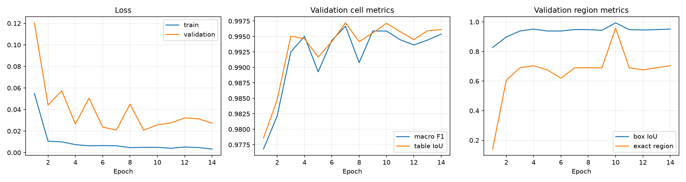
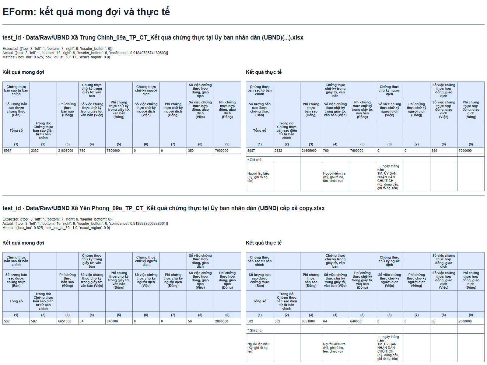
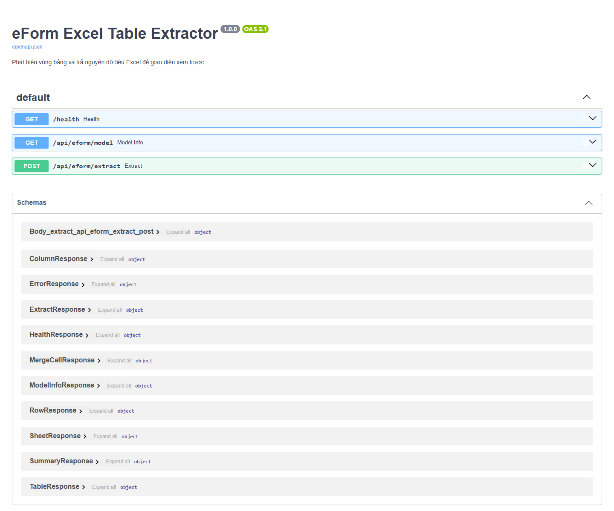

# TÀI LIỆU TỐI ƯU AI VÀ XÂY DỰNG FASTAPI ĐỌC MÔ HÌNH

## 1. Mục đích và phạm vi

Tài liệu này ghi lại phần công việc tuần 5 của mô-đun nhập dữ liệu Excel: huấn luyện mô hình đã thiết kế từ bộ dữ liệu tuần 4, đánh giá kết quả, khắc phục lỗi nhận thừa vùng bảng, chuẩn hóa phân cấp hàng và chuẩn hóa JSON trước khi cung cấp API bằng FastAPI.

Điểm kết thúc của tuần 5 là **FastAPI nạp được mô hình, nhận tệp Excel và trả JSON đúng lược đồ qua Swagger**. Tài liệu không bao gồm tích hợp với backend nghiệp vụ, giao diện xem trước, cơ sở dữ liệu hay thao tác “Nhập dữ liệu”.

Trong hệ thống này, “AI” không phải LLM sinh văn bản. Mô hình học sâu làm nhiệm vụ nhận diện vùng bảng, còn việc đọc giá trị ô, giữ nguyên nội dung Excel, phân cấp hàng và kiểm tra JSON được thực hiện bằng các bước xác định. Cách phân vai này giảm nguy cơ sinh số liệu không tồn tại trong tệp nguồn.

## 2. Kết quả cần đạt

1. Huấn luyện được mô hình nhận diện vùng bảng từ tập train và chọn trọng số tốt nhất bằng validation.
2. Đánh giá riêng trên test-ID và test-OOD, không dùng các mẫu test để cập nhật trọng số.
3. Hạn chế lỗi mô hình nhận thừa phần ghi chú hoặc chữ ký dưới bảng.
4. Phân biệt được các cấp phổ biến: “Tổng số”, “I/II/...”, “1/2/...”, “1.1/1.2/...”.
5. Không ép đoán đối với hàng không đủ căn cứ; phải giữ dữ liệu và gắn cờ kiểm tra.
6. Trả JSON phiên bản 2.0 có cấu trúc ổn định, được Pydantic kiểm tra trước khi phản hồi.
7. Chạy được FastAPI và quan sát được đặc tả, mô hình dữ liệu, yêu cầu và phản hồi trên Swagger.

## 3. Kiến trúc xử lý

Quy trình được chia thành hai nhóm trách nhiệm:

| Nhóm | Trách nhiệm | Không thực hiện |
|---|---|---|
| Mô hình Compact U-Net | Dự đoán mặt nạ/vùng chứa header và value, từ đó suy ra giới hạn bảng | Không tự sinh số liệu ô |
| Bộ đọc Excel | Đọc workbook, sheet, merge cells, kiểu và giá trị ô trong vùng đã xác định | Không tự sửa số liệu nguồn |
| Hậu xử lý | Loại ghi chú/chữ ký cuối biểu; phân cấp hàng; tạo quan hệ cha–con | Không map vào Document nghiệp vụ |
| Pydantic/FastAPI | Kiểm tra lược đồ và phát JSON qua HTTP | Không render giao diện, không ghi cơ sở dữ liệu |

Sơ đồ tổng thể có tại [01_TU_HUAN_LUYEN_DEN_FASTAPI.drawio](diagrams/01_TU_HUAN_LUYEN_DEN_FASTAPI.drawio). Sơ đồ chuẩn hóa JSON và phân cấp có tại [02_CHUAN_HOA_JSON_VA_PHAN_CAP.drawio](diagrams/02_CHUAN_HOA_JSON_VA_PHAN_CAP.drawio). Hai tệp là nguồn draw.io có thể chỉnh sửa; chúng mô tả thiết kế, không được dùng thay cho bằng chứng chạy chương trình.





*Hai ảnh sơ đồ được xuất cục bộ từ chính nguồn draw.io, dùng để giải thích quy trình; ảnh thực nghiệm được phân biệt ở các mục sau.*

## 4. Quá trình huấn luyện thực tế

### 4.1. Cấu hình

| Thuộc tính | Giá trị chạy thực tế |
|---|---:|
| Tên mô hình triển khai | `eform_excel_table_extractor_v1` |
| Kiến trúc | Compact U-Net |
| Framework | PyTorch |
| Phiên bản PyTorch lần train | 2.8.0+cpu |
| Số tham số | 379.107 |
| Batch size | 8 |
| Learning rate | 0,001 |
| Số epoch yêu cầu | 20 |
| Early-stopping patience | 5 |
| Số mẫu train hiệu dụng sau augmentation | 1.670 |
| Thiết bị triển khai kiểm thử | CPU |

Batch và epoch là tham số do người chạy notebook điều chỉnh. Sau mỗi epoch, chương trình đo trên tập validation. Khi chỉ số không cải thiện trong 5 epoch liên tiếp, early stopping dừng huấn luyện và giữ lại checkpoint tốt nhất.

Tập gốc của lần chạy gồm 694 mẫu train, 71 mẫu validation, 130 mẫu test-ID và 34 mẫu test-OOD. Số 1.670 là train hiệu dụng sau augmentation, không phải số workbook độc lập.

### 4.2. Diễn biến epoch

Lần chạy thực tế hoàn thành 14/20 epoch; early stopping dừng quá trình và chọn **epoch 9** là epoch tốt nhất. Điều này không phải lỗi chạy thiếu epoch: 20 là giới hạn tối đa, còn 14 là số epoch cần thiết theo tiêu chí dừng sớm.



*Hình 1 – Ảnh được lấy trực tiếp từ đầu ra lần huấn luyện, thể hiện loss và metric qua 14 epoch.*

Lịch sử epoch, cấu hình và metric gốc được giữ trong [training_report_actual.json](evidence/training_report_actual.json) để đối chiếu với các bảng trong tài liệu.

### 4.3. Kết quả đánh giá

| Tập đánh giá | Exact match | Box IoU | Header F1 | Value F1 |
|---|---:|---:|---:|---:|
| Validation | 69,01% | 94,33% | 99,92% | 99,68% |
| Test-ID | 55,38% | 85,62% | 98,71% | 98,79% |
| Test-OOD | 97,06% | 99,96% | 100,00% | 99,98% |

Ý nghĩa các chỉ số:

- **Exact match**: toàn bộ giới hạn vùng dự đoán phải trùng hoàn toàn với nhãn. Chỉ lệch một hàng cũng bị tính là sai.
- **Box IoU**: mức giao nhau giữa hộp dự đoán và hộp đúng; phản ánh sai lệch vùng tổng thể mềm hơn exact match.
- **Header F1** và **Value F1**: độ cân bằng precision/recall trên hai vùng tiêu đề và dữ liệu.

Test-ID exact match 55,38% cho thấy vẫn còn trường hợp lệch biên dù F1 cao. Vì vậy không thể kết luận mô hình hoàn hảo chỉ dựa trên Header/Value F1. Đây là lý do cần hậu xử lý vùng cuối bảng và gắn cờ các trường hợp không chắc chắn.

### 4.4. Lỗi thực tế dùng để tối ưu

Trong kết quả trước tối ưu, một mẫu có vùng mong đợi `A3:I7` nhưng mô hình dự đoán `A3:I10`; ba hàng thừa là ghi chú/chữ ký. Đây là bằng chứng thực tế cho dạng lỗi “bắt đúng dữ liệu nhưng kéo dài xuống footer”.



*Hình 2 – Ảnh chụp từ báo cáo đánh giá thực tế; không phải hình minh họa dựng lại.*

Giải pháp được áp dụng là hậu xử lý `footer-trim-v1`: xem xét các hàng cuối vùng dự đoán và loại phần ghi chú/chữ ký khi chúng không còn cấu trúc của hàng dữ liệu. Bước này chỉ điều chỉnh giới hạn vùng; không thay đổi giá trị ô nguồn.

## 5. Chuẩn hóa phân cấp chỉ tiêu

### 5.1. Nguyên tắc

Phân cấp được nhận diện từ mã hàng và nhãn hàng đã đọc trong Excel. Kết quả mỗi hàng gồm ít nhất:

- `rowIndex`, `excelRow`: vị trí trong bảng và vị trí thật trên Excel;
- `code`, `label`: mã và nội dung chỉ tiêu;
- `rowType`: loại hàng;
- `level`: cấp phân cấp;
- `parentRowIndex`: hàng cha gần nhất phù hợp;
- `mappingConfidence`: độ tin cậy của bước phân loại hàng;
- `requiresReview`: có cần người dùng xem lại hay không.

### 5.2. Quy tắc cơ bản

| Dấu hiệu | `rowType` | `level` | Ví dụ |
|---|---|---:|---|
| Nhãn thể hiện tổng toàn biểu | `grand_total` | 0 | Tổng số trên địa bàn tỉnh/thành phố |
| Số La Mã | `section` | 1 | I, II, III |
| Số nguyên | `item` | 2 | 1, 2, 3 |
| Mã có dấu chấm | `subitem` | 3 trở xuống | 1.1, 1.2, 2.1.1 |
| Hàng dữ liệu thông thường | `data` hoặc `detail` | Theo ngữ cảnh | Nội dung không có mã cấp độc lập |
| Không đủ căn cứ | `unclassified` | Theo ngữ cảnh gần nhất | `-`, mã trống nhưng nội dung bất thường |

Quan hệ cha–con được thiết lập từ cấp gần nhất đã xác định. Ví dụ chạy thực tế:

```text
Tổng số trên địa bàn tỉnh/thành phố     grand_total, level 0
└── I. Tại cấp tỉnh                     section, level 1
    └── 1. Cơ quan chuyên môn...        item, level 2
        └── 1.1. Sở Nông nghiệp...      subitem, level 3
```

Nếu gặp mã `-` và nhãn `...`, hệ thống không gán bừa vào một loại chắc chắn. Hàng vẫn có mặt trong JSON với `rowType = "unclassified"`, `mappingConfidence = 0.5` và `requiresReview = true`.

## 6. Chuẩn hóa đầu ra JSON

### 6.1. Lược đồ cấp cao

```json
{
  "schemaVersion": "2.0",
  "sourceFile": "ten-tep.xlsx",
  "model": "eform_excel_table_extractor_v1",
  "modelFormat": "eformmodel-1.0",
  "device": "cpu",
  "sheets": [
    {
      "sheetName": "Sheet1",
      "tables": [
        {
          "sourceRange": "A2:X195",
          "headerRows": 6,
          "rowCount": 194,
          "columnCount": 24,
          "valueRowCount": 188,
          "columns": [],
          "data": [],
          "rows": []
        }
      ]
    }
  ],
  "summary": {
    "tableCount": 1,
    "ambiguousRowCount": 1
  },
  "requiresReview": true,
  "warnings": ["Có 1 hàng chưa đủ căn cứ xác định cấp, cần kiểm tra."]
}
```

Đây là trích đoạn cấu trúc rút gọn: các mảng dữ liệu và một số trường kỹ thuật được lược bỏ để dễ đọc; không dùng đoạn này thay cho một phản hồi đầy đủ hợp lệ. Phản hồi đầy đủ chạy thật được lưu tại [api_extract_actual.json](evidence/api_extract_actual.json).

### 6.2. Cơ chế ngăn JSON lỗi

FastAPI sử dụng các response model Pydantic cho health, thông tin mô hình, sheet, table, column, row, summary, lỗi và kết quả extract. Trước khi trả HTTP 200, đối tượng kết quả được xác thực lại bằng `ExtractResponse.model_validate(...)`.

Cơ chế này kiểm soát:

- trường bắt buộc bị thiếu;
- sai kiểu dữ liệu;
- cấu trúc lồng nhau không hợp lệ;
- các lỗi yêu cầu đã công bố trên OpenAPI có trường `detail`;
- tài liệu Swagger không mô tả được response.

Pydantic đảm bảo **đúng cấu trúc JSON**, không tự đảm bảo mọi dự đoán nghiệp vụ đều đúng. Độ đúng của vùng bảng và phân cấp vẫn cần metric, kiểm thử thực tế và cờ `requiresReview`.

## 7. FastAPI đọc mô hình

### 7.1. Chạy lại và quan sát Swagger

Từ thư mục mô-đun AI Import, dùng môi trường đã cài thư viện của dự án:

```powershell
.\Train\.venv\Scripts\python.exe -m uvicorn API.main:app --host 127.0.0.1 --port 8010
```

Mở `http://127.0.0.1:8010/docs`, chọn `POST /api/eform/extract` → **Try it out** → chọn tệp Excel trong Raw → **Execute**. Quan sát HTTP status, response body và schema. Các lần chạy có thể khác thời gian xử lý; `2773,23 ms` trong tài liệu là thời gian của lần ghi nhận minh chứng, không phải thời gian cố định.

### 7.2. Các endpoint đã chạy

| Phương thức | Endpoint | Chức năng |
|---|---|---|
| `GET` | `/health` | Kiểm tra dịch vụ sẵn sàng và mô hình đã nạp |
| `GET` | `/api/eform/model` | Xem tên, định dạng, thiết bị và thông tin artifact |
| `POST` | `/api/eform/extract` | Tải một tệp Excel và nhận JSON trích xuất |
| `GET` | `/docs` | Swagger UI tương tác |
| `GET` | `/openapi.json` | Đặc tả OpenAPI sinh tự động |



*Hình 3 – Swagger UI của dịch vụ đang chạy, hiển thị ba endpoint và các schema phản hồi.*

Kiểm tra thực tế `/health` trả `status = "ready"`, `serviceVersion = "1.0.0"`, mô hình `eform_excel_table_extractor_v1`, định dạng `eformmodel-1.0`, thiết bị `cpu` và artifact `eform_excel_table_extractor_v1.eformmodel`.

## 8. Thử nghiệm end-to-end trên tệp Raw

### 8.1. Tệp kiểm thử

Tệp nguồn được chọn từ thư mục Raw:

`Sở Tư pháp Tỉnh Thanh Hóa_04c_TP_PBGDPL_Kết quả công tác phổ biến giáo dục(...).xlsx`

- SHA-256 tệp nguồn: `806F4BAE3DCA9FAC64F883DD91C95ECED5047E9A3D96CFC06A88E89985ED85F6`
- HTTP status: `200`
- Thời gian xử lý ghi trong phản hồi: `2773,23 ms`
- Kích thước JSON phản hồi: `951.500 byte`
- SHA-256 JSON phản hồi: `48D069F6B1F4728E90CE739C25306E3E25E80180FD117F47F7777BC275C02C6D`

### 8.2. Kết quả trích xuất

| Thuộc tính | Kết quả thực tế |
|---|---:|
| Số bảng | 1 |
| Vùng nguồn | `A2:X195` |
| Số cột | 24 |
| Số hàng trong vùng | 194 |
| Số hàng header | 6 |
| Số hàng value | 188 |
| Confidence vùng | 0,9990783334 |
| Footer bị loại | 2 hàng |
| Hàng cần xem lại | 1 |

Hai hàng 196–197 của workbook là chú thích “Từ cột (1) đến cột (4) không phải báo cáo kỳ sơ bộ 6 tháng” và “Ô có dấu '-' không phải báo cáo”. Việc kết thúc vùng tại hàng 195 phù hợp với nội dung nguồn.

Phân bố loại hàng trong lần chạy:

| Loại hàng | Số lượng |
|---|---:|
| `grand_total` | 1 |
| `section` | 2 |
| `item` | 169 |
| `subitem` | 14 |
| `data` | 1 |
| `unclassified` | 1 |

Hàng chưa xác định chắc chắn nằm tại `excelRow = 28`, có mã `-`, nhãn `...`, `mappingConfidence = 0.5` và `requiresReview = true`. Phản hồi có cảnh báo: “Có 1 hàng chưa đủ căn cứ xác định cấp, cần kiểm tra.”

### 8.3. Đối chiếu giá trị

Một phép kiểm tra độc lập đã đọc lại workbook và so sánh từng ô trong `data` của JSON với vùng Excel nguồn:

| Kiểm tra | Kết quả |
|---|---|
| JSON parse | PASS |
| So sánh ô nguồn | PASS |
| Số ô đã đối chiếu | 4.656 |
| Số ô sai khác | 0 |
| Chuỗi phân cấp Tổng số → I → 1 → 1.1 | PASS |
| Health sau nạp artifact | READY |
| Schema ExtractResponse/RowResponse trên OpenAPI | PASS |
| Tệp `.txt` gửi thay Excel | HTTP 415, JSON có `detail` |

Kết quả 0 sai khác chứng minh rằng **trong tệp kiểm thử này**, giá trị trả về được giữ đúng với Excel trong vùng đã nhận diện. Kết quả này không được suy rộng thành cam kết rằng mọi biểu chưa kiểm thử đều đạt 100%.

## 9. Tiêu chí nghiệm thu tuần 5

| Tiêu chí | Trạng thái | Bằng chứng |
|---|---|---|
| Huấn luyện có batch, epoch, validation và early stopping | Đạt | Hình 1 và báo cáo metric |
| Có đánh giá test-ID/test-OOD | Đạt | Bảng kết quả mục 4.3 |
| Nhận diện và xử lý lỗi thừa footer | Đạt ở mức triển khai | Hình 2 và kết quả trim 2 hàng của mẫu Raw |
| Chuẩn hóa phân cấp Tổng số/I/1/1.1 | Đạt trên mẫu chạy | Chuỗi phân cấp PASS trong JSON thực tế |
| Trường hợp mơ hồ không bị ép phân loại | Đạt | 1 hàng `unclassified`, `requiresReview=true` |
| JSON đúng lược đồ | Đạt | Pydantic response model, `schemaVersion=2.0` |
| FastAPI nạp được mô hình | Đạt | `/health` trả `ready` |
| Swagger hoạt động | Đạt | Hình 3 |
| API extract chạy trên tệp Raw | Đạt | HTTP 200 và `api_extract_actual.json` |

## 10. Giới hạn và kết luận

Các chỉ số cho thấy mô hình nhận diện vùng tốt nhưng exact match trên test-ID vẫn còn dư địa cải thiện. Hậu xử lý footer giải quyết một nhóm lỗi quan sát được, không thay thế cho việc mở rộng tập dữ liệu và đánh giá nhiều biểu mới. Lần chạy end-to-end được ghi nhận trên một workbook Raw với 4.656 ô khớp hoàn toàn; đây là minh chứng có thể kiểm tra lại, không phải khẳng định mọi workbook đều giống nhau.

Đến cuối tuần 5, hệ thống đã có chuỗi hoàn chỉnh trong phạm vi AI/API: mô hình được huấn luyện và đánh giá, artifact được nạp lại thành công, dữ liệu Excel được trích xuất không sinh số liệu, phân cấp cơ bản được tạo, JSON được xác thực và FastAPI/Swagger trả kết quả. Việc tích hợp API này vào backend và giao diện thuộc giai đoạn sau, không nằm trong tài liệu này.

## 11. Danh mục minh chứng

| Tệp | Nguồn | Ý nghĩa |
|---|---|---|
| `evidence/training_curves_actual.png` | Đầu ra lần train | Diễn biến epoch và metric |
| `evidence/model_expected_vs_actual.png` | Báo cáo đánh giá mô hình | Sai lệch vùng thực tế trước tối ưu footer |
| `evidence/swagger_actual.png` | Dịch vụ FastAPI đang chạy | Endpoint và response schema trên Swagger |
| `evidence/training_report_actual.json` | Đầu ra lần train | Cấu hình, lịch sử epoch và metric gốc |
| `evidence/api_extract_actual.json` | POST tệp Raw vào API | Phản hồi JSON đầy đủ để kiểm tra lại |
| `diagrams/*.drawio` | Sơ đồ thiết kế tuần 5 | Sơ đồ chỉnh sửa được bằng draw.io |
