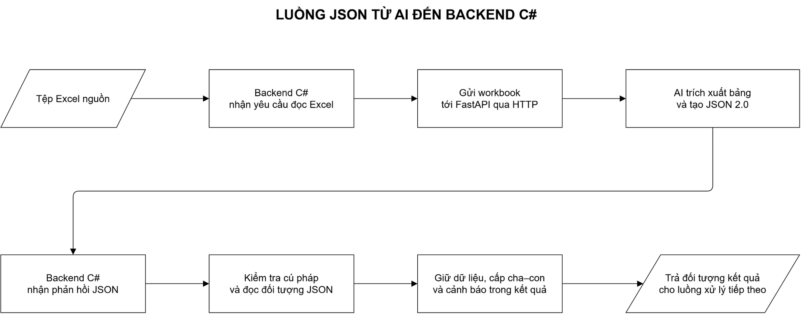
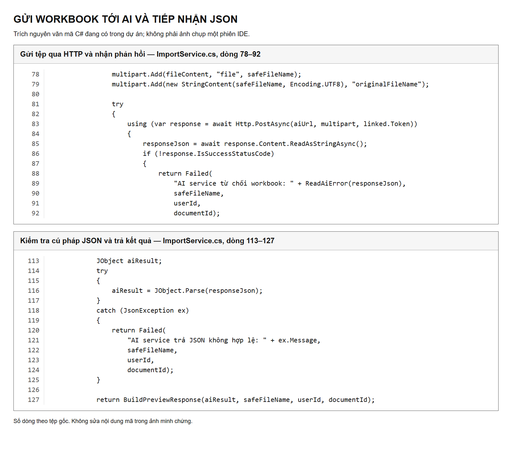
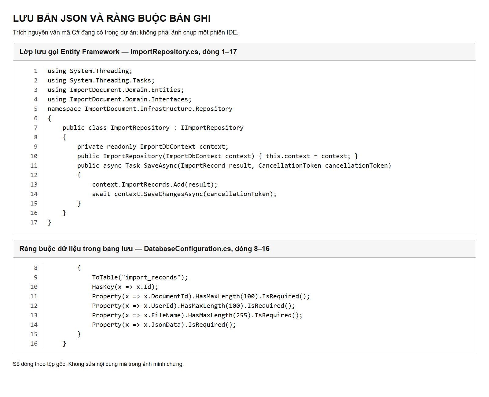
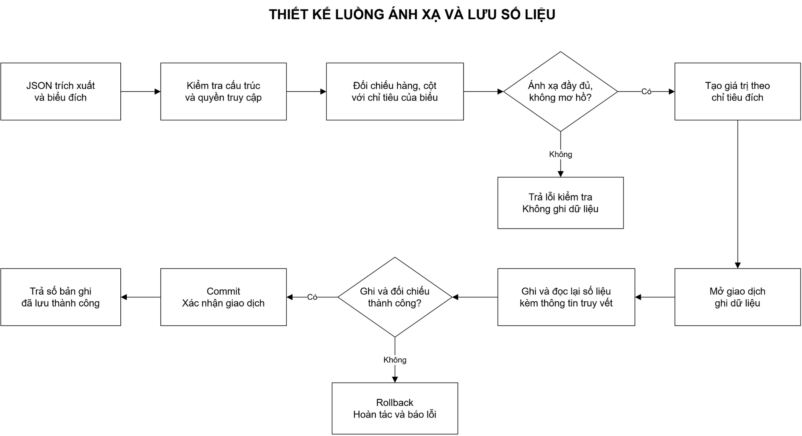

# TÍCH HỢP KẾT QUẢ AI VÀO BACKEND C#

## 1. Mục tiêu và kết luận hiện tại

Công việc tuần 6 tiếp nối dịch vụ FastAPI đã nạp mô hình ở tuần 5. Mục tiêu là đưa kết quả trích xuất Excel dạng JSON vào backend C#, đối chiếu với biểu báo cáo đích và lưu số liệu đúng chỉ tiêu trong cơ sở dữ liệu. Tài liệu chỉ đề cập AI/API, backend và lưu trữ; không triển khai giao diện.

Kiểm tra thực tế xác nhận hai khả năng đã có: lớp nghiệp vụ C# gọi được FastAPI và giữ nguyên dữ liệu trong kết quả; lớp lưu trữ Entity Framework 6 ghi/đọc lại được một bản JSON trong cơ sở dữ liệu thử nghiệm tách biệt. Tuy nhiên, **luồng tự động ánh xạ và lưu số liệu vào biểu chưa hoàn thành**: kết quả ánh xạ nghiệp vụ đang rỗng, lớp nhận JSON chưa gọi lớp lưu và kiểm tra lược đồ phía C# còn thiếu.

Vì vậy, không được dùng minh chứng tuần này để khẳng định hệ thống đã tự động đổ đúng số liệu vào cơ sở dữ liệu nghiệp vụ. Báo cáo kiểm thử trình bày cả kết quả đạt và lỗi còn tồn tại.

## 2. Phân vai giữa AI và backend

Trong dự án này, AI không phải LLM sinh văn bản. Mô hình nhận diện vùng bảng; bộ đọc Excel lấy giá trị nguồn; hậu xử lý tạo thông tin hàng, cột và quan hệ phân cấp; FastAPI phát JSON 2.0. Backend không cần yêu cầu AI sinh lại số liệu.

| Thành phần | Trách nhiệm cần có trong chuỗi hoàn chỉnh |
|---|---|
| AI và bộ đọc Excel | Trích xuất header, value, vùng nguồn và cấu trúc cha–con; không tự tạo số liệu |
| FastAPI | Nạp mô hình một lần, kiểm tra đầu ra bằng Pydantic, cung cấp HTTP/JSON |
| Backend C# | Tiếp nhận yêu cầu, gọi AI, kiểm tra hợp đồng dữ liệu và quyền truy cập; đối chiếu với biểu đích |
| Lớp lưu trữ | Ghi dữ liệu hợp lệ, hỗ trợ truy vết và kiểm tra dữ liệu sau ghi |
| Cơ sở dữ liệu nghiệp vụ | Lưu giá trị gắn với đúng biểu, kỳ báo cáo, hàng/chỉ tiêu và cột đích |

Thông tin nhận diện biểu đích thuộc ngữ cảnh nghiệp vụ của backend. `DocumentId` không phải `DocType` bắt buộc cho đầu vào mô hình: mô hình vẫn nhận workbook thô. Khi lưu, backend phải biết số liệu được đưa vào biểu nào và người nào có quyền thực hiện.

## 3. Luồng tiếp nhận JSON đang có

*Sơ đồ mô tả luồng có trong mã nguồn. Kiểm thử chạy trực tiếp từ lớp nghiệp vụ C# tới FastAPI, không khởi chạy tuyến controller qua IIS.*

Mã nguồn backend định nghĩa hai tuyến `POST /api/import/parse` và `GET /api/import/health`; chưa kiểm thử các tuyến controller này qua IIS. Lớp nghiệp vụ gửi workbook theo multipart tới `POST /api/eform/extract`, nhận nội dung phản hồi rồi đọc bằng `JObject.Parse`.

Các cơ chế đang có:

- Chỉ chấp nhận `.xlsx` và `.xlsm`; từ chối stream rỗng.
- Làm sạch tên tệp bằng cách lấy tên cuối cùng của đường dẫn.
- Dùng `HttpClient` dùng lại và cancellation token cho từng yêu cầu.
- Có thời hạn xử lý cấu hình được; giá trị mặc định 180 giây, giới hạn 5–600 giây.
- Xử lý lỗi kết nối, timeout, HTTP không thành công và JSON lỗi cú pháp.
- Giữ toàn bộ phản hồi AI trong `AiResult`, gồm nhiều sheet/bảng, cấu trúc hàng, đường dẫn header, ô gộp và cảnh báo.

Các trường tiện dụng `Data` và `Columns` chỉ lấy từ bảng đầu tiên. Vì vậy, luồng lưu số liệu không được chỉ dựa vào hai trường này nếu workbook có nhiều bảng: phải duyệt đầy đủ `AiResult.sheets[].tables[]`.

Backend đặt `Success` theo việc có phát hiện bảng và đặt `Valid` tương ứng. Hiện các cờ này **không có nghĩa là ánh xạ nghiệp vụ đã đúng hoặc dữ liệu đã lưu**. `RowMappings` vẫn là mảng rỗng.

### Minh chứng mã nguồn tiếp nhận

*Ảnh là các đoạn nguyên văn của lớp nghiệp vụ C#, có số dòng thật. Ảnh được xuất từ mã nguồn, không phải ảnh giả lập một phiên IDE hay một lần chạy API.*

## 4. Hợp đồng dữ liệu cần giữ nguyên

| Nhóm thông tin | Trường đang có trong JSON | Cách backend cần sử dụng |
|---|---|---|
| Phiên bản và nguồn | `schemaVersion`, `sourceFile`, `model` | Kiểm tra phiên bản, ghi dấu vết nguồn và mô hình |
| Sheet và bảng | `sheetName`, `sourceRange`, `rowCount`, `columnCount` | Xác định bảng/vị trí nguồn, duyệt đủ các bảng |
| Tiêu đề phân cấp | `columns[].headerPath`, `columnCode` | Đối chiếu cột theo cả đường dẫn cha–con, không chỉ nhãn cuối |
| Hàng phân cấp | `rows[].code`, `label`, `level`, `parentRowIndex`, `hierarchyPath` | Phân biệt Tổng số, mục La Mã, mục số và tiểu mục |
| Giá trị | `data`, `headerRows`, `valueRowCount` | Bỏ vùng header khi tạo số liệu đích; giữ đúng kiểu và giá trị nguồn |
| Cảnh báo | `requiresReview`, `warnings`, `mappingConfidence` | Không tự xác nhận những ánh xạ còn mơ hồ |
| Ô gộp và công thức | `mergeCells`, `formulaCells` | Giữ cấu trúc nguồn; kiểm soát giá trị công thức khi có |

Các phép kiểm tra cần bổ sung ở C# gồm phiên bản được hỗ trợ, trường bắt buộc, kiểu dữ liệu, kích thước ma trận, giới hạn chỉ số hàng/cột, quan hệ hàng cha và tính nhất quán giữa các bộ đếm. Pydantic phía FastAPI không thay thế cho kiểm tra ở bên nhận: backend vẫn phải xử lý trường hợp dịch vụ khác phiên bản hoặc phản hồi không đúng hợp đồng.

## 5. Từ cấu trúc Excel đến ánh xạ nghiệp vụ

Nhận diện cấu trúc và ánh xạ nghiệp vụ là hai việc khác nhau. AI có thể xác định hàng “1” nằm dưới “I”, nhưng backend còn phải tìm đúng mã chỉ tiêu hàng đó trong biểu đích. Việc số liệu tồn tại trong Excel không chứng minh số liệu đã gắn đúng chỉ tiêu của hệ thống.

Quy trình đối chiếu cần dựa trên:

1. Biểu đích, phiên bản biểu, kỳ báo cáo và phạm vi đơn vị được phép nhập.
2. Toàn bộ đường dẫn header: ví dụ cùng nhãn “Tổng số” nhưng nằm dưới hai nhóm cột khác nhau không được coi là cùng một cột.
3. Toàn bộ đường dẫn chỉ tiêu: các mục “1”, “2” có thể lặp dưới nhiều mục La Mã; phải dùng ngữ cảnh cha–con để phân biệt.
4. Mã chỉ tiêu/cột của biểu đích khi có; nhãn chữ chỉ là căn cứ bổ sung, không được ép khớp khi có nhiều ứng viên.
5. Kiểu dữ liệu và ô nguồn tương ứng với từng giá trị được nhập.

Kết quả ánh xạ đạt yêu cầu phải chỉ ra được vị trí nguồn, định danh hàng/cột đích, giá trị nguồn, trạng thái kiểm tra và lý do nếu không khớp. Các định danh đích phải lấy từ cơ sở dữ liệu nghiệp vụ, không do AI tự tạo.

### Các trường hợp dễ đổ sai số liệu

| Trường hợp | Nguy cơ | Kiểm soát cần có |
|---|---|---|
| Mã “1” xuất hiện dưới I và II | Gán số liệu vào nhầm chỉ tiêu | Dùng đường dẫn phân cấp đầy đủ |
| Header cha có nhiều cột con | Làm phẳng mất ngữ cảnh cột | Đối chiếu `headerPath`, không ghép theo tên cuối |
| Ma trận chứa cả header và value | Lưu tiêu đề như số liệu | Tách theo `headerRows`, chỉ nhập vùng value |
| Ô trống, số 0 và dấu `-` | Tự đổi ô trống/dấu quy ước thành 0 | Giữ khác biệt; áp dụng quy tắc nghiệp vụ có căn cứ |
| Công thức không có giá trị cache | Nhập chuỗi công thức vào cột số | Cảnh báo/không ghi; không tự tính hay đoán số |
| Nhiều sheet hoặc nhiều bảng | Chỉ nhập bảng đầu tiên | Duyệt toàn bộ phản hồi AI |
| `requiresReview=true` | Lưu tự động một ánh xạ còn mơ hồ | Chặn bước commit tự động cho phần chưa xác nhận |

Đây là yêu cầu thiết kế của bước lưu; không phải những kiểm soát đã được triển khai đầy đủ trong mã hiện tại.

## 6. Lưu JSON và lưu số liệu là hai mức kết quả

Lớp lưu hiện có thực thể bản nhập với các thông tin: mã biểu, mã người dùng, tên tệp, JSON nguồn và thời điểm tạo. Entity Framework ánh xạ thực thể này vào bảng `import_records`. Hàm lưu thêm bản ghi và gọi `SaveChangesAsync`.

*Ảnh trích nguyên văn lớp lưu và cấu hình ràng buộc. Mã này lưu bản JSON; không phải mã tự động ghi từng giá trị vào các chỉ tiêu nghiệp vụ.*

| Mức lưu | Ý nghĩa | Tình trạng |
|---|---|---|
| Lưu bản JSON nguồn | Giữ dữ liệu trích xuất để truy vết/đọc lại | Lớp lưu đã kiểm thử riêng trên SQL Server LocalDB |
| Lưu giá trị theo chỉ tiêu | Mỗi giá trị gắn đúng biểu, kỳ, hàng/chỉ tiêu và cột đích | Chưa có luồng ánh xạ/lưu nối liền được kiểm chứng |

Cấu hình backend của dự án sử dụng provider MySQL. Minh chứng lưu lần này sử dụng **SQL Server LocalDB tách biệt**, qua cùng mã Entity Framework/lớp lưu. Kết quả không được dùng thay cho kiểm thử provider MySQL hoặc kiểm thử trên cơ sở dữ liệu nghiệp vụ của dự án.

`SaveChangesAsync` có cơ chế giao dịch cho lần ghi của Entity Framework; điều còn thiếu là quy trình giao dịch nghiệp vụ cho toàn bộ bản nhập đã ánh xạ, quy tắc chống nhập lặp và kiểm tra quyền với biểu đích.

## 7. Thiết kế hoàn thiện luồng lưu ở backend

*Đây là sơ đồ thiết kế cho phần còn thiếu, không phải minh chứng các bước đó đã chạy thành công.*

Luồng lưu cần độc lập về ý nghĩa với luồng trích xuất. Đọc một workbook không nên tự động ghi dữ liệu nghiệp vụ chỉ vì đã tìm thấy bảng.

1. Nhận phản hồi trích xuất cùng ngữ cảnh biểu đích.
2. Kiểm tra hợp đồng JSON, quyền truy cập và trạng thái biểu/kỳ báo cáo.
3. Đối chiếu hàng/cột theo cấu trúc phân cấp, tạo định danh đích có căn cứ.
4. Nếu thiếu ánh xạ, nhầm cấp, sai kiểu hoặc còn cảnh báo chưa xác nhận: trả lỗi kiểm tra, không ghi số liệu.
5. Tạo các giá trị nhập từ ô nguồn; không sinh thêm giá trị hoặc thay ô trống bằng số đoán.
6. Ghi số liệu và dấu vết nguồn trong một giao dịch; đọc lại/đối chiếu trước khi commit.
7. Khi có lỗi, rollback; khi thành công, trả số bản ghi thực sự đã lưu và trạng thái rõ ràng.

Tài liệu chưa đề xuất tên endpoint lưu hoặc tên bảng chỉ tiêu cụ thể vì chưa có hợp đồng lưu nghiệp vụ được xác nhận trong phần backend đang khảo sát. Việc này tránh tạo một thiết kế giả định không phù hợp hệ thống thật.

## 8. Kết quả kiểm thử và điều kiện nghiệm thu

Chi tiết có tại [Báo cáo kiểm thử](BAO_CAO_KIEM_THU.md). Tổng hợp lần chạy: **14 kiểm tra PASS, 1 FAIL và 3 khoảng thiếu phát hiện qua mã nguồn**. Hai workbook trả về tổng cộng 4.747 ô trong các vùng nhận diện; đối chiếu với Excel nguồn có 0 sai khác. Đây là phép đo giữ nguyên dữ liệu trong vùng trả về, không phải độ chính xác nhận diện toàn biểu hay ánh xạ nghiệp vụ.

Điều kiện để nghiệm thu mục tiêu “backend tự động xử lý và lưu chuẩn xác dữ liệu do AI map”:

- JSON sai lược đồ bị từ chối ở C#; trường hợp lỗi TC09 được sửa và kiểm thử lại.
- Có định danh hàng/cột đích, có kiểm tra ngữ cảnh phân cấp và có xử lý ánh xạ không rõ ràng.
- Lớp nghiệp vụ gọi được lớp lưu trong luồng nhập số liệu, không chỉ trả đối tượng kết quả.
- Có kiểm thử lưu và đọc lại trên provider MySQL/cơ sở dữ liệu thử nghiệm đúng cấu trúc nghiệp vụ.
- Có kiểm thử sai biểu, sai quyền, nhập lặp, rollback và nhiều bảng.
- Số bản ghi cùng giá trị đọc lại khớp với tập giá trị nguồn đã được phép nhập.

Ở thời điểm ghi nhận, chưa đủ các điều kiện này. Bộ tài liệu tuần 6 là minh chứng khảo sát, thiết kế và kiểm thử hiện trạng backend; không phải biên bản nghiệm thu hoàn tất tự động nhập số liệu.

## 9. Giải thích thuật ngữ và bộ minh chứng

Lược đồ là quy định về cấu trúc và kiểu dữ liệu của JSON. Repository là lớp lưu trữ. Commit là xác nhận giao dịch ghi; rollback là hoàn tác khi có lỗi. Các trách nhiệm ở mục 2 và cách sử dụng ở mục 4 là yêu cầu của chuỗi hoàn chỉnh; phần đã triển khai được mô tả riêng ở mục 3 và mục 6.

| Tệp/nhóm | Công dụng |
|---|---|
| Tài liệu này | Phân tích và thiết kế phần tích hợp backend |
| `BAO_CAO_KIEM_THU.md` | Môi trường, ca kiểm thử, kết quả thật và lỗi cần xử lý |
| `BAO_CAO_THUC_TAP_TUAN_6.docx` | Báo cáo thực tập theo cấu trúc tuần trước |
| `diagrams/TICH_HOP_BACKEND.drawio` | Nguồn draw.io gồm hai trang có thể chỉnh sửa |
| Hai ảnh trong `diagrams` | Sơ đồ hiện trạng và sơ đồ thiết kế lưu |
| Hai ảnh mã nguồn trong `evidence` | Trích nguyên văn mã C# đang có |
| `evidence/backend_checks_actual.json` | Kết quả, mã băm nguồn, đối chiếu ô và xác nhận dọn CSDL tạm |
| `evidence/backend_response_actual.json` | Hai phản hồi C# đầy đủ, giữ nguyên JSON AI |
| `evidence/backend_checks_actual.txt` | Nhật ký gốc lần chạy C# |

Không có notebook huấn luyện mới, mã giao diện, bản sao dataset hay thư viện chạy được thêm vào bộ tài liệu này.
