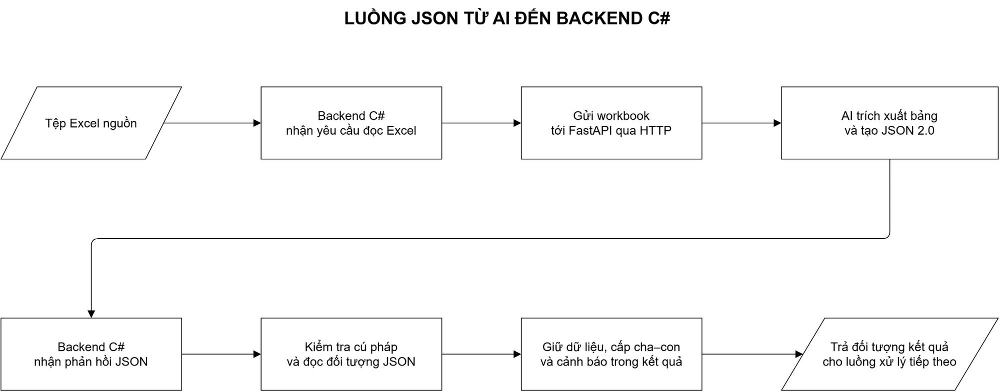
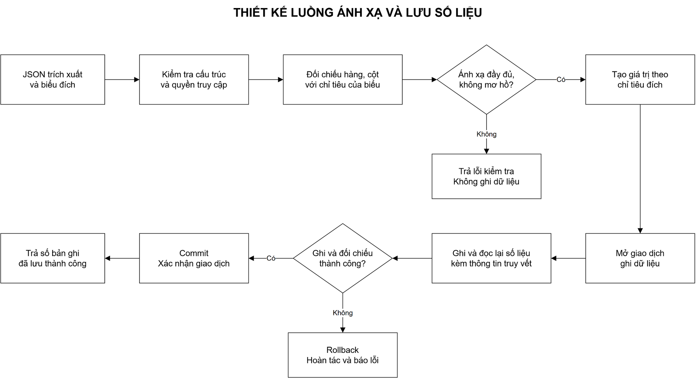

# TÀI LIỆU THIẾT KẾ TẦNG TÍCH HỢP BACKEND C# CHO MODULE NHẬP EXCEL AI

**Đề tài:** Module AI Import file Excel thông minh cho Hệ thống Báo cáo thống kê eForm BTP 
**Giai đoạn:** Tuần 6 (Tích hợp dịch vụ trung gian .NET và lưu vết độc lập)

---

## 1. Mục tiêu thiết kế tầng Backend trung gian

Để bảo đảm tính an toàn, phân tách trách nhiệm và không làm ảnh hưởng đến hệ thống lõi eForm BTP đang vận hành, em xây dựng một dịch vụ web trung gian độc lập trên nền tảng ASP.NET làm cầu nối giữa trình duyệt người dùng, dịch vụ suy luận AI (FastAPI) và cơ sở dữ liệu lưu vết nhập liệu.

---

## 2. Bốn nhóm chức năng chính của tầng dịch vụ trung gian

### 2.1. Xác thực phiên làm việc và kiểm soát truy cập
- Mọi yêu cầu gửi tệp từ giao diện eForm đều phải đính kèm mã phiên ký số ngắn hạn do máy chủ eForm phát hành riêng cho tài khoản và tài liệu đang mở.
- Dịch vụ trung gian xác minh chữ ký, thời hạn hiệu lực và nguồn gốc tên miền trước khi tiếp nhận dữ liệu, ngăn chặn tuyệt đối việc truy cập trái phép từ bên ngoài.

### 2.2. Kiểm định tính hợp lệ tệp Excel đầu vào
- Chặn ngay các tệp rỗng (dung lượng 0 byte) hoặc vượt quá giới hạn dung lượng cho phép.
- Kiểm tra phần mở rộng hợp lệ và thẩm định 4 byte chữ ký nén đầu tệp của chuẩn bảng tính OpenXML nhằm loại bỏ các tệp giả mạo đổi đuôi hoặc hỏng cấu trúc trước khi chuyển sang dịch vụ AI.

### 2.3. Điều phối gọi dịch vụ AI và kiểm soát ngoại lệ
- Chuyển tiếp nội dung tệp sang dịch vụ suy luận FastAPI thông qua kết nối HTTP nội bộ có thiết lập thời gian chờ hợp lý.
- Kiểm tra tính toàn vẹn của gói phản hồi JSON 2.0, bảo toàn nguyên vẹn thông tin vùng bảng, cấu trúc ô gộp tiêu đề, cấp bậc cha–con của hàng và danh sách cảnh báo nghiệp vụ để trả về giao diện xem trước.
- Bắt mọi tình huống ngoại lệ (mất kết nối dịch vụ AI, quá thời gian chờ, tệp không có bảng hợp lệ) và quy đổi thành thông báo lỗi tiếng Việt rõ ràng.

### 2.4. Lưu vết lịch sử và bảo toàn dữ liệu theo giao dịch an toàn

- Sau khi cán bộ kiểm tra trên lưới xem trước và xác nhận ghép số liệu vào biểu mẫu eForm, hệ thống ghi nhận nhật ký giao dịch nhập liệu (mã định danh báo cáo, tài khoản thực hiện, tên tệp gốc, thời điểm nhập, tổng số dòng hợp lệ và thông tin truy vết).
- Toàn bộ thao tác ghi được bao bọc trong giao dịch cơ sở dữ liệu an toàn: chỉ xác nhận hoàn tất khi mọi bước ghi nhận đều thành công và tự động hoàn tác nếu phát sinh lỗi, đồng thời tách hoàn toàn khỏi các bảng số liệu lõi của eForm.
