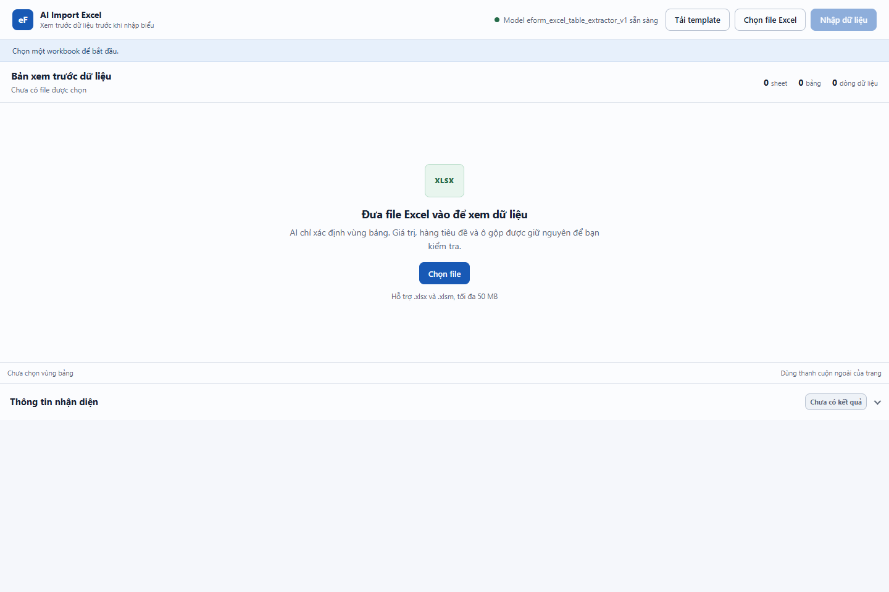
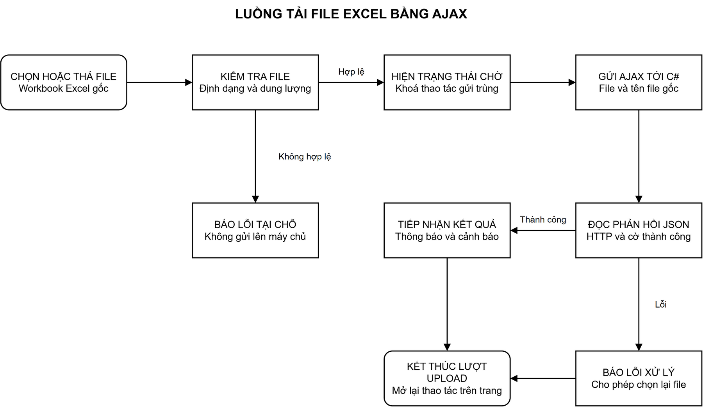
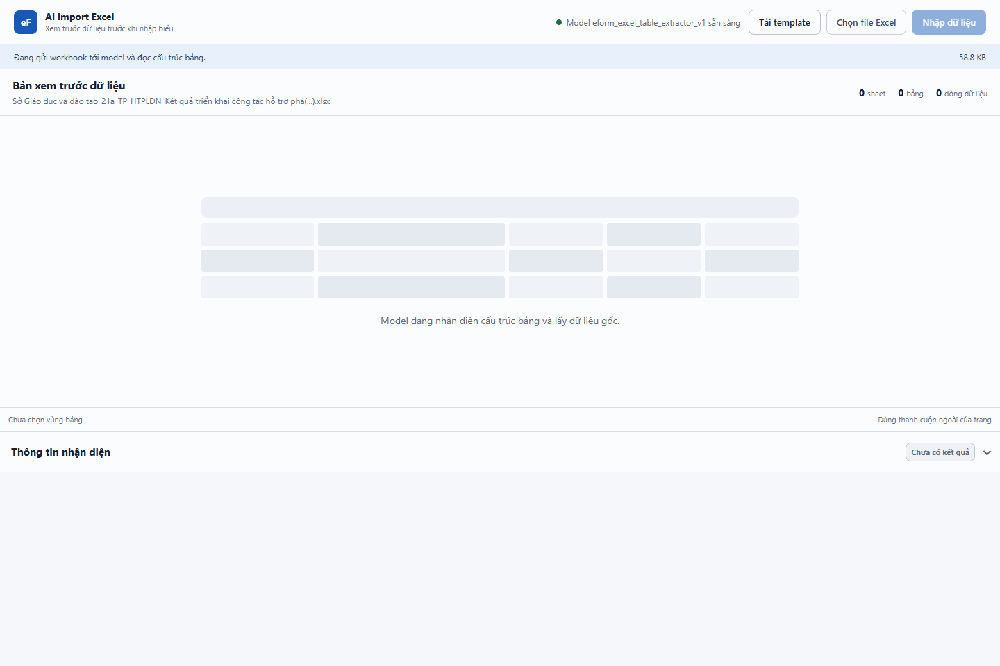
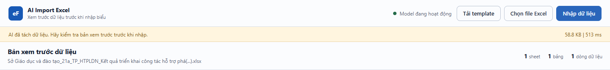
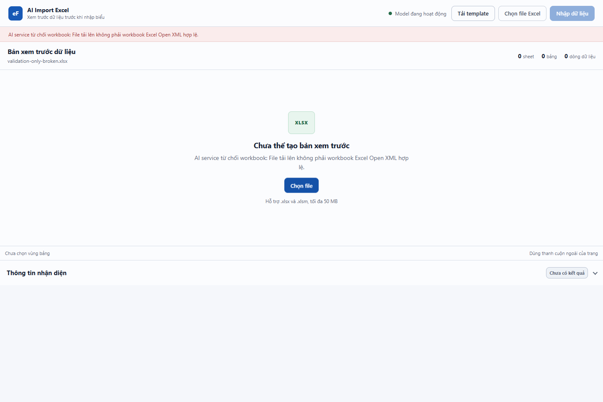

# GIAO DIỆN TẢI FILE EXCEL KHÔNG TẢI LẠI TRANG

## 1. Mục tiêu và kết quả hiện tại

Tuần 7 tiếp nối kết nối C#–FastAPI của tuần 6, bổ sung góc nhìn người sử dụng: chọn hoặc kéo thả một workbook Excel, gửi file đến backend, theo dõi trạng thái xử lý và nhận thông báo kết quả ngay trên trang. Mục tiêu thiết kế là giao diện rõ ràng, phù hợp phong cách eForm và dùng AJAX để không tải lại trang.

Tài liệu được lập bằng cách khảo sát và chạy **màn hình đang có trong dự án**, không dựng một màn hình minh hoạ khác. Dự án C# được chạy bằng IIS Express; frontend gửi file Raw tới backend và FastAPI thật. Không sửa mã giao diện, backend, mô hình hoặc dataset trong đợt lập minh chứng này.

Kết quả kiểm thử: **15 PASS, 1 FAIL**. Chọn file, kéo thả, gửi bất đồng bộ, khoá thao tác trong khi xử lý, hiển thị lỗi và chọn lại file đã được kiểm chứng. Yêu cầu sử dụng Bootstrap trên chính màn hình import **chưa đạt**: Bootstrap có trong dự án nhưng trang này đang dùng CSS riêng và không nạp Bootstrap.

Việc nhận JSON thành công không chứng minh dữ liệu đã được ánh xạ đúng vào biểu hoặc đã lưu vào cơ sở dữ liệu. Những khoảng thiếu của backend được ghi nhận ở tuần 6 vẫn không được coi là đã hoàn thành chỉ vì xuất hiện nút “Nhập dữ liệu”.

## 2. Nội dung thuộc tuần 7

| Nội dung | Công việc và mức độ xác nhận |
|---|---|
| Khung giao diện HTML/CSS | Có nhận diện eForm, nút chọn file, trạng thái dịch vụ, hướng dẫn định dạng và dung lượng |
| Chọn file | Hai nút mở trình chọn file của trình duyệt; input nhận một file mỗi lần |
| Kéo thả | Sự kiện thả file đi vào cùng luồng xử lý; chặn hành vi trình duyệt tự mở file |
| AJAX | Dùng `fetch` và `FormData` gửi multipart tới C#, không submit form và không điều hướng |
| Trạng thái xử lý | Hiện vùng chờ, tên file và dung lượng; tạm khoá chọn file và xác nhận |
| Tiếp nhận phản hồi | Đọc JSON, xét trạng thái HTTP và cờ thành công của backend, cập nhật thông báo |
| Lỗi và thử lại | Hiển thị lỗi, giải phóng trạng thái bận, xoá lựa chọn cũ để cho phép chọn lại cùng file |
| Thiết kế thích ứng | Kiểm tra bố cục upload tại 1.440 px và 390 px; không đánh giá lưới số liệu |
| Bootstrap | Thư viện tồn tại trong dự án nhưng chưa được nạp vào màn hình import; còn cần xử lý nếu đây là tiêu chí bắt buộc |

Tuần 7 dừng tại việc frontend gửi file, nhận JSON và phản ánh trạng thái. Việc xây dựng/đánh giá lưới Preview đa cấp, ô gộp, quan hệ cột cha–con và hiển thị số liệu bằng Handsontable thuộc **tuần 8**, không được tính là kết quả thực hiện tuần này. Màn hình hiện có đã chứa các thành phần Preview, nhưng sự tồn tại đó không phải minh chứng hoàn thành tuần 8.

## 3. Bố cục và trải nghiệm sử dụng

*Ảnh chụp vùng nội dung trình duyệt của ứng dụng thật chạy qua IIS Express, trước khi chọn file. Các thành phần xem trước đang rỗng; ảnh không chứng minh khả năng vẽ lưới.*

Giao diện dùng nền sáng, màu nhấn xanh, nhãn tiếng Việt và thứ tự thao tác từ chọn file đến theo dõi kết quả. Nhận diện, khoảng cách, đường viền, kiểu nút và màu trạng thái lấy từ CSS của màn hình hiện có, không tự thiết kế một bộ phong cách khác để chụp minh chứng.

Hai vị trí chọn file giúp người dùng bắt đầu từ thanh công cụ hoặc vùng trống ở giữa trang. Thông tin hỗ trợ `.xlsx`, `.xlsm` và giới hạn “50 MB” được đặt gần thao tác. Nút xác nhận ban đầu bị khoá. Các nút HTML có `type="button"`, không kích hoạt việc submit và tải lại trang.

Thông báo có vùng trạng thái và `aria-live="polite"`; nút có kiểu hiển thị khi nhận focus. Đây là đặc điểm được khảo sát trong mã nguồn, chưa thay thế kiểm thử đầy đủ bằng trình đọc màn hình, bàn phím và tất cả trình duyệt.

### Bootstrap và CSS riêng

Bootstrap 3.4.1 đã có trong thư mục tài nguyên và cấu hình bundle dùng chung của dự án. Tuy nhiên, trang import đặt `Layout = null`, nên không kế thừa layout nạp bundle Bootstrap. Danh sách CSS/script thực tế của trang không có Bootstrap; nút và bố cục dùng class riêng thay vì các class Bootstrap.

Do đó, kết luận đúng là **giao diện HTML/CSS và AJAX hoạt động; yêu cầu Bootstrap trên màn hình import còn thiếu**. Nếu cần đáp ứng yêu cầu thư viện, phải có một thay đổi frontend riêng, kiểm soát ảnh hưởng của Bootstrap đến reset CSS, nút và bố cục, rồi chụp lại minh chứng. Tài liệu này không thực hiện thay đổi đó.

## 4. Luồng Upload bằng AJAX

*Sơ đồ trình bày luồng chọn file–gửi–nhận phản hồi. Điểm bàn giao là JSON và trạng thái; không bao gồm lưới Preview hoặc ghi dữ liệu vào cơ sở dữ liệu.*

AJAX là cách trao đổi dữ liệu với máy chủ trong nền mà không tải lại toàn bộ trang. Trong dự án này, AJAX được thực hiện bằng API `fetch` của trình duyệt; không cần dùng `$.ajax` của jQuery để được coi là AJAX.

Trình tự xử lý:

1. Nhận file từ trình chọn file hoặc sự kiện kéo thả.
2. Kiểm tra phần mở rộng và dung lượng. File sai điều kiện không được gửi tới backend.
3. Xoá trạng thái dữ liệu cũ, chuyển sang trạng thái đang xử lý, hiển thị tên file.
4. Tạo `FormData`, thêm file và tên file gốc; thêm ngữ cảnh người dùng/biểu nếu màn hình được cấu hình.
5. Gửi `POST /api/import/parse`; trình duyệt tự tạo boundary của multipart.
6. Đọc nội dung phản hồi, phân tích JSON, kiểm tra HTTP và cờ thành công. Không dùng riêng HTTP 200 để kết luận thành công nghiệp vụ.
7. Cập nhật thông báo kết quả hoặc thông báo lỗi.
8. Trong `finally`, mở lại thao tác và đặt giá trị input file về rỗng để người dùng có thể chọn lại cùng file.

Frontend còn gọi `GET /api/import/health` để hiển thị trạng thái AI thông qua backend. Trình duyệt không gọi trực tiếp FastAPI; URL dịch vụ AI thuộc cấu hình phía C#.

### Hợp đồng trao đổi với backend

| Hướng | Nội dung | Ý nghĩa |
|---|---|---|
| Trình duyệt → C# | `file` | Nội dung workbook gốc, dạng phần file trong multipart |
| Trình duyệt → C# | `originalFileName` | Tên gốc, giữ tiếng Việt để xác định nguồn |
| Trình duyệt → C# | `userId`, `documentId` nếu được cấu hình | Ngữ cảnh nghiệp vụ của ứng dụng, không phải điều kiện đầu vào bắt buộc của mô hình |
| C# → trình duyệt | `Success`, `Message`, `AiResult` hoặc cách viết camelCase tương ứng | Cờ xử lý, thông báo và kết quả trích xuất |
| Kết quả AI → trạng thái UI | `sourceFile`, `summary`, `requiresReview`, `durationMs` | Nhận diện nguồn, bộ đếm và cảnh báo; không phải bằng chứng đã lưu |

Ngữ cảnh người dùng do frontend gửi không thay thế xác thực và phân quyền phía backend. Cờ `Success` trong luồng hiện có chủ yếu xác nhận nhận được bảng, không có nghĩa nghiệp vụ đã đối chiếu đúng từng chỉ tiêu.

## 5. Quản lý trạng thái và xử lý lỗi

| Trạng thái | Cách hiển thị và thao tác |
|---|---|
| Chưa chọn file | Hướng dẫn upload; nút chọn khả dụng; xác nhận bị khoá |
| Sai định dạng/dung lượng | Thông báo lỗi tại chỗ; không gửi POST |
| Đang xử lý | Vùng chờ dạng skeleton; tên file và dung lượng; các nút chọn/xác nhận bị khoá |
| Nhận JSON thành công | Thông báo đã tách dữ liệu; cập nhật tên và bộ đếm; vẫn thể hiện yêu cầu kiểm tra khi có cảnh báo |
| Backend/AI từ chối file | Hiển thị thông báo thật; xoá trạng thái dữ liệu cũ; cho phép chọn lại |
| Lỗi HTTP hoặc JSON không đọc được | Hiển thị lỗi; mở lại thao tác trong `finally`; không làm trang bị tải lại |

*File Raw thật đã được chọn. Công cụ kiểm thử tạm giữ yêu cầu trước khi gửi ra mạng để quan sát vùng chờ và các nút bị khoá, rồi tiếp tục gửi nguyên yêu cầu tới backend thật. Ảnh không phải số đo thời gian suy luận của mô hình.*

Biến trạng thái bận giúp bỏ qua yêu cầu nhận file thứ hai khi lượt đầu chưa kết thúc. Cơ chế này đã được thử bằng sự kiện thả file trong lúc bận; chỉ phát sinh một yêu cầu upload.

*Ảnh chụp trực tiếp phần đầu trang sau phản hồi thật, chỉ gồm trạng thái, tên file và bộ đếm. Phần lưới bên dưới nằm ngoài khung chụp và ngoài nội dung đánh giá.*

Kết quả của mẫu 21a có `requiresReview=true`, nên giao diện dùng trạng thái cảnh báo. Việc nút “Nhập dữ liệu” có thể được mở khoá trong mã hiện có không xác nhận dữ liệu đã nhập. Không nhấn nút này trong đợt kiểm thử tuần 7.

*File thử nghiệm cố ý không phải workbook Excel hợp lệ. Thông báo đi qua IIS Express → C# → FastAPI thật; ảnh không dùng phản hồi giả lập.*

## 6. Minh chứng và giới hạn đánh giá

Thử nghiệm dùng mẫu Raw Giáo dục biểu 21a, kích thước 60.161 byte. Quan sát ở trình duyệt xác nhận đối tượng file trong `FormData` có SHA-256 trùng file nguồn; backend trả `summary.uploadBytes=60161`, đúng tên file và JSON 2.0. Phản hồi có một sheet, một bảng và vùng nguồn `A2:M8`. Đây là kiểm chứng gửi/nhận dữ liệu, **không đo độ chính xác phát hiện vùng bảng hoặc ánh xạ nghiệp vụ**.

Có một lần tải document ban đầu; dấu nhận diện đặt trong document được giữ nguyên sau upload, thử lại và kéo thả. Bằng chứng này xác nhận không tải lại trang trong phiên thử. Không ghi “100% mượt mà trên mọi thiết bị” vì chưa có kiểm thử tải đồng thời, mạng yếu dài hạn hoặc ma trận trình duyệt đầy đủ.

Các điều kiện còn cần lưu ý:

- Chưa có thanh phần trăm tiến độ truyền file; vùng chờ chỉ báo trạng thái tổng quát.
- Chưa có timeout/hủy yêu cầu riêng ở frontend bằng `AbortController`; timeout phía backend không thay thế hoàn toàn kiểm soát kết nối của trình duyệt.
- Giao diện hiển thị giới hạn “50 MB” nhưng phép kiểm tra dùng 50 × 1.024 × 1.024 byte, tức 50 MiB. Giới hạn phía IIS tính cả nội dung multipart, nên file gần sát ngưỡng có thể cần chừa phần header; chưa kiểm thử thành công ở biên tối đa.
- Chưa chạy workbook `.xlsm` thật trong đợt này; hỗ trợ phần mở rộng được xác nhận qua mã nguồn, không suy ra hỗ trợ mọi macro hoặc cấu trúc file.
- Đáp ứng phong cách màn hình hiện có không thay thế nghiệm thu thiết kế với toàn bộ sản phẩm eForm.

Chi tiết các ca thử và kết quả nguyên bản nằm trong [báo cáo kiểm thử](BAO_CAO_KIEM_THU_UI.md) và [minh chứng JSON](evidence/ui_checks_actual.json). Không tạo bản sao dataset, file train hoặc gói thư viện trong thư mục tài liệu.

## 7. Kết luận

Tuần 7 cung cấp phân tích và minh chứng cho trải nghiệm tải workbook bất đồng bộ: người dùng chọn/kéo thả file, thấy trạng thái xử lý, nhận thông báo JSON hoặc lỗi và có thể thử lại mà không tải lại trang. Phần thiếu Bootstrap được ghi nhận minh bạch, không che bằng ảnh minh hoạ. Điểm dừng là dữ liệu đã được frontend tiếp nhận; phần dựng và kiểm chứng lưới Preview đa cấp thuộc tuần 8.

### Nguồn kỹ thuật để kiểm tra lại

Các đường dẫn sau chỉ phục vụ tra cứu, không bắt buộc người đọc báo cáo phải đọc mã nguồn:

- Màn hình và cấu trúc upload: `Module/ImportDoucment/ImportDocumentAPI/Views/Home/Index.cshtml`.
- Sự kiện, kiểm tra file và gửi/nhận AJAX: `Module/ImportDoucment/ImportDocumentAPI/Scripts/import-preview.js`.
- Phong cách và bố cục thích ứng: `Module/ImportDoucment/ImportDocumentAPI/Content/import.css`.
- Bundle Bootstrap và layout dùng chung: `App_Start/BundleConfig.cs`, `Views/Shared/_Layout.cshtml` trong dự án API.
- Tuyến nhận upload: `Controllers/ImportController.cs` trong dự án API.

Mã băm các nguồn chính và xác nhận không thay đổi chúng được lưu cùng kết quả kiểm thử.
