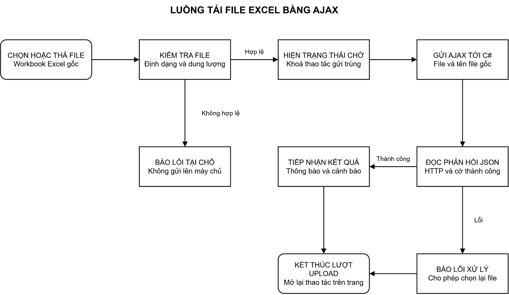
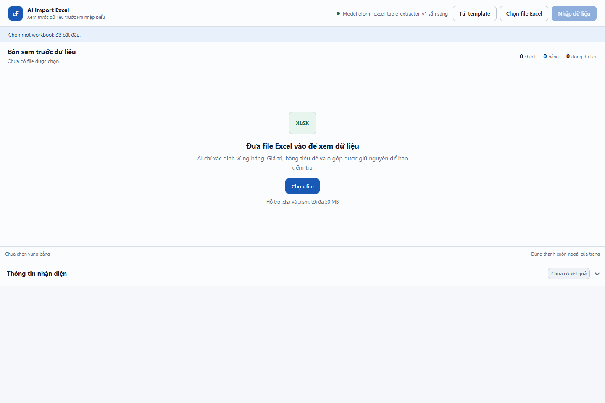
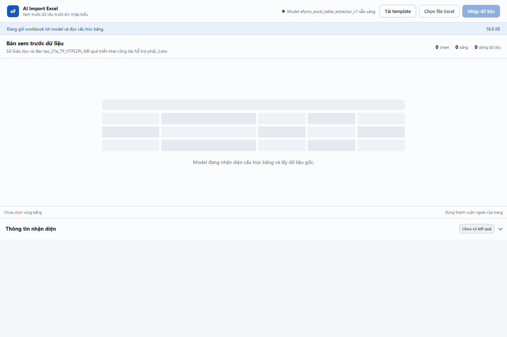
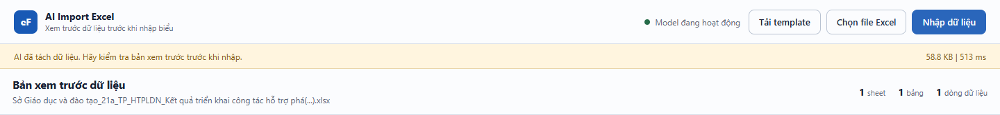
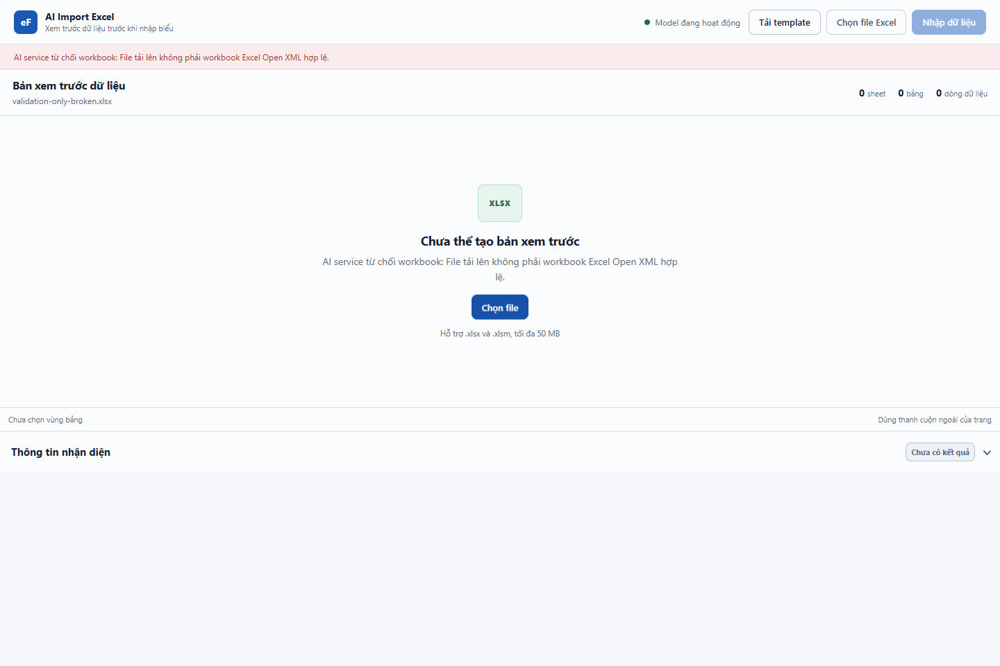

# TÀI LIỆU THIẾT KẾ GIAO DIỆN TẢI TỆP BẤT ĐỒNG BỘ CHO MODULE NHẬP EXCEL AI

**Đề tài:** Module AI Import file Excel thông minh cho Hệ thống Báo cáo thống kê eForm BTP 
**Giai đoạn:** Tuần 7

---

## 1. Mục tiêu thiết kế luồng tải tệp phía trình duyệt

Giao diện tải tệp của Module Nhập Excel AI cần tích hợp hài hòa vào hộp thoại nhập liệu sẵn có của hệ thống eForm BTP, bảo đảm thao tác đơn giản cho cán bộ tư pháp địa phương đồng thời duy trì trạng thái phản hồi minh bạch trong suốt quá trình gửi tệp và chờ mô hình AI phân tích.

---

## 2. Thiết kế các trạng thái tương tác giao diện

Luồng tương tác phía người dùng gồm 4 trạng thái rõ ràng:

1. **Trạng thái chờ chọn tệp:** Hiển thị chỉ báo sức khỏe của dịch vụ AI (màu xanh lục khi sẵn sàng), cung cấp hai nút song song **Nhập file Excel** (theo mẫu truyền thống) và **Nhập File Excel AI** (phân tích tự động).
2. **Kiểm tra hợp lệ tại chỗ:** Ngay khi cán bộ chọn tệp, trình duyệt kiểm tra phần mở rộng bảng tính hợp lệ, dung lượng khác 0 byte và không vượt giới hạn cho phép. Nếu không đạt, hệ thống báo lỗi trực quan ngay tại chỗ mà không gửi yêu cầu lên máy chủ.
3. **Trạng thái đang phân tích bất đồng bộ:** Khóa thao tác gửi trùng lặp trong thời gian chờ phản hồi, hiển thị tiến trình tải tệp lên cổng dịch vụ trung gian và nhận kết quả JSON 2.0 mà không làm tải lại trang báo cáo.
4. **Tiếp nhận kết quả hoặc báo lỗi an toàn:** Khi thành công, hệ thống tự động mở cửa sổ xem trước bảng tính đa cấp kèm siêu dữ liệu nhận diện (tên tệp, trang tính, vùng bảng, số dòng tiêu đề, số dòng số liệu, độ tin cậy). Khi gặp sự cố mạng hoặc tệp lỗi, hiển thị hộp thoại thông báo tiếng Việt rõ ràng và mở lại quyền chọn tệp khác.

---

## 3. Minh chứng giao diện thực tế theo từng trạng thái

 
*Hình 1: Giao diện ban đầu cho phép chọn tệp Excel và theo dõi trạng thái sẵn sàng của mô hình AI.*

 
*Hình 2: Giao diện hiển thị trạng thái chờ xử lý bất đồng bộ và khóa thao tác nhấn lặp.*

 
*Hình 3: Trạng thái sau khi nhận phản hồi thành công từ dịch vụ AI kèm thời gian xử lý và thống kê bảng.*

 
*Hình 4: Cảnh báo lỗi thân thiện khi người dùng chọn tệp sai định dạng hoặc hỏng cấu trúc.*
