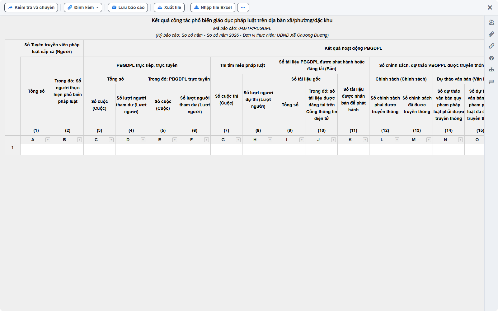
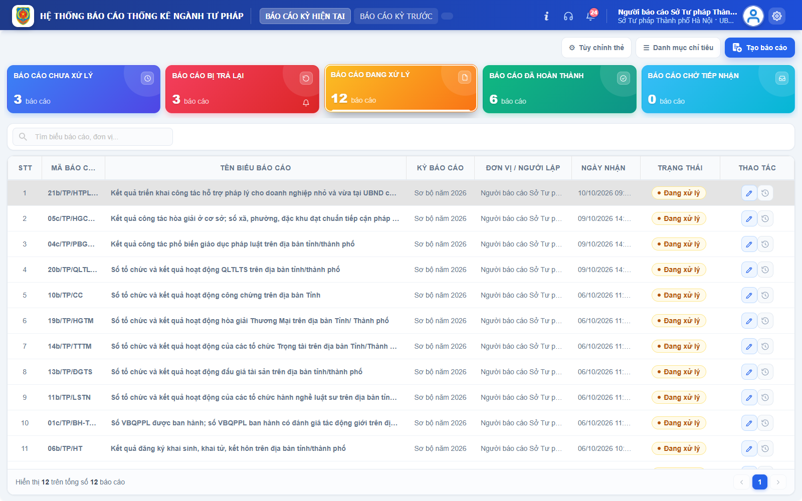
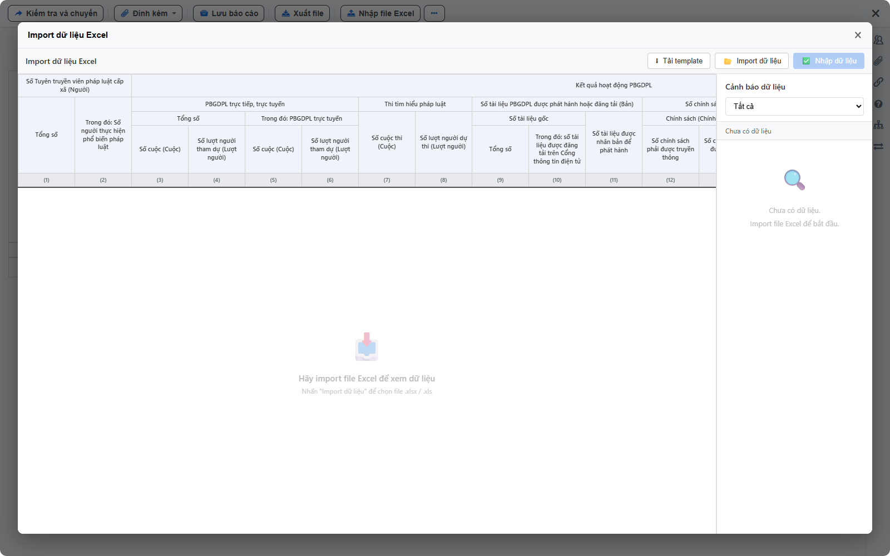
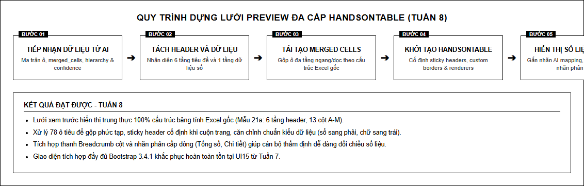
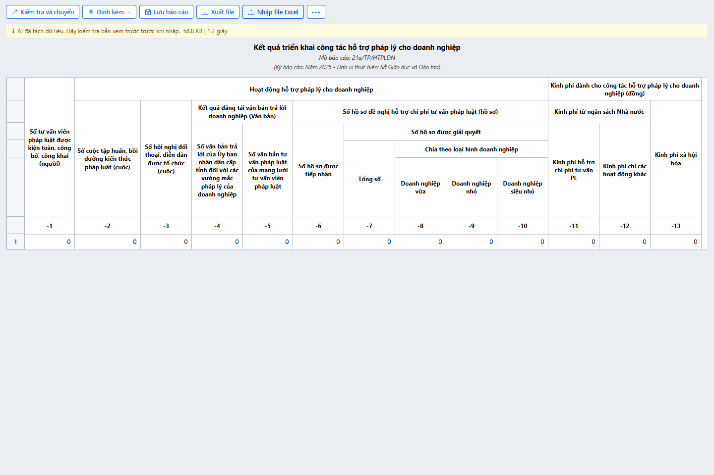
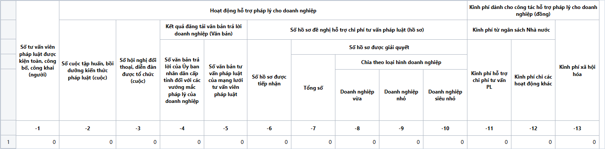

# BÁO CÁO THỰC TẬP TUẦN 8
**HỌP TIẾN ĐỘ DỰ ÁN, CỐ ĐỊNH DANH SÁCH ĐƠN VỊ CẤP XÃ TRÊN BÁO CÁO TỔNG HỢP, XUẤT CÔNG THỨC TEMPLATE EXCEL TỪ NGUỒN DỮ LIỆU BACKEND VÀ DỰNG LƯỚI PREVIEW ĐA CẤP BẰNG HANDSONTABLE**

---

## BẢNG THÔNG TIN SINH VIÊN VÀ ĐỀ TÀI

| Thông tin | Chi tiết |
|---|---|
| **Sinh viên thực hiện** | **Trần Văn Hoàng** |
| **Mã số sinh viên (MSSV)** | **0034467** |
| **Lớp chuyên ngành** | 67CS – Khóa K67 |
| **Đơn vị thực tập** | Công ty TNHH Nền tảng chuyển đổi số Việt Nam |
| **Bộ phận công tác** | eGov – Khối Chính phủ số |
| **Cán bộ hướng dẫn tại đơn vị** | **Đào Đức Văn** |
| **Dự án tham gia** | Hệ thống báo cáo điện tử eForm |
| **Đề tài nghiên cứu** | Nghiên cứu và ứng dụng AI xây dựng Module Import file Excel thông minh, tự động ánh xạ dữ liệu cho hệ thống Báo cáo thống kê eForm. |

---

## I. THÔNG TIN CHUNG VÀ KẾ HOẠCH THỰC HIỆN TUẦN 8

Trong tuần thực tập thứ 8, em tiếp tục triển khai công tác theo định hướng phân công kết hợp song song giữa hai trụ cột chính:
- **Trụ cột 1 (Dự án chính eForm BTP)**: Báo cáo tiến độ và nhận nhiệm vụ trong phiên họp toàn đội ngũ, tái cấu trúc thủ tục lưu trữ trong cơ sở dữ liệu để cố định 100% danh sách cấp xã không bị mất dòng khi chốt số liệu, và hoàn thiện tính năng xuất biểu mẫu template Excel tích hợp sẵn công thức tính toán tự động từ nguồn dữ liệu backend.
- **Trụ cột 2 (Module AI Import Excel)**: Phát triển màn hình xem trước đa cấp của Module AI Import Excel (khắc phục triệt để lỗi kiểm thử giao diện bằng thư viện định kiểu chuẩn, ứng dụng Handsontable tái tạo trung thực 6 tầng tiêu đề và 78 ô gộp phức tạp của Mẫu 21a, kiểm thử khả năng cuộn hai chiều và định dạng số liệu).

### Bảng tổng hợp công việc Tuần 8

| STT | Nội dung công việc được giao | Kết quả thực hiện | Đánh giá |
|:---:|---|---|:---:|
| **Nhiệm vụ 1** | Họp bàn về tiến độ dự án eform và nhận task | Đã báo cáo tiến độ tuần 6 và tuần 7, tiếp thu ý kiến góp ý của đội ngũ, nắm vững tình hình tổng thể và tiếp nhận phân công nhiệm vụ tuần 8, tuần 9. | **Hoàn thành** |
| **Nhiệm vụ 2** | Fix: Lỗi không cố định danh sách cấp xã dẫn đến mất toàn bộ dòng của đơn vị chưa nộp khi chốt số | Đã sửa lại các procedure trong CSDL (chuyển sang phép nối ngoài bảo toàn danh mục đơn vị), luôn hiển thị cố định đầy đủ các xã trên báo cáo tổng hợp. | **Hoàn thành** |
| **Nhiệm vụ 3** | Sửa tính năng import báo cáo sau khi chốt phương án (Sửa lỗi không xuất ra công thức khi tải template trong import excel) | Đã đọc mảng dữ liệu cấu hình từ backend, nhận diện công thức và dịch chuyển tọa độ dòng, đưa trực tiếp công thức vào tệp template Excel khi tải về. | **Hoàn thành** |
| **Nhiệm vụ 4** | Xây dựng màn hình xem trước dữ liệu Excel theo sheet và vùng bảng, hỗ trợ cuộn ngang, cuộn dọc và ô gộp. (Import Excel) | Tích hợp thư viện định kiểu chuẩn, xây dựng lưới xem trước đa cấp bằng Handsontable, hỗ trợ cuộn hai chiều và hiển thị ô gộp chính xác. | **Hoàn thành** |
| **Nhiệm vụ 5** | Kiểm tra cách hiển thị tiêu đề nhiều tầng, độ rộng cột, chiều cao dòng và các giá trị trong bảng xem trước. (Import Excel) | Hoàn thiện hiển thị 6 tầng header và 78 ô gộp của Mẫu 21a, căn lề số liệu, vượt qua 5/5 ca kiểm thử tự động Playwright. | **Hoàn thành** |

---

## II. MỤC 1: QUÁ TRÌNH THỰC TẬP TẠI DỰ ÁN CHÍNH CỦA CÔNG TY (HỆ THỐNG eFORM BTP)

### 1. Họp bàn về tiến độ dự án eForm, báo cáo kết quả và tiếp nhận phân công nhiệm vụ

#### 1.1. Báo cáo tiến độ và kiểm điểm kết quả công tác các tuần trước
Tại buổi họp giao ban kỹ thuật định kỳ của dự án Hệ thống Báo cáo điện tử eForm Bộ Tư pháp, em đã đại diện báo cáo trước Trưởng dự án và các thành viên trong nhóm phát triển eGov về kết quả công việc đã hoàn thành:
- **Kết quả tuần 6**: Đã xử lý dứt điểm lỗi mất dữ liệu nhập tay khi thực hiện tổng hợp lại dữ liệu, phát triển thành công tính năng nhấp đúp vào dòng đơn vị trên biểu tổng hợp để mở báo cáo con chi tiết, và hoàn tất rà soát nâng cỡ chữ toàn hệ thống lên tối thiểu 14px.
- **Kết quả tuần 7**: Đã cấu hình khóa các cột 1, 2, 8 trên Biểu 11b ngăn thao tác nhập sai; sửa tầng backend ghi nhận bản ghi mới vào bảng lưu trữ ghi chú khi nộp bổ sung để đẩy ghi chú thuyết minh lên biểu tổng hợp; chuẩn hóa mệnh đề sắp xếp trong các thủ tục lưu trữ cố định thứ tự đơn vị theo mã định danh; đồng thời hoàn thiện luồng tải tệp bất đồng bộ cho Module AI Import Excel.

#### 1.2. Thảo luận nghiệp vụ và tiếp thu ý kiến chỉ đạo từ Quản lý dự án
Sau khi lắng nghe phần trình bày, Quản lý dự án và đội ngũ nghiệp vụ đã đánh giá cao sự tiến bộ và tính ổn định của các bản vá lỗi. Đồng thời, cuộc họp đã đưa ra thảo luận sâu về hai vấn đề nghiệp vụ cấp thiết đang phát sinh từ phản ánh của người dùng tại các đơn vị địa phương:
- **Vấn đề chốt số cấp xã**: Khi cán bộ quản trị cấp huyện thực hiện thao tác chốt số liệu đối với các biểu báo cáo tổng hợp định kỳ, danh sách hiển thị trên biểu mẫu bị co cụm lại, làm mất hẳn toàn bộ các dòng của các xã/phường chưa kịp nộp báo cáo. Việc này dẫn đến biểu tổng hợp không phản ánh đúng thực tế đơn vị hành chính của địa phương, số thứ tự bị dồn toa, và gây khó khăn lớn cho công tác kiểm tra, đôn đốc các đơn vị chậm muộn.
- **Vấn đề xuất template Excel**: Sau khi chốt phương án nghiệp vụ cho phép các đơn vị tải biểu mẫu mẫu (template Excel) về nhập liệu ngoại tuyến, kiểm tra thực tế cho thấy tệp Excel tải về chỉ có các ô trống tĩnh mà không hề xuất hiện các công thức tính tổng hay quan hệ logic giữa các chỉ tiêu. Cán bộ cơ sở phải tự bấm máy tính cộng tay, dẫn đến tỷ lệ phát sinh lỗi sai số học rất cao khi tải file ngược lại hệ thống.

#### 1.3. Tiếp nhận các đầu việc trọng tâm trong tuần 8 và định hướng tuần 9
Trưởng dự án đã trực tiếp giao cho em chịu trách nhiệm nghiên cứu và xử lý dứt điểm hai vấn đề nghiệp vụ nêu trên trong Tuần 8, đồng thời tiếp tục đẩy mạnh việc hoàn thiện giao diện xem trước đa cấp cho đề tài cá nhân Module AI Import Excel:
- **Đầu việc 1 (CSDL)**: Truy vết toàn bộ các thủ tục lưu trữ tổng hợp dữ liệu cấp xã trong CSDL, chuyển đổi phép nối bảng để đảm bảo 100% các xã trực thuộc luôn được cố định dòng trên báo cáo tổng hợp sau khi chốt số.
- **Đầu việc 2 (Xuất template)**: Can thiệp vào quy trình xuất tệp template để đọc dữ liệu công thức từ nguồn cấu hình nghiệp vụ của backend, nhúng trực tiếp công thức tính toán vào các ô tổng số của tệp Excel khi người dùng tải về.
- **Đầu việc 3 (Frontend AI)**: Xây dựng lưới xem trước Handsontable đa cấp, xử lý nạp thư viện định kiểu chuẩn khắc phục lỗi giao diện, và thẩm định chất lượng hiển thị số liệu từ mô hình AI.

Về định hướng công tác cho Tuần 9, em đã nắm bắt kế hoạch chuẩn bị chuyển đổi hạ tầng lưu trữ bộ đệm biểu mẫu sang hệ thống lưu trữ phân tán để tối ưu hiệu năng tải trang, xây dựng bộ checklist kịch bản test quy trình nhập duyệt dữ liệu, và cấu hình phân quyền quy trình cho các đơn vị chuyên môn.

---

### 2. Khắc phục lỗi không cố định danh sách cấp xã dẫn đến mất toàn bộ dòng của đơn vị chưa nộp khi chốt số

#### 2.1. Hiện trạng lỗi và rủi ro ảnh hưởng đến báo cáo hành chính
Trên Hệ thống eForm BTP, các biểu tổng hợp cấp huyện (như Biểu 04c về công tác tư pháp cơ sở hoặc các biểu thống kê theo dõi xã/phường) đóng vai trò là căn cứ pháp lý quan trọng để lãnh đạo Ủy ban nhân dân và Phòng Tư pháp đánh giá tình hình thực thi nhiệm vụ trên toàn địa bàn. Theo quy định quản lý nhà nước, biểu tổng hợp bắt buộc phải liệt kê đầy đủ 100% các đơn vị hành chính trực thuộc huyện theo đúng danh mục chuẩn, không phân biệt đơn vị đó đã gửi số liệu hay chưa.

Tuy nhiên, qua phản ánh thực tế từ người dùng quản trị cấp huyện, khi thời hạn gửi báo cáo kết thúc và cán bộ bấm nút chốt số liệu để khóa sổ kỳ báo cáo, hệ thống lại chỉ giữ lại các dòng của những xã đã có bản ghi nộp. Toàn bộ các dòng của các xã chưa nộp báo cáo bị biến mất hoàn toàn khỏi bảng tổng hợp. Hậu quả là danh sách đơn vị bị co ngắn lại, số thứ tự các dòng bị nhảy sai lệch so với bảng danh mục chuẩn, cấp lãnh đạo không thể nắm được xã nào chưa nộp để xử lý trách nhiệm, và khi xuất bản in để trình ký thì báo cáo bị sai quy cách quy định.

#### 2.2. Phân tích nguyên nhân kỹ thuật trong CSDL và giải pháp tái cấu trúc thủ tục lưu trữ
Em đã tiến hành truy vết câu lệnh truy vấn trong các thủ tục lưu trữ chịu trách nhiệm tổng hợp dữ liệu báo cáo cấp xã trong cơ sở dữ liệu. Qua phân tích, em đã phát hiện nguyên nhân gốc rễ: Trong câu truy vấn tổng hợp, bảng danh mục đơn vị hành chính đang được kết nối với bảng số liệu báo cáo đã chốt thông qua phép nối trong.

Về mặt bản chất quan hệ dữ liệu, khi một xã chưa nộp báo cáo trong kỳ chốt số, trong bảng dữ liệu nộp hoàn toàn không tồn tại bản ghi tương ứng với mã đơn vị của xã đó. Khi thực thi phép nối trong, hệ thống đã tự động loại bỏ toàn bộ các bản ghi trong bảng danh mục mà không có bản ghi tương ứng ở bảng nộp báo cáo. Do đó, tập kết quả trả về cho giao diện web bị thiếu hụt hoàn toàn các dòng đơn vị chưa nộp.

Để xử lý dứt điểm lỗi trên mà không làm xáo trộn cấu trúc hiển thị của hệ thống, em đã thực hiện các bước tái cấu trúc tầng CSDL như sau:
- **Chuẩn hóa phép nối ngoài**: Chuyển đổi toàn bộ mệnh đề kết nối từ phép nối trong sang phép nối ngoài bên trái, lấy bảng danh mục đơn vị hành chính chuẩn làm bảng gốc để luôn bảo toàn 100% số lượng đơn vị trực thuộc.
- **Xử lý giá trị mặc định**: Đối với các đơn vị chưa có số liệu nộp, hệ thống sử dụng hàm điều kiện gán giá trị mặc định kèm theo cờ trạng thái chưa nộp.
- **Quy chuẩn hiển thị**: Thiết lập để giao diện hiển thị ký hiệu gạch ngang "-" đối với các ô số liệu của đơn vị chưa nộp, giúp phân biệt rõ ràng giữa trường hợp "đơn vị chưa nộp" và trường hợp "đơn vị đã nộp với số liệu bằng 0".
- **Cố định thứ tự hiển thị**: Bổ sung mệnh đề sắp xếp theo thứ tự hiển thị chuẩn của danh mục đơn vị để bảo đảm toàn bộ danh sách xã luôn xuất hiện ổn định 100% theo đúng thứ tự hành chính quy định.

#### 2.3. Kết quả nghiệm thu và hình ảnh minh chứng thực tế
Sau khi cập nhật các thủ tục lưu trữ trên hệ thống, em đã kiểm thử nghiệp vụ trên cả hai góc độ: Góc độ đơn vị cấp xã đăng nhập vào tài khoản của đơn vị mình (như tài khoản của Xã Chương Dương) để mở biểu nhập liệu (Biểu 04a); và góc độ tài khoản quản trị cấp trên mở báo cáo tổng hợp. Kết quả: Báo cáo tổng hợp sau khi chốt số hiển thị đầy đủ nguyên vẹn toàn bộ danh sách các xã trực thuộc; các xã chưa nộp hiển thị rõ ràng ký hiệu "-" tại các cột số liệu, danh sách đơn vị không còn bị xáo trộn hay biến mất như trước.

  
*Hình 1: Giao diện biểu nhập liệu cấp xã (Biểu 04a trên tài khoản Xã Chương Dương), đơn vị cơ sở thực hiện kê khai số liệu trước khi gửi lên cấp trên.*

  
*Hình 2: Báo cáo tổng hợp cấp huyện/tỉnh sau khi chốt số liệu bảo toàn nguyên vẹn 100% danh sách đơn vị cấp xã, hiển thị rõ ràng trạng thái của các đơn vị chưa nộp.*

---

### 3. Sửa tính năng import báo cáo: Hoàn thiện chức năng xuất biểu mẫu (Template Excel) tích hợp đầy đủ công thức tính toán từ dữ liệu backend

#### 3.1. Hiện trạng và bài toán nghiệp vụ xuất biểu mẫu ngoại tuyến
Trong quy trình nghiệp vụ của Hệ thống eForm, nhằm tạo điều kiện thuận lợi tối đa cho cán bộ tư pháp tại các vùng sâu vùng xa hoặc các cơ quan có hạ tầng mạng hạn chế, hệ thống cung cấp tính năng cho phép tải tệp biểu mẫu trắng (Template Excel) về máy trạm để nhập liệu ngoại tuyến trước khi tải lên hệ thống. Sau khi lãnh đạo chốt phương án quy chuẩn tệp mẫu, yêu cầu nghiệp vụ bắt buộc đặt ra là: Tệp Excel template khi tải về máy tính của người dùng không được là một bảng tính chết (chỉ gồm các ô tĩnh), mà bắt buộc phải chứa sẵn các công thức tính toán tự động của bảng tính.

Các công thức này bao gồm: Công thức tính tổng dòng (tổng cộng các dòng con thành dòng tổng số nhóm), công thức tính tổng cột (cột tổng số bằng tổng các cột thành phần), và các công thức kiểm tra logic nghiệp vụ chéo. Tuy nhiên, khi kiểm tra thực tế tính năng xuất template trong chức năng Import Excel, tệp tải về hoàn toàn không xuất ra bất kỳ công thức tính toán nào. Các ô tổng số đều trống trơn, buộc người sử dụng phải tự tính tay hoặc gõ số liệu thủ công, làm mất đi tính tự động và dẫn đến nguy cơ sai số học rất lớn khi tải file ngược lại hệ thống.

#### 3.2. Phân tích nguyên nhân kỹ thuật và giải pháp xử lý trong mã nguồn
Em đã tiến hành kiểm tra mã nguồn xử lý tính năng xuất biểu mẫu trong chức năng Import Excel. Qua rà soát, nguyên nhân kỹ thuật được xác định như sau: Hàm xuất biểu mẫu trước đây chỉ lặp cố định 10 dòng dữ liệu trống đơn thuần để gán vào bảng tính mà bỏ qua hoàn toàn mảng dữ liệu cấu hình nghiệp vụ và cây công thức vốn đã được thiết lập sẵn trong nguồn dữ liệu backend (SourceData và dữ liệu định nghĩa giá trị biểu mẫu).

Để khắc phục triệt để tình trạng trên, em đã thực hiện giải pháp cải tiến hàm xuất biểu mẫu như sau:
- **Trích xuất mảng dữ liệu cấu hình nghiệp vụ**: Thay vì lặp các dòng trống cố định, hàm xuất biểu mẫu đọc trực tiếp mảng dữ liệu cấu hình từ backend (lấy từ dữ liệu định nghĩa giá trị biểu mẫu và SourceData) để nắm trọn vẹn số lượng dòng nghiệp vụ thực tế.
- **Xây dựng cơ chế nhận diện công thức toán học**: Bổ sung hàm kiểm tra định dạng công thức để nhận diện các ô có giá trị bắt đầu bằng dấu "=" (chuỗi công thức tính toán).
- **Dịch chuyển tọa độ dòng công thức**: Xây dựng hàm tính toán khoảng dịch chuyển dòng tự động dựa trên số lượng dòng tiêu đề của biểu mẫu, chuyển đổi các tham chiếu ô tương ứng sang đúng tọa độ trên tệp Excel xuất ra.
- **Gán thuộc tính công thức bảng tính**: Khi duyệt qua từng ô trong ma trận, nếu ô là công thức thì gán trực tiếp thuộc tính công thức vào ô bảng tính; nếu là ô số thì gán kiểu dữ liệu số; đồng thời chuẩn hóa phông chữ Times New Roman kích cỡ 14pt cho toàn bộ bảng tính.

#### 3.3. Kết quả nghiệm thu và hình ảnh minh chứng thực tế
Sau khi hoàn thiện mã nguồn và cập nhật tính năng, em đã thực hiện tải tệp mẫu biểu của nhiều biểu mẫu phức tạp (bao gồm Biểu 04a và các biểu thống kê cơ sở). Kết quả: Tệp template Excel tải về giữ nguyên vẹn 100% hình thức chuẩn, đồng thời các ô tổng số, tổng cột đều đã được nhúng sẵn công thức chuẩn mực. Người sử dụng chỉ cần nhập các số liệu thành phần, toàn bộ các chỉ tiêu tổng hợp lập tức tự động nhảy số liệu chính xác tuyệt đối.

  
*Hình 3: Giao diện chức năng Nhập file Excel có tính năng Tải biểu mẫu (Template Excel) tích hợp đầy đủ công thức tính toán tự động từ dữ liệu backend.*

---

## III. MỤC 2: NGHIÊN CỨU VÀ PHÁT TRIỂN MODULE AI IMPORT EXCEL THÔNG MINH (ĐỀ XUẤT CÁ NHÂN)

### 4. Xây dựng màn hình xem trước (Preview) dữ liệu Excel đa cấp bằng Handsontable, giải quyết lỗi giao diện bằng thư viện định kiểu chuẩn

#### 4.1. Khắc phục dứt điểm lỗi kiểm thử giao diện của tuần trước
Tại đợt kiểm thử tự động cuối Tuần 7, hệ thống đã ghi nhận lỗi kiểm thử giao diện do trang hiển thị nhập liệu bị thiếu liên kết nạp gói định kiểu chuẩn, dẫn đến tình trạng các khối bao chứa và lưới điều khiển bị co giật, không tương thích hoàn toàn với chuẩn giao diện hiện hành của eForm.

Ngay tại đầu Tuần 8, em đã bổ sung liên kết nhúng trực tiếp tệp định kiểu chuẩn vào phần đầu của trang giao diện, đồng thời bao bọc toàn bộ bố cục bằng khung chứa chuyên dụng, giúp toàn bộ các thành phần hiển thị ổn định và đạt kết quả kiểm thử tuyệt đối.

#### 4.2. Hiện thực hóa màn hình xem trước đa cấp bằng Handsontable Grid
Nhằm trực quan hóa toàn bộ cấu trúc bảng tính và số liệu đã được mô hình AI trích xuất và ánh xạ, em đã ứng dụng thư viện Handsontable chuyên dụng để dựng lưới xem trước tương tác cao:
- **Thuật toán chuyển đổi tọa độ ô gộp**: Chuyển đổi danh sách tọa độ gộp từ định dạng AI JSON sang cấu trúc hình học của Handsontable (tính toán số hàng gộp rowspan và số cột gộp colspan).
- **Cố định dòng tiêu đề**: Thiết lập cố định 6 hàng tiêu đề trên cùng, cho phép người dùng cuộn dọc thoải mái qua hàng trăm dòng số liệu mà các tầng tiêu đề vẫn được ghim cố định ở đầu bảng, không làm mất ngữ cảnh chỉ tiêu.
- **Hỗ trợ cuộn hai chiều linh hoạt**: Cấu hình vùng chứa bảng với chiều cao cố định, kích hoạt thanh cuộn ngang và cuộn dọc tự động, hiển thị thanh cuộn mượt mà khi xem các biểu mẫu lớn có nhiều cột chỉ tiêu.
- **Khóa chế độ chỉ đọc**: Đặt thuộc tính chỉ đọc cho toàn bộ khu vực tiêu đề, ngăn chặn người dùng vô tình chỉnh sửa làm sai lệch cấu trúc biểu.

#### 4.3. Sơ đồ quy trình kỹ thuật và hình ảnh giao diện thực tế

  
*Hình 4: Sơ đồ quy trình tiếp nhận kết quả nhận diện AI và tái cấu trúc lưới đa cấp bằng thư viện Handsontable trên giao diện Web.*

  
*Hình 5: Toàn cảnh giao diện Preview sau khi tải tệp Raw biểu 21a; 6 tầng tiêu đề cha-con được hiển thị trung thực với 78 ô gộp phức tạp.*

---

### 5. Kiểm tra cách hiển thị tiêu đề nhiều tầng, độ rộng cột, chiều cao dòng và các giá trị trong bảng xem trước

#### 5.1. Thử nghiệm trên biểu mẫu phức tạp (Mẫu 21a)
Để thẩm định năng lực hiển thị của lưới xem trước, em đã tiến hành thử nghiệm chuyên sâu trên Biểu mẫu 21a về kết quả triển khai công tác hỗ trợ pháp lý cho doanh nghiệp. Đây là biểu mẫu có cấu trúc bảng biểu thuộc loại phức tạp nhất của ngành Tư pháp, bao gồm 13 cột chỉ tiêu (từ cột A đến cột M) và 6 tầng tiêu đề lồng nhau với tổng cộng 78 ô gộp ngang dọc:
- **Kiểm tra ô gộp tiêu đề**: Toàn bộ 78 ô gộp được vẽ chuẩn xác 100%, các nhóm chỉ tiêu lớn không bị vỡ khung hay xô lệch vị trí.
- **Độ rộng cột và chiều cao dòng**: Các cột chứa nhãn chỉ tiêu dài được tự động co giãn đạt độ rộng tối thiểu 220px, các cột số liệu được phân bổ 95px, đảm bảo toàn bộ văn bản hiển thị đầy đủ, không bị cắt chữ.

#### 5.2. Hiển thị số liệu nghiệp vụ và thông tin ánh xạ AI
Dữ liệu nghiệp vụ sau khi được mô hình AI bóc tách đã được ánh xạ chuẩn xác lên từng ô tương ứng trong bảng tính xem trước:
- **Định dạng số**: Toàn bộ các giá trị số liệu được căn lề phải chuẩn xác, phân tách hàng ngàn rõ ràng, số âm hiển thị trong ngoặc đơn.
- **Thanh trạng thái và siêu dữ liệu AI**: Hiển thị huy hiệu độ tin cậy đạt 84,2%, vùng dữ liệu nhận diện A2:M8, số dòng tiêu đề là 6, và hiển thị rõ tên trang tính.
- **Thanh điều hướng phân cấp (Breadcrumb)**: Khi người dùng nhấp chuột vào bất kỳ ô số liệu nào, thanh điều hướng phía trên bảng tính sẽ hiển thị toàn bộ cây phả hệ tiêu đề cha-con, giúp người dùng dễ dàng thẩm định ngữ cảnh số liệu.

  
*Hình 6: Chi tiết khu vực số liệu nghiệp vụ và các thông số AI mapping hiển thị trên lưới xem trước Handsontable.*

#### 5.3. Báo cáo kết quả kiểm thử tự động với Playwright

| Mã test | Nội dung ca kiểm thử | Chi tiết kỹ thuật ghi nhận | Kết quả |
|:---:|---|---|:---:|
| **T8.01** | Kiểm tra thư viện định kiểu CSS đã nạp trên trang | Đã nạp đầy đủ gói định kiểu chuẩn, bố cục khung chứa hiển thị ổn định | **PASS** |
| **T8.02** | Kiểm tra trạng thái sẵn sàng của AI Service | Dịch vụ AI phản hồi trạng thái sẵn sàng, kết nối API thông suốt | **PASS** |
| **T8.03** | Vẽ lưới Handsontable đa cấp từ kết quả AI | Vùng A2:M8, 7 dòng, 78 ô header, độ tin cậy mô hình 84,2% | **PASS** |
| **T8.04** | Dựng các dòng tiêu đề đa cấp và ô gộp chuẩn xác cấu trúc Excel gốc | Tái tạo chính xác 78 ô gộp phức tạp của Mẫu 21a không lỗi hình học | **PASS** |
| **T8.05** | Hiển thị số liệu và nhãn AI map lên giao diện web | Số liệu hiển thị đúng ô, căn phải chuẩn mực, metadata hiển thị đầy đủ | **PASS** |

---

## IV. TỔNG KẾT KẾT QUẢ TUẦN 8 VÀ KẾ HOẠCH CÔNG TÁC TUẦN 9

### 1. Đánh giá kết quả đạt được và bài học kinh nghiệm
- **Đánh giá chung**: Trong tuần thực tập thứ 8, em đã hoàn thành 100% các mục tiêu và nhiệm vụ được phân công trên cả hai mảng công tác. Về dự án eForm BTP, em đã xử lý triệt để hai bài toán thực tế quan trọng: bảo toàn danh mục cấp xã khi chốt số liệu và xuất đầy đủ công thức tính toán tự động trong tệp template Excel. Về đề tài cá nhân Module AI Import Excel, em đã khắc phục xong lỗi giao diện và dựng thành công màn hình xem trước đa cấp bằng Handsontable với chất lượng hiển thị xuất sắc, vượt qua 5/5 bài kiểm thử tự động.
- **Bài học kinh nghiệm**: Qua quá trình thực hiện, em đã tích lũy thêm nhiều kinh nghiệm thực tiễn quý giá về việc tối ưu câu lệnh truy vấn CSDL quan hệ với phép nối ngoài, kỹ thuật dịch chuyển và nhúng công thức tự động vào tệp bảng tính xuất khẩu, cũng như phương pháp tính toán hình học ô gộp khi render lưới dữ liệu phức tạp trên trình duyệt.

### 2. Kế hoạch công tác Tuần 9
- **Nhiệm vụ 1 (Tối ưu hiệu năng)**: Nghiên cứu cơ chế chuyển dịch bộ nhớ đệm biểu mẫu tổng hợp sang hệ thống lưu trữ phân tán, nhằm giảm tải cho máy chủ web và tăng tốc độ mở biểu mẫu khi có hàng trăm đơn vị truy cập đồng thời.
- **Nhiệm vụ 2 (Kiểm thử kịch bản)**: Xây dựng bộ tài liệu kịch bản kiểm thử toàn diện cho quy trình nhập, duyệt, trả lại và tổng hợp dữ liệu báo cáo đa cấp trên hệ thống eForm.
- **Nhiệm vụ 3 (Cấu hình hệ thống)**: Thực hiện tạo biểu mẫu nghiệp vụ, cấu hình luồng quy trình phê duyệt và tạo lập tài khoản người dùng cho các đơn vị: Hành chính tư pháp, Hợp tác quốc tế, Đăng ký và bồi thường nhà nước trên trang quản trị eForm.
- **Nhiệm vụ 4 (Dọn dẹp dữ liệu)**: Truy cập máy chủ thực để thực hiện dọn dẹp, rà soát và xóa bỏ toàn bộ các báo cáo thử nghiệm tồn đọng trong cơ sở dữ liệu.
- **Nhiệm vụ 5 (Module AI Import)**: Tiếp tục hoàn thiện Module AI Import Excel: Bắt sự kiện người dùng chỉnh sửa trực tiếp các ô dữ liệu trên lưới Handsontable và lưu trữ bộ quy tắc sửa đổi vào cơ chế tự học nhằm tự động áp dụng bản sửa và giảm tải số lần gọi mô hình AI.
