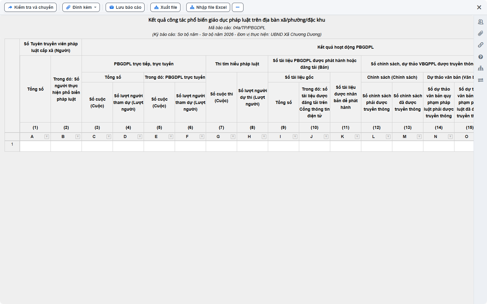
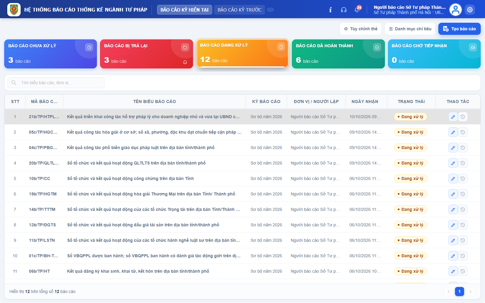
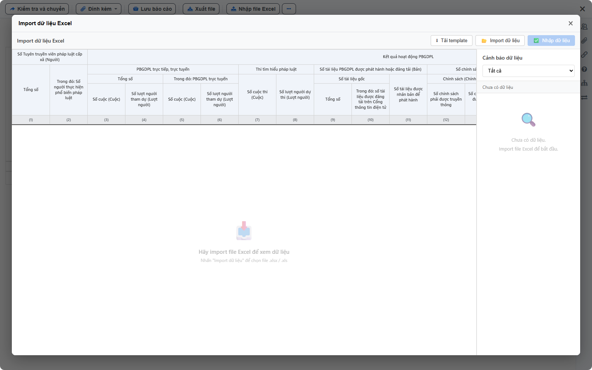
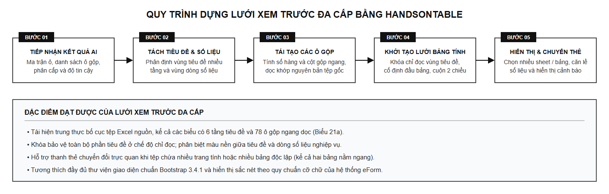
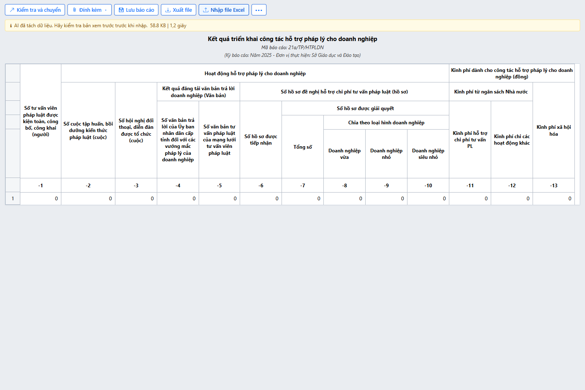
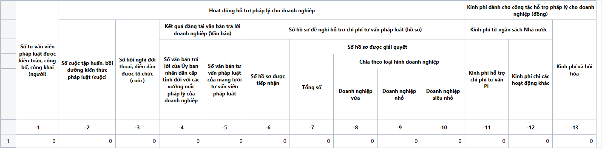

# BÁO CÁO THỰC TẬP TUẦN 8
**HỌP TIẾN ĐỘ DỰ ÁN, CỐ ĐỊNH DANH SÁCH ĐƠN VỊ CẤP XÃ TRÊN BÁO CÁO TỔNG HỢP, XUẤT CÔNG THỨC TEMPLATE EXCEL TỪ NGUỒN DỮ LIỆU BACKEND VÀ DỰNG LƯỚI XEM TRƯỚC ĐA CẤP BẰNG HANDSONTABLE**

---

## BẢNG THÔNG TIN SINH VIÊN VÀ ĐỀ TÀI

| Thông tin | Chi tiết |
|---|---|
| **Sinh viên thực hiện** | **Trần Văn Hoàng** |
| **Mã số sinh viên (MSSV)** | **0034467** |
| **Lớp chuyên ngành** | 67CS – Khóa K67 |
| **Đơn vị thực tập** | Công ty Cổ phần BEDX |
| **Bộ phận công tác** | Trung tâm Nền tảng chuyển đổi số |
| **Cán bộ hướng dẫn tại đơn vị** | **Đào Đức Văn** |
| **Dự án tham gia** | Hệ thống báo cáo điện tử eForm |
| **Đề tài nghiên cứu** | Nghiên cứu và ứng dụng AI xây dựng Module Import file Excel thông minh, tự động ánh xạ dữ liệu cho hệ thống Báo cáo thống kê eForm. |

---

## I. THÔNG TIN CHUNG VÀ KẾ HOẠCH THỰC HIỆN TUẦN 8

Trong tuần thực tập thứ 8, em tiếp tục triển khai công tác kết hợp song song giữa hai trụ cột chính:

- **Trụ cột 1 (Dự án chính eForm BTP):** Báo cáo tiến độ và nhận nhiệm vụ trong phiên họp toàn đội ngũ, tái cấu trúc thủ tục lưu trữ trong cơ sở dữ liệu để cố định 100% danh sách đơn vị cấp xã không bị mất dòng khi chốt số liệu, và hoàn thiện tính năng xuất biểu mẫu Excel mẫu tích hợp sẵn công thức tính toán tự động từ nguồn cấu hình phía máy chủ.
- **Trụ cột 2 (Module AI Import Excel):** Phát triển màn hình xem trước đa cấp bằng lưới bảng tính Handsontable (khắc phục lỗi nạp gói định kiểu giao diện, tái tạo trung thực 6 tầng tiêu đề và 78 ô gộp phức tạp của Biểu 21a, kiểm thử khả năng cuộn hai chiều và định dạng số liệu).

### Bảng tổng hợp công việc Tuần 8

| STT | Nội dung công việc được giao | Kết quả thực hiện | Đánh giá |
|:---:|---|---|:---:|
| **Nhiệm vụ 1** | Họp bàn về tiến độ dự án eForm và nhận nhiệm vụ mới | Đã báo cáo tiến độ tuần 6 và tuần 7, tiếp thu góp ý của đội ngũ và tiếp nhận phân công nhiệm vụ tuần 8, tuần 9. | **Hoàn thành** |
| **Nhiệm vụ 2** | Khắc phục lỗi không cố định danh sách cấp xã làm mất dòng đơn vị chưa nộp khi chốt số | Đã cập nhật các thủ tục lưu trữ tổng hợp sang phép nối ngoài bảo toàn danh mục đơn vị, hiển thị cố định đầy đủ các xã trên báo cáo tổng hợp. | **Hoàn thành** |
| **Nhiệm vụ 3** | Sửa lỗi không xuất công thức tính toán khi tải tệp mẫu trong chức năng nhập Excel | Đã đọc dữ liệu cấu hình biểu mẫu từ máy chủ, nhận diện công thức và dịch chuyển tọa độ dòng, nhúng trực tiếp công thức vào tệp Excel mẫu tải về. | **Hoàn thành** |
| **Nhiệm vụ 4** | Xây dựng màn hình xem trước dữ liệu Excel theo trang và vùng bảng, hỗ trợ cuộn hai chiều và ô gộp | Tích hợp gói định kiểu chuẩn, xây dựng lưới xem trước đa cấp bằng Handsontable, hỗ trợ cuộn ngang/dọc và hiển thị ô gộp chính xác. | **Hoàn thành** |
| **Nhiệm vụ 5** | Kiểm tra hiển thị tiêu đề nhiều tầng, độ rộng cột, chiều cao dòng và giá trị trên bảng xem trước | Hoàn thiện hiển thị 6 tầng tiêu đề và 78 ô gộp của Biểu 21a, căn lề số liệu chuẩn, vượt qua 5/5 ca kiểm thử toàn trình trên giao diện. | **Hoàn thành** |

---

## II. MỤC 1: QUÁ TRÌNH THỰC TẬP TẠI DỰ ÁN CHÍNH CỦA CÔNG TY (HỆ THỐNG eFORM BTP)

### 1. Họp bàn về tiến độ dự án eForm, báo cáo kết quả và tiếp nhận phân công nhiệm vụ

Tại buổi họp giao ban kỹ thuật định kỳ của dự án Hệ thống Báo cáo điện tử eForm Bộ Tư pháp, em đã báo cáo trước Trưởng dự án và nhóm phát triển Trung tâm Nền tảng chuyển đổi số về các đầu việc hoàn thành trong Tuần 6 (xử lý lỗi mất số liệu nhập tay khi tổng hợp lại, phát triển tính năng nhấp đúp mở báo cáo con, rà soát nâng cỡ chữ tối thiểu 14px) và Tuần 7 (khóa các cột quy định trên Biểu 11b, đồng bộ ghi chú thuyết minh khi nộp bổ sung, cố định thứ tự đơn vị theo mã định danh, hoàn thiện luồng tải tệp bất đồng bộ cho Module AI).

Cuộc họp thảo luận sâu hai vấn đề nghiệp vụ cấp thiết phát sinh từ phản ánh tại địa phương: lỗi mất dòng đơn vị chưa nộp khi chốt sổ báo cáo tổng hợp cấp xã và lỗi tệp Excel mẫu tải về không chứa công thức tính tổng tự động. Em được phân công xử lý dứt điểm cả hai bài toán này trong Tuần 8, đồng thời hoàn thiện màn hình xem trước đa cấp cho Module AI Import Excel.

---

### 2. Khắc phục lỗi không cố định danh sách cấp xã dẫn đến mất dòng đơn vị chưa nộp khi chốt số

#### 2.1. Hiện trạng lỗi và tác động nghiệp vụ
Theo quy định thống kê nhà nước, các biểu tổng hợp cấp tỉnh/thành phố bắt buộc phải liệt kê đầy đủ 100% đơn vị hành chính trực thuộc theo đúng danh mục chuẩn, không phân biệt đơn vị đã nộp hay chưa nộp. Tuy nhiên, khi cán bộ bấm chốt số liệu, hệ thống trước đây chỉ giữ lại các dòng của những xã đã có bản ghi nộp, làm biến mất toàn bộ các xã chưa nộp, gây sai lệch thứ tự hành chính và khó khăn cho công tác đôn đốc.

#### 2.2. Nguyên nhân và giải pháp tái cấu trúc thủ tục lưu trữ
Qua truy vết thủ tục tổng hợp trong cơ sở dữ liệu, nguyên nhân gốc rễ là phép nối bảng giữa danh mục đơn vị hành chính và bảng số liệu nộp đang dùng phép nối trong, khiến các đơn vị chưa có bản ghi nộp bị loại bỏ tự động. Em đã thực hiện chuẩn hóa như sau:

- Chuyển toàn bộ mệnh đề liên kết sang phép nối ngoài bên trái lấy danh mục đơn vị hành chính chuẩn làm gốc để bảo toàn 100% số lượng xã trực thuộc.
- Thiết lập giá trị mặc định kèm cờ trạng thái chưa nộp và quy chuẩn hiển thị ký hiệu gạch ngang (`-`) cho các đơn vị chưa nộp, phân biệt rõ với đơn vị đã nộp có số liệu bằng `0`.
- Cố định thứ tự sắp xếp theo mã và thứ tự hành chính chuẩn của danh mục đơn vị.

#### 2.3. Kết quả nghiệm thu và minh chứng thực tế

 
*Hình 1: Giao diện biểu nhập liệu cấp xã (Biểu 04a trên tài khoản Xã Chương Dương) trước khi gửi lên cấp trên.*

 
*Hình 2: Báo cáo tổng hợp sau khi chốt số liệu bảo toàn nguyên vẹn 100% danh sách đơn vị cấp xã, hiển thị rõ trạng thái đơn vị chưa nộp.*

---

### 3. Hoàn thiện tính năng xuất biểu mẫu (Template Excel) tích hợp công thức tính toán tự động

#### 3.1. Hiện trạng và yêu cầu nghiệp vụ
Hệ thống cho phép cán bộ cơ sở tải tệp biểu mẫu Excel trắng về nhập liệu ngoại tuyến. Tuy nhiên trước đây tệp tải về chỉ chứa ô trống tĩnh, không có công thức tính tổng dòng, tổng cột hay quan hệ chéo giữa các chỉ tiêu, buộc cán bộ phải cộng tay và dễ phát sinh sai sót số học.

#### 3.2. Nguyên nhân và giải pháp cải tiến
Bộ sinh tệp mẫu cũ chỉ tạo cố định một số dòng trống đơn thuần mà bỏ qua dữ liệu cấu hình nghiệp vụ và danh sách công thức đã thiết lập sẵn phía máy chủ. Em đã cải tiến cơ chế xuất mẫu biểu theo bốn bước:

- Đọc trực tiếp dữ liệu cấu hình biểu mẫu từ nguồn dữ liệu máy chủ để lấy đúng đầy đủ các dòng chỉ tiêu thực tế.
- Nhận diện các ô chứa chuỗi công thức toán học (bắt đầu bằng dấu `=`).
- Tự động tính khoảng dịch chuyển tọa độ dòng theo số dòng tiêu đề của biểu mẫu nhằm chuyển đổi tham chiếu công thức sang đúng vị trí trên tệp Excel kết xuất.
- Gán thuộc tính công thức bảng tính cho ô công thức, kiểu số cho ô số liệu và chuẩn hóa phông chữ Times New Roman cỡ 14pt toàn biểu.

#### 3.3. Kết quả nghiệm thu và minh chứng thực tế

 
*Hình 3: Giao diện chức năng Nhập file Excel với nút tải tệp mẫu đã được tích hợp đầy đủ công thức tính toán tự động.*

---

## III. MỤC 2: NGHIÊN CỨU VÀ PHÁT TRIỂN MODULE AI IMPORT EXCEL THÔNG MINH

### 4. Dựng lưới xem trước dữ liệu Excel đa cấp bằng Handsontable

#### 4.1. Khắc phục lỗi nạp gói định kiểu giao diện
Ngay đầu Tuần 8, em đã bổ sung liên kết nạp gói định kiểu chuẩn vào phần đầu trang giao diện nhập liệu và chuẩn hóa khung chứa bố cục, xử lý dứt điểm lỗi co giật khung lưới ghi nhận ở cuối Tuần 7.

#### 4.2. Hiện thực hóa lưới xem trước đa cấp
- Chuyển đổi chính xác tọa độ các ô gộp từ đầu ra JSON 2.0 của dịch vụ AI sang cấu trúc gộp dòng/cột của Handsontable.
- Ghim cố định các dòng tiêu đề phía trên để cán bộ cuộn xem hàng trăm dòng số liệu mà không mất ngữ cảnh chỉ tiêu.
- Bật thanh cuộn hai chiều mượt mà và khóa chế độ chỉ đọc cho toàn bộ vùng tiêu đề để tránh vô tình sửa hỏng cấu trúc cột.

 
*Hình 4: Sơ đồ quy trình tiếp nhận kết quả bóc tách AI và tái cấu trúc lưới bảng tính đa cấp trên giao diện web.*

 
*Hình 5: Toàn cảnh giao diện xem trước Biểu 21a tái hiện trung thực 6 tầng tiêu đề cha–con và 78 ô gộp phức tạp.*

---

### 5. Thẩm định hiển thị nhiều tầng tiêu đề, căn lề số liệu và kiểm thử tự động

Thử nghiệm trên Biểu 21a (13 cột chỉ tiêu, 6 tầng tiêu đề, 78 ô gộp) cho thấy toàn bộ ô gộp hiển thị nguyên vẹn không vỡ khung; cột nhãn chỉ tiêu tự động co giãn đủ rộng để không cắt chữ; cột số liệu căn lề phải rõ ràng; thanh siêu dữ liệu và thanh điều hướng phân cấp hiển thị đầy đủ ngữ cảnh chỉ tiêu cha–con.

 
*Hình 6: Chi tiết vùng số liệu và thông tin siêu dữ liệu ánh xạ hiển thị trên lưới xem trước Handsontable.*

| Mã kiểm thử | Nội dung ca kiểm thử tự động | Chi tiết kỹ thuật ghi nhận | Kết quả |
|:---:|---|---|:---:|
| **T8.01** | Kiểm tra nạp gói định kiểu chuẩn trên trang | Khung chứa và nút chức năng hiển thị ổn định, đúng bố cục eForm | **ĐẠT** |
| **T8.02** | Kiểm tra trạng thái sẵn sàng của dịch vụ AI | Dịch vụ AI phản hồi trạng thái sẵn sàng, kết nối thông suốt | **ĐẠT** |
| **T8.03** | Dựng lưới Handsontable đa cấp từ kết quả AI | Định vị chính xác vùng bảng, hiển thị đủ dòng tiêu đề và số liệu | **ĐẠT** |
| **T8.04** | Tái tạo tiêu đề nhiều tầng và ô gộp giống tệp gốc | Tái tạo chuẩn xác 78 ô gộp của Biểu 21a không lỗi hình học | **ĐẠT** |
| **T8.05** | Hiển thị số liệu và siêu dữ liệu bóc tách lên lưới | Căn lề số liệu chuẩn, thông tin vùng bảng và độ tin cậy đầy đủ | **ĐẠT** |

---

## IV. TỔNG KẾT TUẦN 8 VÀ KẾ HOẠCH TUẦN 9

### 1. Đánh giá kết quả và kinh nghiệm rút ra
Em đã hoàn thành 100% các đầu việc Tuần 8 trên cả hai mảng: giải quyết triệt để bài toán cố định danh mục cấp xã khi chốt số và nhúng công thức tự động vào tệp mẫu Excel cho hệ thống eForm BTP, đồng thời hoàn thiện lưới xem trước đa cấp Handsontable vượt qua 5/5 ca kiểm thử tự động.

### 2. Kế hoạch công tác Tuần 9
- Tối ưu hiệu năng mở biểu tổng hợp bằng cách tích hợp bộ nhớ đệm phân tán Redis sẵn có trong hạ tầng hệ thống.
- Biên soạn bộ danh mục kịch bản kiểm thử toàn diện quy trình nhập, duyệt, trả lại và tổng hợp báo cáo đa cấp bàn giao cho đội ngũ kiểm thử.
- Cấu hình biểu mẫu, luồng phê duyệt và khởi tạo tài khoản cho 3 khối đơn vị chuyên môn (Hành chính tư pháp, Hợp tác quốc tế, Đăng ký và bồi thường nhà nước) trên cổng quản trị; dọn dẹp dữ liệu thử nghiệm trên máy chủ vận hành.
- Thu gọn giao diện Module AI Import Excel, hoàn thiện thao tác chỉnh sửa trực tiếp trên lưới xem trước kèm truy vết ô đã sửa và cơ chế hoàn tác trước khi chuyển sang bước đối soát ghép biểu.
