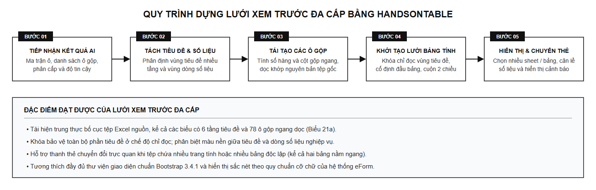
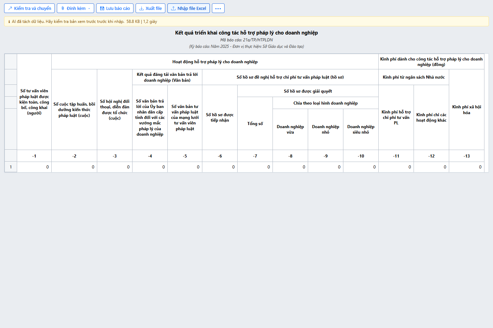
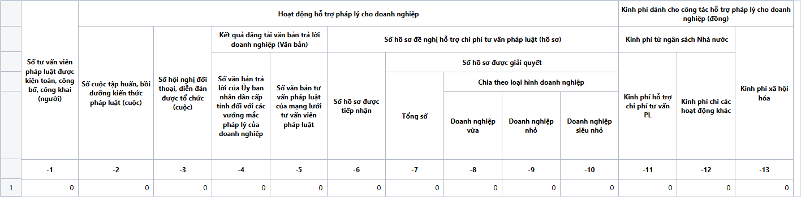

# TÀI LIỆU THIẾT KẾ LƯỚI XEM TRƯỚC BẢNG TÍNH ĐA CẤP (HANDSONTABLE)

**Đề tài:** Module AI Import file Excel thông minh cho Hệ thống Báo cáo thống kê eForm BTP 
**Giai đoạn:** Tuần 8

---

## 1. Yêu cầu nghiệp vụ đối với màn hình xem trước

Các biểu mẫu thống kê ngành Tư pháp thường có chiều rộng lớn (từ 10 đến trên 25 cột), tiêu đề lồng nhau từ 3 đến 6 tầng và chứa hàng chục ô gộp ngang dọc. Nếu chỉ hiển thị dạng bảng phẳng thông thường, cán bộ sẽ rất khó đối chiếu xem số liệu bóc tách có đúng với tệp Excel gốc hay không. Vì vậy, màn hình xem trước được xây dựng bằng thư viện lưới bảng tính tương tác **Handsontable** nhằm tái hiện trung thực hình thái biểu mẫu gốc ngay trên trình duyệt.

---

## 2. Các cơ chế hiển thị trọng tâm

- **Tái tạo chính xác ô gộp tiêu đề nhiều tầng:** Chuyển đổi danh sách vùng gộp từ dữ liệu JSON 2.0 sang ma trận lưới hiển thị, bảo toàn nguyên vẹn cấu trúc nhóm chỉ tiêu cha–con mà không bị xô lệch cột.
- **Ghim cố định vùng tiêu đề khi cuộn:** Cố định toàn bộ các dòng tiêu đề phía trên và hỗ trợ cuộn ngang/cuộn dọc mượt mà khi biểu mẫu có hàng trăm dòng số liệu.
- **Khóa vùng tiêu đề, cho phép rà soát số liệu:** Khóa chế độ chỉ đọc đối với khu vực tiêu đề để tránh làm hỏng cấu trúc cột, đồng thời căn lề phải chuẩn xác các cột số liệu.
- **Hỗ trợ đa bảng bằng thẻ chuyển đổi:** Khi tệp Excel chứa nhiều bảng (như bảng chính và bảng phụ đặt song song hoặc bên dưới), giao diện tự động sinh các thẻ chọn bảng kèm tọa độ vùng bảng để người dùng kiểm tra và chọn đúng bảng cần nhập.
- **Hiển thị siêu dữ liệu và cảnh báo cấu trúc:** Thanh thông tin phía trên lưới thể hiện rõ tên tệp, trang tính, tọa độ vùng bảng, số dòng tiêu đề, số dòng số liệu, độ tin cậy của mô hình và các cảnh báo cấu trúc cần lưu ý.

---

## 3. Minh chứng giao diện thực tế

 
*Hình 1: Toàn cảnh lưới xem trước tái hiện đầy đủ 6 tầng tiêu đề và 78 ô gộp của Biểu 21a.*

 
*Hình 2: Khu vực số liệu được căn lề chuẩn xác cùng thanh thông số vùng bảng và độ tin cậy.*
