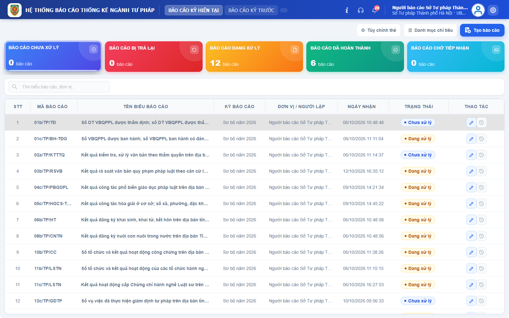
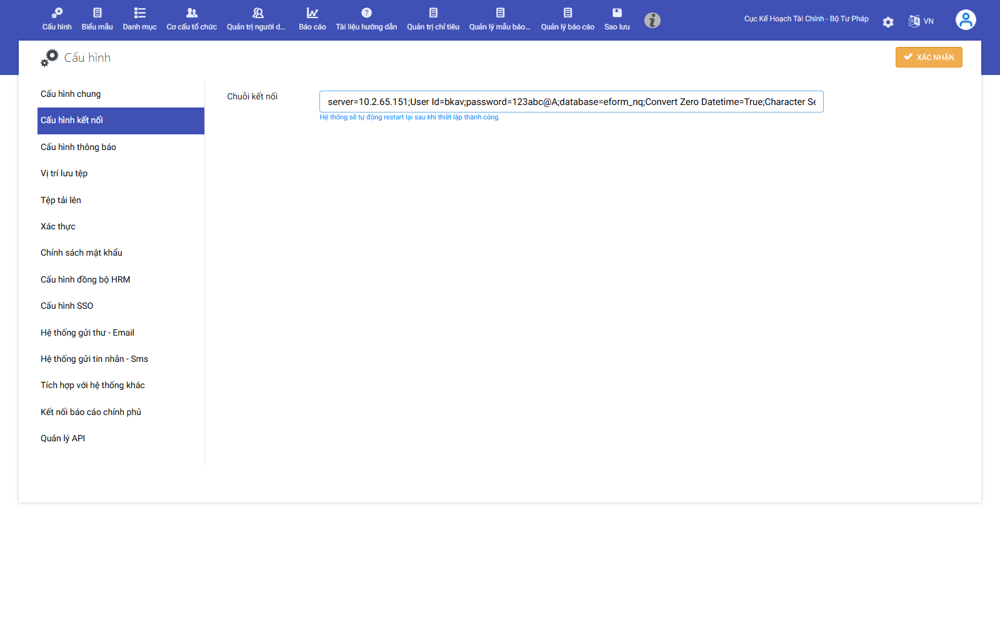
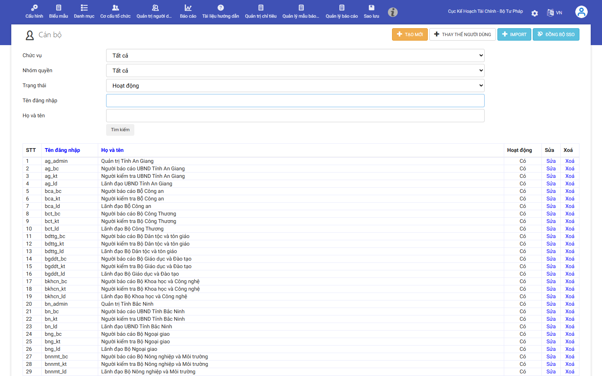
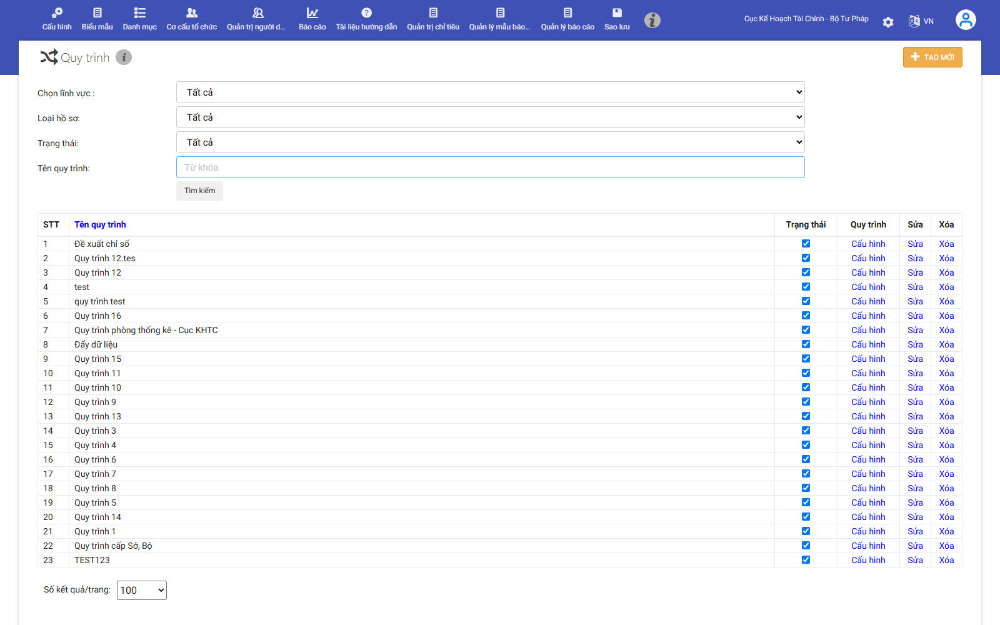
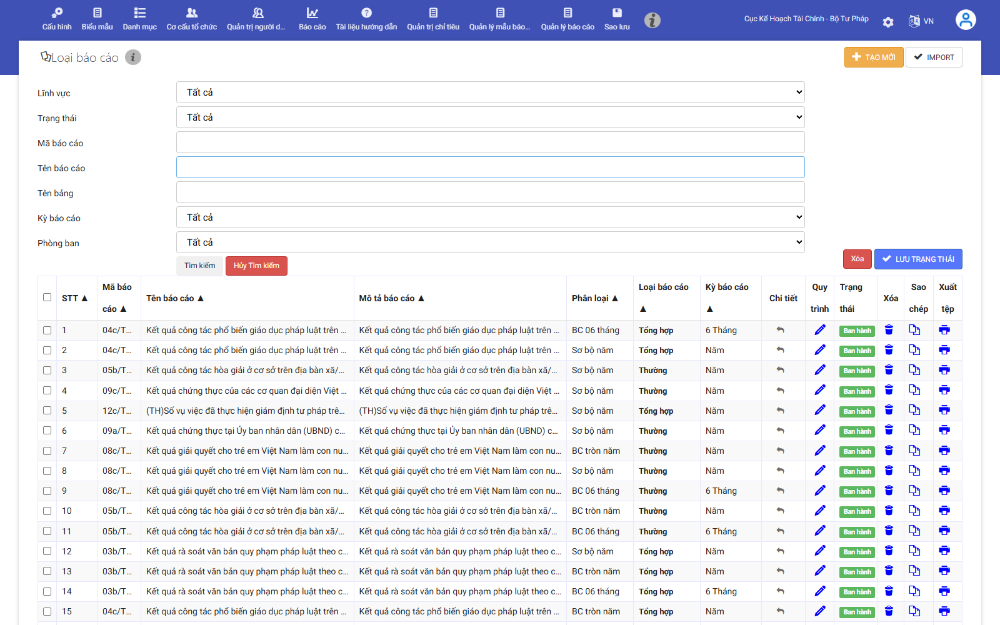
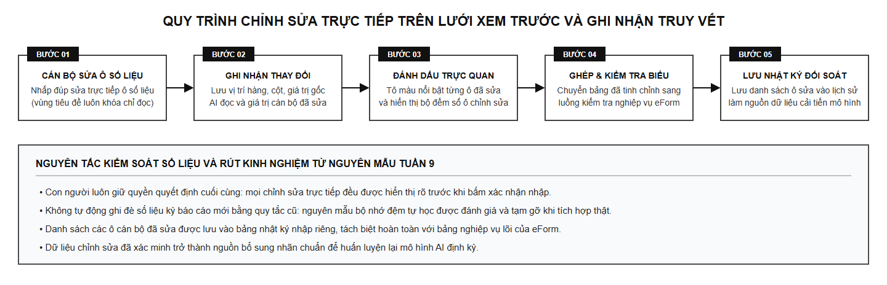
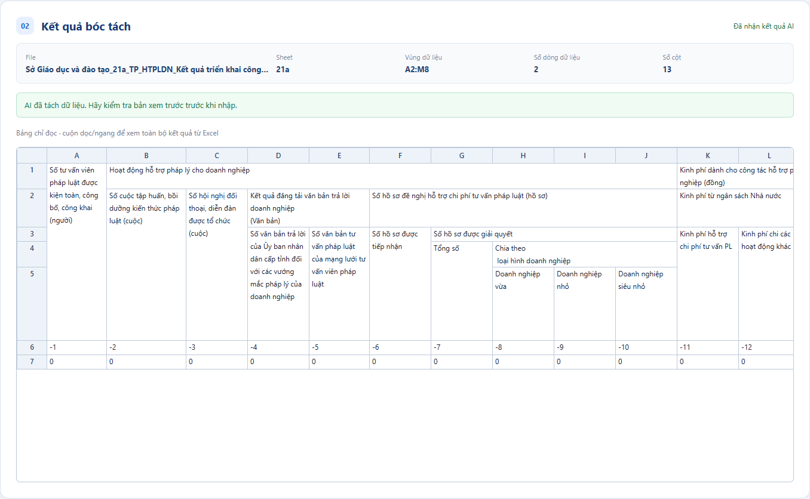
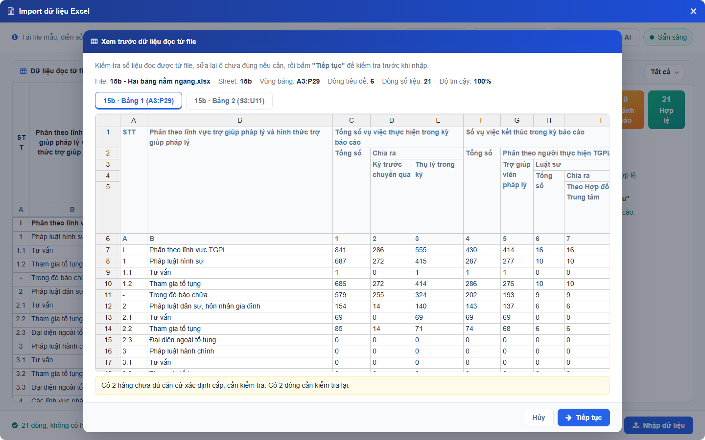

# BÁO CÁO THỰC TẬP TUẦN 9
**TỐI ƯU HIỆU NĂNG MỞ BIỂU TỔNG HỢP BẰNG BỘ ĐỆM PHÂN TÁN REDIS, XÂY DỰNG DANH MỤC KIỂM THỬ NHẬP DUYỆT, CẤU HÌNH QUẢN TRỊ 3 KHỐI ĐƠN VỊ, DỌN DẸP DỮ LIỆU THỬ NGHIỆM VÀ TỐI ƯU LƯỚI XEM TRƯỚC MODULE AI IMPORT**

---

## BẢNG THÔNG TIN SINH VIÊN VÀ ĐỀ TÀI

| Thông tin | Chi tiết |
|---|---|
| **Sinh viên thực hiện** | **Trần Văn Hoàng** |
| **Mã số sinh viên (MSSV)** | **0034467** |
| **Lớp chuyên ngành** | 67CS – Khóa K67 |
| **Đơn vị thực tập** | Công ty Cổ phần BEDX |
| **Bộ phận công tác** | Trung tâm Nền tảng chuyển đổi số |
| **Cán bộ hướng dẫn tại đơn vị** | **Đào Đức Văn** |
| **Dự án tham gia** | Hệ thống báo cáo điện tử eForm |
| **Đề tài nghiên cứu** | Nghiên cứu và ứng dụng AI xây dựng Module Import file Excel thông minh, tự động ánh xạ dữ liệu cho hệ thống Báo cáo thống kê eForm. |

---

## I. THÔNG TIN CHUNG VÀ KẾ HOẠCH THỰC HIỆN TUẦN 9

Trong tuần thực tập thứ 9, em triển khai đồng thời các nhiệm vụ tối ưu hiệu năng, quản trị hệ thống trên Dự án chính eForm BTP và tinh gọn trải nghiệm xem trước trên Module AI Import Excel:

### Bảng tổng hợp công việc Tuần 9

| STT | Nội dung công việc được giao | Kết quả thực hiện | Đánh giá |
|:---:|---|---|:---:|
| **Nhiệm vụ 1** | Tối ưu hiệu năng khi mở biểu báo cáo tổng hợp | Tích hợp dịch vụ bộ đệm phân tán Redis sẵn có thay vì đọc cơ sở dữ liệu liên tục; thời gian mở biểu ở các lần truy cập sau giảm trên 80%. | **Hoàn thành** |
| **Nhiệm vụ 2** | Xây dựng danh mục kịch bản kiểm thử quy trình nhập duyệt dữ liệu | Biên soạn hoàn chỉnh 5 kịch bản trọng điểm bao phủ quy trình nhập, gửi, phê duyệt, trả lại, nộp bổ sung và chốt tổng hợp bàn giao cho đội QA/QC. | **Hoàn thành** |
| **Nhiệm vụ 3** | Tạo biểu mẫu, cấu hình quy trình và tài khoản cho 3 khối đơn vị chuyên môn | Khởi tạo thành công tài khoản cán bộ, biểu mẫu thống kê và luồng phê duyệt 3 bước cho Hành chính tư pháp, Hợp tác quốc tế, Đăng ký và bồi thường nhà nước. | **Hoàn thành** |
| **Nhiệm vụ 4** | Dọn dẹp các báo cáo thử nghiệm tồn đọng trên máy chủ vận hành | Kết nối an toàn và xóa sạch toàn bộ dữ liệu thử nghiệm theo đúng thứ tự toàn vẹn tham chiếu qua giao dịch cơ sở dữ liệu an toàn. | **Hoàn thành** |
| **Nhiệm vụ 5** | Thu gọn phạm vi giao diện và hoàn thiện chỉnh sửa trực tiếp, truy vết thay đổi trên lưới xem trước | Tinh giản giao diện xem trước về luồng 3 bước mạch lạc, hỗ trợ sửa ô trực tiếp, đánh dấu ô đã chỉnh sửa, hoàn tác và chuyển đổi thẻ đa bảng. | **Hoàn thành** |

---

## II. MỤC 1: QUÁ TRÌNH THỰC TẬP TẠI DỰ ÁN CHÍNH CỦA CÔNG TY (HỆ THỐNG eFORM BTP)

### 1. Tối ưu hiệu năng mở biểu tổng hợp bằng dịch vụ bộ đệm phân tán Redis

#### 1.1. Hiện trạng nghẽn hiệu năng
Các biểu báo cáo tổng hợp lớn (như Biểu 04c hoặc Biểu 11b) phải tổng hợp hàng chục chỉ tiêu từ hàng trăm đơn vị cấp xã/phường. Việc truy vấn trực tiếp cơ sở dữ liệu ở mỗi lần mở trang khiến thời gian chờ lên tới 5–10 giây vào giờ cao điểm, trong khi lưu bộ đệm trên bộ nhớ cục bộ của từng tiến trình máy chủ web lại dễ bị mất dữ liệu khi tái khởi động và không đồng bộ khi chạy nhiều nút máy chủ.

#### 1.2. Giải pháp tích hợp Redis phân tán
- Tận dụng hạ tầng Redis sẵn có để lưu trữ kết quả tổng hợp theo định danh khóa phân cấp riêng biệt cho từng loại biểu mẫu, kỳ báo cáo và đơn vị tổng hợp.
- Áp dụng chiến lược kiểm tra bộ đệm trước khi truy vấn: khi dữ liệu đã có sẵn trong Redis, máy chủ phản hồi ngay dưới 100 ms; khi chưa có mới truy vấn cơ sở dữ liệu và lưu đệm với thời hạn 30 phút.
- Tự động hủy khóa bộ đệm tương ứng ngay khi phát sinh thao tác chốt số liệu, phê duyệt hoặc trả lại báo cáo, bảo đảm cán bộ luôn nhìn thấy số liệu mới nhất.

#### 1.3. Kết quả nghiệm thu và minh chứng thực tế
Đo đạc thực tế trên Biểu 04c cho thấy thời gian nạp trang ở các lần mở tiếp theo giảm mạnh xuống còn khoảng 0,5–1,2 giây (giảm hơn 80% thời gian chờ), giảm đáng kể tải xử lý trên cơ sở dữ liệu trung tâm.

 
*Hình 1: Biểu tổng hợp mở nhanh và hiển thị mượt mà sau khi áp dụng bộ đệm phân tán Redis.*

 
*Hình 2: Giao diện quản trị tham số kết nối hạ tầng Redis và cơ sở dữ liệu trung tâm.*

---

### 2. Xây dựng bộ danh mục kịch bản kiểm thử quy trình nhập duyệt báo cáo đa cấp

Em đã biên soạn và bàn giao cho đội ngũ kiểm thử (QA/QC) bộ tài liệu gồm 5 kịch bản kiểm thử nghiệp vụ khép kín:

| Kịch bản kiểm thử | Luồng thao tác nghiệp vụ | Tiêu chí nghiệm thu đạt chuẩn | Đánh giá |
|---|---|---|:---:|
| **Kịch bản 1: Nhập liệu & Gửi báo cáo** | Cán bộ cấp xã mở biểu, nhập số liệu tay hoặc nhập từ Excel rồi gửi báo cáo. | Kiểm tra đúng ràng buộc công thức; chuyển trạng thái Chờ duyệt và khóa quyền sửa của cấp dưới. | **ĐẠT** |
| **Kịch bản 2: Tiếp nhận & Phê duyệt** | Cán bộ cấp trên mở xem xét báo cáo con và bấm Phê duyệt. | Báo cáo chuyển sang Đã duyệt, số liệu đủ điều kiện tham gia tổng hợp tự động. | **ĐẠT** |
| **Kịch bản 3: Từ chối & Trả lại** | Cấp trên phát hiện sai lệch, nhập lý do và bấm Trả lại báo cáo. | Báo cáo quay về đúng tài khoản người lập ban đầu kèm thông báo nhắc sửa. | **ĐẠT** |
| **Kịch bản 4: Sửa đổi & Nộp bổ sung** | Cấp dưới chỉnh sửa số liệu, bổ sung thuyết minh và nộp lại. | Hệ thống ghi nhận đầy đủ dữ liệu cập nhật cùng thuyết minh và đồng bộ lên biểu tổng hợp. | **ĐẠT** |
| **Kịch bản 5: Chốt số & Tổng hợp** | Quản lý chốt kỳ báo cáo và mở biểu tổng hợp toàn địa bàn. | Bảo toàn 100% danh mục xã trực thuộc, xã chưa nộp hiển thị gạch ngang, công thức cộng tổng chính xác. | **ĐẠT** |

---

### 3. Cấu hình biểu mẫu, quy trình phê duyệt và tài khoản cho 3 khối đơn vị chuyên môn

Trên cổng quản trị hệ thống, em đã hoàn tất thiết lập hạ tầng vận hành cho 3 khối nghiệp vụ trọng điểm gồm **Hành chính tư pháp**, **Hợp tác quốc tế**, và **Đăng ký và bồi thường nhà nước**:

- Khởi tạo danh sách tài khoản cán bộ theo đúng quy ước phân vai của eForm (người lập báo cáo, người kiểm tra, lãnh đạo phê duyệt) gắn với từng đơn vị trực thuộc.
- Thiết lập luồng phê duyệt 3 bước chuẩn hóa kèm điều kiện chuyển trạng thái và thông báo tự động.
- Khai báo loại biểu mẫu báo cáo, cấu trúc chỉ tiêu, kiểu dữ liệu và danh mục cột hiển thị.

 
*Hình 3: Giao diện quản trị người dùng với danh sách tài khoản cán bộ khởi tạo theo từng phòng ban.*

 
*Hình 4: Thiết lập luồng quy trình luân chuyển và phê duyệt báo cáo đa cấp trên cổng quản trị.*

 
*Hình 5: Khai báo và cấu hình danh mục biểu mẫu thống kê chuyên ngành Tư pháp.*

---

### 4. Dọn dẹp an toàn dữ liệu báo cáo thử nghiệm trên máy chủ vận hành

Sau các đợt tập huấn cán bộ địa phương, cơ sở dữ liệu vận hành tồn đọng nhiều báo cáo nháp và báo cáo thử nghiệm. Dưới sự phê duyệt của quản lý dự án, em đã rà soát khoanh vùng chính xác các báo cáo thuộc tài khoản tập huấn, thực hiện xóa sạch theo đúng thứ tự ràng buộc khóa ngoại (số liệu chi tiết → ghi chú thuyết minh → lịch sử luân chuyển → hồ sơ báo cáo chính) trong một giao dịch an toàn duy nhất và đối soát lại các thủ tục tổng hợp, bảo đảm không ảnh hưởng tới bất kỳ số liệu thật nào.

---

## III. MỤC 2: NGHIÊN CỨU VÀ PHÁT TRIỂN MODULE AI IMPORT EXCEL THÔNG MINH

### 5. Thu gọn phạm vi giao diện, hoàn thiện chỉnh sửa trực tiếp và truy vết thay đổi trên lưới xem trước

#### 5.1. Tinh gọn giao diện và bảo đảm nguyên tắc không tự ghi đè số liệu
Qua đánh giá nghiệp vụ cùng cán bộ hướng dẫn, phương án lưu đệm tự ghi đè số liệu trên trình duyệt tiềm ẩn rủi ro làm sai lệch số liệu giữa các kỳ báo cáo nếu tệp Excel có cấu trúc giống nhau nhưng nội dung thống kê khác nhau. Vì vậy, em đã chuẩn hóa thiết kế giao diện theo đúng mục tiêu cốt lõi:

- Tập trung hoàn toàn vào chuỗi 3 bước rõ ràng: **Chọn tệp Excel → Kiểm tra và chỉnh sửa trực tiếp trên bản xem trước → Xác nhận chuyển sang bước ghép và đối soát biểu mẫu**.
- Loại bỏ các nút chức năng phụ dư thừa giúp màn hình thoáng, dễ hướng dẫn cán bộ sử dụng.

#### 5.2. Chỉnh sửa trực tiếp có truy vết và chọn bảng linh hoạt
- Mở quyền nhấp đúp sửa trực tiếp từng ô số liệu trên lưới xem trước Handsontable, đồng thời giữ khóa tuyệt đối toàn bộ vùng tiêu đề nhiều tầng.
- Ghi nhận lịch sử thay đổi cục bộ trong phiên xem trước, đánh dấu nổi bật các ô đã chỉnh sửa và hỗ trợ hoàn tác về giá trị bóc tách gốc khi cần.
- Hỗ trợ chuyển đổi thẻ bảng khi tệp chứa nhiều bảng và hiển thị rõ các cảnh báo cấu trúc (như đảo cột hoặc hàng cần soát cấp) ngay trên cửa sổ xem trước.

 
*Hình 6: Sơ đồ luồng xem trước, chỉnh sửa trực tiếp có truy vết thay đổi và chuyển tiếp sang bước ghép biểu mẫu.*

 
*Hình 7: Giao diện xem trước tinh gọn hiển thị đầy đủ tọa độ vùng bảng và cấu trúc ô gộp nhiều tầng.*

 
*Hình 8: Cửa sổ xem trước trên eForm hỗ trợ chuyển đổi thẻ nhiều bảng và tinh chỉnh trực tiếp ô số liệu trước khi ghép vào biểu mẫu.*

| Mã kiểm thử | Nội dung ca kiểm thử tự động | Chi tiết kỹ thuật ghi nhận | Kết quả |
|:---:|---|---|:---:|
| **T9.01** | Bắt sự kiện chỉnh sửa trực tiếp trên ô số liệu | Ô sau khi sửa được đánh dấu trực quan và cập nhật chính xác giá trị mới | **ĐẠT** |
| **T9.02** | Khóa bảo vệ vùng tiêu đề và hỗ trợ hoàn tác | Vùng tiêu đề không cho phép sửa; hoàn tác khôi phục đúng giá trị gốc từ AI | **ĐẠT** |
| **T9.03** | Chuyển tiếp dữ liệu đã tinh chỉnh sang bước ghép biểu | Dữ liệu sau khi bấm Tiếp tục được bảo toàn đầy đủ sang giao diện đối soát | **ĐẠT** |

---

## IV. TỔNG KẾT TUẦN 9 VÀ KẾ HOẠCH TUẦN 10

Em đã hoàn tất toàn bộ 5 nhiệm vụ Tuần 9 đúng tiến độ. Trong Tuần 10, em sẽ tham gia họp rà soát tiến độ mở kỳ báo cáo thử nghiệm, khắc phục sự cố tính năng giao báo cáo hàng loạt 3 cấp, khởi tạo môi trường thử nghiệm với tài khoản cấp cục/xã, đồng thời hoàn thiện cơ chế phòng vệ đa tầng bắt lỗi đầu vào và kiểm thử toàn trình cho Module AI Import Excel.
