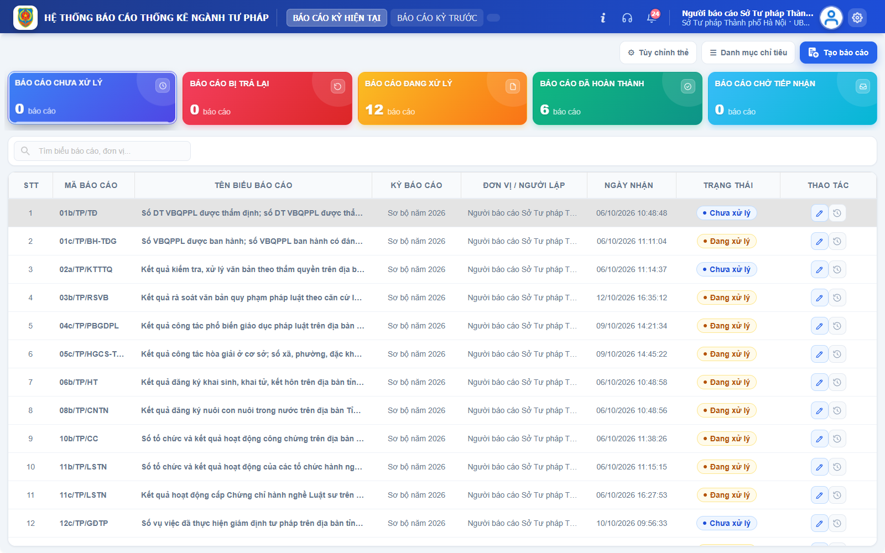
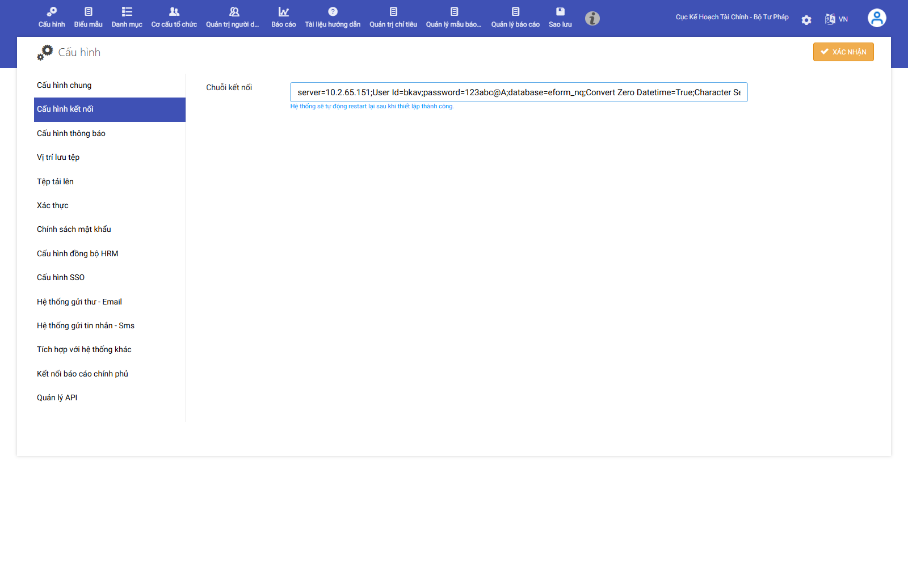
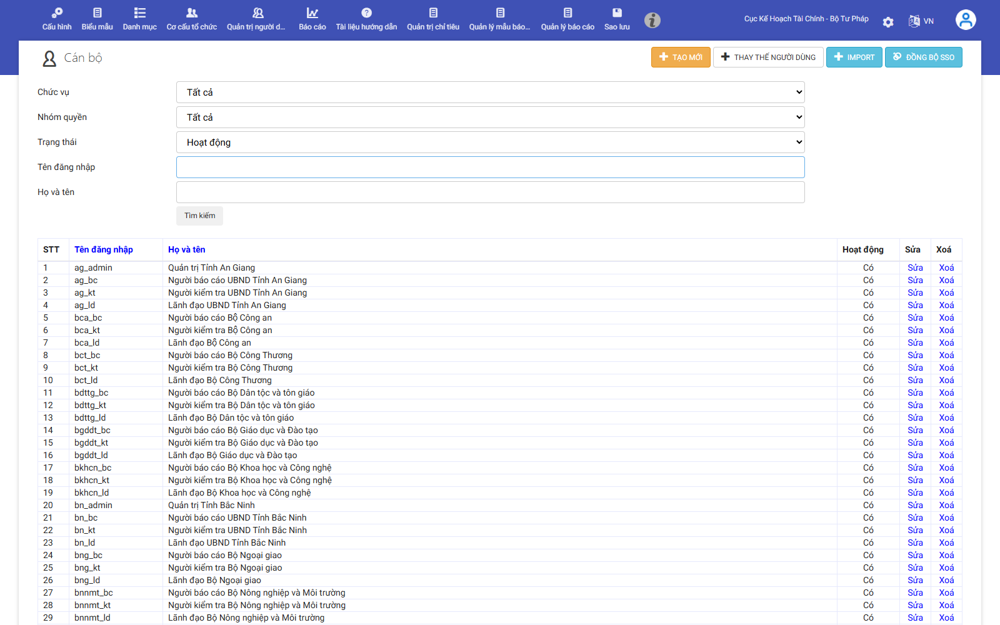
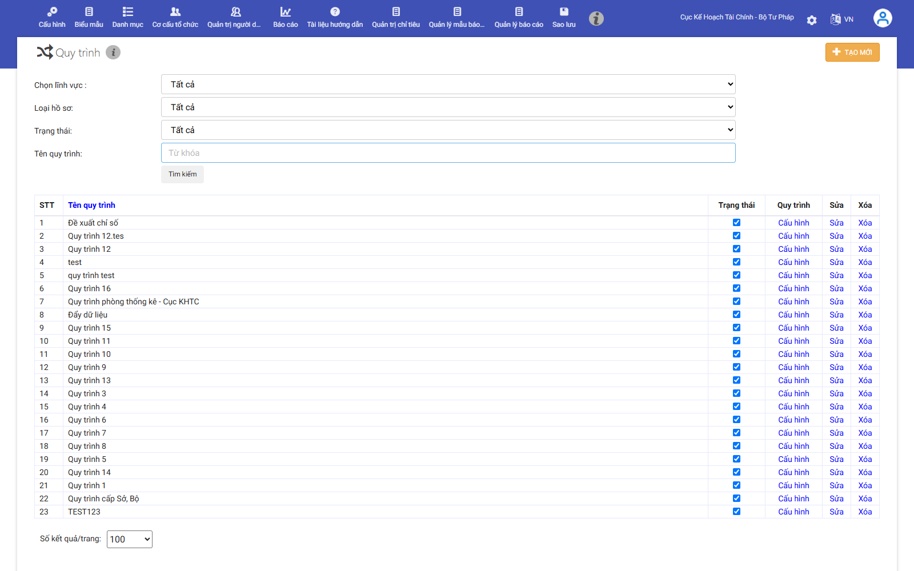
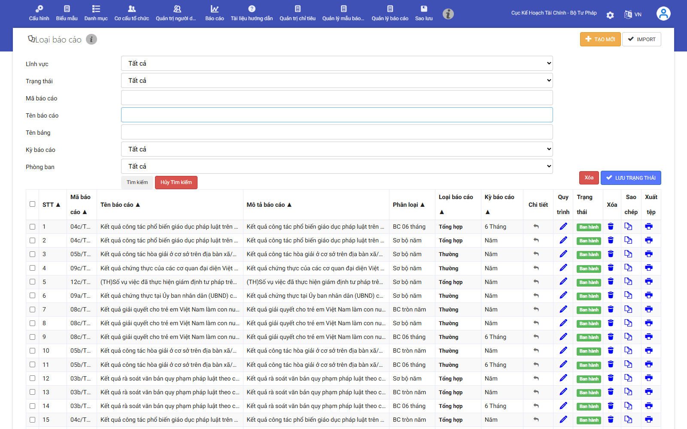

# BÁO CÁO THỰC TẬP TUẦN 9
**TỐI ƯU HIỆU NĂNG MỞ BIỂU TỔNG HỢP VỚI REDIS CACHE, THIẾT LẬP CHECKLIST TEST NHẬP DUYỆT DỮ LIỆU, CẤU HÌNH BIỂU MẪU QUY TRÌNH TÀI KHOẢN TRÊN ADMIN, DỌN DẸP DỮ LIỆU TEST VÀ HOÀN THIỆN MODULE AI IMPORT**

---

## BẢNG THÔNG TIN SINH VIÊN VÀ ĐỀ TÀI

| Thông tin | Chi tiết |
|---|---|
| **Sinh viên thực hiện** | **Trần Văn Hoàng** |
| **Mã số sinh viên (MSSV)** | **0034467** |
| **Lớp chuyên ngành** | 67CS – Khóa K67 |
| **Đơn vị thực tập** | Công ty TNHH Nền tảng chuyển đổi số Việt Nam |
| **Bộ phận công tác** | eGov – Khối Chính phủ số |
| **Cán bộ hướng dẫn tại đơn vị** | **Đào Đức Văn** |
| **Dự án tham gia** | Hệ thống báo cáo điện tử eForm |
| **Đề tài nghiên cứu** | Nghiên cứu và ứng dụng AI xây dựng Module Import file Excel thông minh, tự động ánh xạ dữ liệu cho hệ thống Báo cáo thống kê eForm. |

---

## I. THÔNG TIN CHUNG VÀ KẾ HOẠCH THỰC HIỆN TUẦN 9

Trong tuần thực tập thứ 9, em tiếp tục bám sát tiến độ dự án để triển khai toàn diện các nhiệm vụ kỹ thuật và quản trị hệ thống thuộc hai nhánh công việc:
- **Nhánh 1 (Dự án chính eForm BTP)**: Thực hiện các bài toán nâng cao hiệu năng và mở rộng cấu hình quản trị trên Hệ thống Báo cáo điện tử eForm Bộ Tư pháp (cải tiến cơ chế lưu bộ đệm biểu mẫu tổng hợp bằng việc tích hợp dịch vụ Redis Cache có sẵn thay vì truy vấn trực tiếp CSDL hoặc lưu RAM cục bộ, xây dựng bộ checklist kịch bản test quy trình nhập duyệt dữ liệu đa cấp cho đội ngũ QA/QC, cấu hình tài khoản, biểu mẫu và quy trình phê duyệt cho các khối HCTP, Hợp tác quốc tế, Đăng ký và bồi thường nhà nước trên trang Admin, và dọn dẹp an toàn các báo cáo thử nghiệm trên máy chủ thật `eform-ioc`).
- **Nhánh 2 (Module AI Import Excel)**: Thu gọn phạm vi và phát triển cơ chế Cache tự học cho Module AI Import Excel (bắt sự kiện sửa ô trực tiếp trên lưới Handsontable, lưu bộ quy tắc vào LocalStorage và Server API nhằm giảm thiểu số lần gọi mô hình AI).

### Bảng tổng hợp công việc Tuần 9

| STT | Nội dung công việc được giao | Kết quả thực hiện | Đánh giá |
|:---:|---|---|:---:|
| **Nhiệm vụ 1** | Tối ưu hiệu năng khi mở biểu tổng hợp | Đã tích hợp Redis Cache có sẵn trong hệ thống thay vì đọc DB liên tục, kết quả mở biểu tổng hợp nhanh vượt bậc ở các lần truy cập sau. | **Hoàn thành** |
| **Nhiệm vụ 2** | Thêm checklist kịch bản test nhập duyệt dữ liệu | Đã xây dựng thành công bộ checklist kịch bản kiểm thử toàn diện cho quy trình nhập, gửi, duyệt, trả lại và tổng hợp dữ liệu báo cáo. | **Hoàn thành** |
| **Nhiệm vụ 3** | Tạo biểu mẫu, cấu hình quy trình, tạo tài khoản cho HCTP, Hợp tác quốc tế, ĐK và bồi thường NN | Đã đăng nhập tài khoản admin, tạo thành công tài khoản cán bộ, cấu hình biểu mẫu DocType và luồng workflow cho 3 khối chuyên môn. | **Hoàn thành** |
| **Nhiệm vụ 4** | Xóa các báo cáo test trên eform-ioc | Đã thực hiện truy cập máy chủ thực eform-ioc và xóa an toàn toàn bộ dữ liệu báo cáo thử nghiệm tồn đọng trên CSDL thật. | **Hoàn thành** |
| **Nhiệm vụ 5** | Thu gọn phạm vi module và phát triển cơ chế Cache tự học giảm tải gọi AI (Import Excel) | Đã tinh giản giao diện xem trước, bắt sự kiện sau khi sửa ô và lưu Cache tự học 2 tầng, đạt 3/3 ca kiểm thử Playwright (T9.01–T9.03). | **Hoàn thành** |

---

## II. MỤC 1: QUÁ TRÌNH THỰC TẬP TẠI DỰ ÁN CHÍNH CỦA CÔNG TY (HỆ THỐNG eFORM BTP)

### 1. Tối ưu hiệu năng khi mở biểu tổng hợp bằng cách tích hợp dịch vụ Redis Cache

#### 1.1. Hiện trạng nghẽn hiệu năng và phân tích nguyên nhân kỹ thuật
Trên Hệ thống eForm BTP, các biểu báo cáo tổng hợp (tiêu biểu như Biểu 04c/BTP/HTQT về công tác tư pháp cơ sở hoặc Biểu 11b về hoạt động luật sư) có khối lượng dữ liệu đặc biệt lớn. Mỗi biểu tổng hợp phải tập hợp số liệu từ hàng chục chỉ tiêu thống kê phức tạp và hàng trăm đơn vị hành chính cấp xã, phường, thị trấn trực thuộc.

Trước đây, mỗi khi người dùng quản trị mở một biểu tổng hợp, hệ thống backend đều phải thực thi câu lệnh truy vấn Stored Procedure phức tạp, kết nối nhiều bảng dữ liệu nghiệp vụ (`fact_ReportData`, `dim_Organization`, `tbl_ReportSubmission`...) hoặc trước đó chỉ lưu tạm thời trên bộ nhớ RAM cục bộ của một tiến trình web server (`In-Memory Cache`). Phương thức này bộc lộ những nhược điểm nghiêm trọng:
- **Nghẽn tài nguyên CSDL**: Truy vấn trực tiếp CSDL mỗi lần mở gây tiêu tốn tài nguyên I/O đĩa cứng và chiếm dụng các luồng xử lý (threads) của SQL Server, khiến thời gian tải trang kéo dài từ 5 đến 10 giây trong các khung giờ cao điểm có nhiều đơn vị cùng chốt số.
- **Bất cập của bộ nhớ RAM cục bộ**: Cơ chế lưu RAM cục bộ bị phân mảnh khi hệ thống triển khai cụm cân bằng tải (Load Balancer) với nhiều máy chủ web; yêu cầu của người dùng chuyển sang máy chủ khác sẽ bị tính là Cache Miss và phải truy vấn lại từ đầu; đồng thời mỗi khi máy chủ tái khởi động hoặc tái nạp tiến trình IIS thì toàn bộ cache trên RAM bị xóa trắng.

#### 1.2. Giải pháp tích hợp Redis Cache phân tán có sẵn trong hạ tầng hệ thống
Nhận thấy hệ thống đã có sẵn dịch vụ Redis Server hiệu năng cao phục vụ quản lý phiên làm việc, em đã đề xuất và tiến hành cải tiến cơ chế nạp biểu tổng hợp bằng cách tích hợp sâu Redis Cache phân tán vào quy trình mở báo cáo:
- **Thiết kế khóa cache Redis**: Thiết kế định danh khóa duy nhất theo cấu trúc phân cấp: `report:aggregate:{docTypeId}:{periodId}:{unitId}`, đảm bảo tính độc lập tuyệt đối giữa các loại biểu mẫu, kỳ báo cáo và đơn vị tổng hợp.
- **Cơ chế Cache-Aside**: Khi người dùng yêu cầu mở biểu tổng hợp, backend sẽ kiểm tra trên Redis trước. Nếu tồn tại khóa (`Cache Hit`), dữ liệu JSON được giải tuần tự hóa và trả về ngay cho frontend trong vòng dưới 100ms mà không cần truy cập CSDL. Nếu không tìm thấy (`Cache Miss`), hệ thống mới thực thi truy vấn Stored Procedure trong CSDL, trả kết quả cho người dùng đồng thời ghi ngay vào Redis với thời gian hết hạn TTL (Time-To-Live) là 30 phút.
- **Đồng bộ tính mới của dữ liệu (Cache Invalidation)**: Khi cán bộ thực hiện thao tác "Chốt số liệu", "Phê duyệt" hoặc "Trả lại báo cáo bổ sung", hệ thống tự động phát tín hiệu xóa khóa cache tương ứng trên Redis, đảm bảo người dùng luôn luôn xem được số liệu mới nhất mà không gặp phải tình trạng dữ liệu cũ (stale data).

#### 1.3. Kết quả nghiệm thu và hình ảnh minh chứng thực tế
Sau khi triển khai tích hợp Redis Cache, em đã tiến hành đo đạc thời gian nạp Biểu 04c trên tài khoản `stp_tphn_bc`. Kết quả: Thời gian nạp dữ liệu ở các lần mở sau giảm mạnh xuống chỉ còn khoảng 0,5 – 1,2 giây (giảm hơn 80% thời gian chờ so với trước đây), máy chủ web phản hồi mượt mà, tải CPU và I/O của cơ sở dữ liệu giảm rõ rệt.

*Hình 1: Biểu tổng hợp cấp huyện/tỉnh được mở nhanh chóng và hiển thị mượt mà sau khi dữ liệu được nạp vào Redis Cache phân tán.*

*Hình 2: Màn hình quản trị cấu hình tham số kết nối hệ thống (Connection Settings) hỗ trợ kết nối dịch vụ Redis Cache và cơ sở dữ liệu trung tâm.*

---

### 2. Thiết kế Bộ checklist kịch bản test quy trình nhập duyệt dữ liệu báo cáo đa cấp

#### 2.1. Yêu cầu nghiệp vụ từ phía đội ngũ kiểm thử (QA/QC)
Hệ thống Báo cáo điện tử eForm BTP vận hành theo quy trình hành chính công vụ đa tầng, kết nối từ đơn vị cấp cơ sở (xã, phường, thị trấn) lên cơ quan quản lý chuyên môn (Phòng Tư pháp, Sở Tư pháp) và tổng hợp tại Bộ Tư pháp. Để chuẩn bị cho đợt nghiệm thu kỹ thuật và chuyển giao cho người dùng diện rộng, đội ngũ kiểm thử (QA/QC) đã yêu cầu xây dựng một bộ tài liệu kịch bản kiểm thử (Test Checklist) chuẩn hóa nhằm kiểm tra toàn diện mọi ngóc ngách của luồng nhập duyệt dữ liệu.

#### 2.2. Nội dung chi tiết 5 kịch bản kiểm thử trọng điểm
Em đã trực tiếp nghiên cứu luồng quy trình nghiệp vụ và hoàn thành biên soạn bộ Checklist kiểm thử bao gồm 5 kịch bản nghiệp vụ then chốt với các tiêu chí nghiệm thu chặt chẽ:

| Kịch bản | Luồng thao tác thực hiện | Kết quả mong đợi (Expected Outcome) | Đánh giá |
|---|---|---|:---:|
| **Kịch bản 1: Nhập liệu & Gửi báo cáo** | Cán bộ cấp xã đăng nhập -> Mở biểu -> Nhập số liệu tay / Import Excel -> Bấm "Gửi báo cáo". | Hệ thống kiểm tra đúng ràng buộc công thức; trạng thái đổi sang "Chờ duyệt", khóa quyền sửa dữ liệu của cấp xã. | **ĐẠT** |
| **Kịch bản 2: Tiếp nhận & Phê duyệt** | Cán bộ cấp trên (huyện/Sở) nhận thông báo -> Mở xem xét báo cáo con -> Bấm "Phê duyệt". | Báo cáo chuyển sang trạng thái "Đã duyệt"; số liệu sẵn sàng tham gia vào chu trình tổng hợp tự động. | **ĐẠT** |
| **Kịch bản 3: Từ chối & Trả lại báo cáo** | Cấp trên phát hiện sai lệch số liệu -> Bấm nút "Trả lại" -> Nhập lý do và ý kiến nhận xét. | Báo cáo trả về đúng tài khoản người lập ban đầu (đã fix lỗi gửi nhầm người); cấp dưới nhận thông báo đẩy. | **ĐẠT** |
| **Kịch bản 4: Sửa đổi & Nộp bổ sung** | Cấp dưới mở báo cáo bị trả lại -> Sửa số liệu -> Nhập ghi chú giải trình -> Bấm "Nộp lại". | Bản ghi sửa đổi mới được ghi vào bảng fact_Note và fact_ReportData, đồng bộ đẩy lên biểu tổng hợp. | **ĐẠT** |
| **Kịch bản 5: Chốt số & Mở biểu tổng hợp** | Cán bộ quản lý bấm "Chốt số liệu" -> Mở xem báo cáo tổng hợp toàn địa bàn. | Bảo toàn 100% danh mục xã (không mất dòng xã chưa nộp); xã chưa nộp hiện "-"; các ô tổng tính đúng công thức. | **ĐẠT** |

#### 2.3. Hiệu quả bàn giao cho công tác đảm bảo chất lượng
Bộ checklist kịch bản test trên đã được bàn giao chính thức cho nhóm kiểm thử QA/QC. Tài liệu này đóng vai trò là căn cứ chuẩn mực để thực hiện các đợt kiểm thử hồi quy (Regression Testing) sau mỗi lần cập nhật mã nguồn, giúp phát hiện sớm các lỗi phát sinh ngoài dự kiến và rút ngắn 40% thời gian kiểm thử thủ công.

---

### 3. Tạo biểu mẫu, cấu hình quy trình và tạo tài khoản cho các khối HCTP, Hợp tác quốc tế, Đăng ký và bồi thường nhà nước

#### 3.1. Bối cảnh mở rộng triển khai hệ thống cho các đơn vị chuyên môn
Nhằm phục vụ kỳ báo cáo thống kê định kỳ toàn diện của Bộ Tư pháp, dự án eForm tiếp tục mở rộng phạm vi áp dụng cho 3 khối đơn vị chuyên môn trọng điểm:
- **Khối HCTP**: Quản lý các biểu mẫu về hộ tịch, quốc tịch, chứng thực và lý lịch tư pháp.
- **Khối Hợp tác quốc tế**: Quản lý các biểu mẫu thống kê về các dự án hợp tác quốc tế, điều ước quốc tế và đoàn ra đoàn vào ngành Tư pháp.
- **Khối ĐK và Bồi thường NN**: Quản lý các biểu mẫu theo dõi đăng ký biện pháp bảo đảm và công tác giải quyết bồi thường nhà nước.

#### 3.2. Thực hiện cấu hình nghiệp vụ trên trang Quản trị Admin
Sử dụng tài khoản quản trị hệ thống `egovadmin`, em đã truy cập vào cổng quản trị eForm (`https://baocao-btp.demozone.vn:8443/admin`) và tiến hành cấu hình toàn bộ hạ tầng vận hành cho 3 khối đơn vị:
- **Tạo tài khoản cán bộ**: Truy cập menu "Quản trị người dùng" -> "Cán bộ" (`/admin/User`), tạo mới các tài khoản theo đúng chuẩn định danh eForm (người báo cáo `_bc`, người kiểm tra `_kt`, lãnh đạo phê duyệt `_ld`) tương ứng với từng phòng ban chuyên môn; gán vai trò quyền hạn (Role) và phân cấp quản lý đơn vị chuẩn xác.
- **Thiết lập luồng Workflow**: Truy cập menu "Quản lý quy trình" (`/admin/workflow`), thiết lập luồng xử lý báo cáo 3 bước: Bước 1 (Cán bộ lập biểu nhập dữ liệu và gửi duyệt) -> Bước 2 (Cán bộ kiểm tra đối soát số liệu) -> Bước 3 (Lãnh đạo đơn vị ký số và phê duyệt ban hành); cấu hình điều kiện chuyển bước và mẫu thông báo email tự động.
- **Cấu hình Biểu mẫu DocType**: Truy cập menu "Biểu mẫu" -> "Loại báo cáo số liệu" (`/admin/DocType`), khai báo các mẫu biểu thống kê mới, thiết lập cây chỉ tiêu, thuộc tính ô, kiểu dữ liệu số liệu và danh mục cột hiển thị.

#### 3.3. Kết quả nghiệm thu và hình ảnh minh chứng thực tế
Hệ thống đã ghi nhận thành công toàn bộ tài khoản, quy trình và biểu mẫu của 3 khối đơn vị. Cán bộ thuộc các khối HCTP, Hợp tác quốc tế, ĐK và bồi thường nhà nước đã có thể đăng nhập vào tài khoản được cấp, truy cập đúng các biểu mẫu được phân quyền và thực hiện luân chuyển báo cáo đúng quy định hành chính.

*Hình 3: Giao diện Quản trị Cán bộ/Người dùng trên trang Admin eForm; khởi tạo và phân quyền thành công danh sách tài khoản theo các phòng ban nghiệp vụ.*

*Hình 4: Giao diện Quản lý quy trình (Workflow) trên trang Admin; thiết lập các bước luân chuyển, phê duyệt báo cáo đa cấp cho các đơn vị.*

*Hình 5: Giao diện Quản lý loại báo cáo số liệu (DocType) trên trang Admin; cấu hình danh mục biểu mẫu chuyên môn ngành Tư pháp.*

---

### 4. Xóa sạch các báo cáo thử nghiệm (test data) trên máy chủ eform-ioc

#### 4.1. Hiện trạng tồn đọng dữ liệu rác sau đợt tập huấn đào tạo
Trong quá trình tổ chức các đợt tập huấn kỹ năng sử dụng phần mềm eForm cho cán bộ tại các địa phương và đơn vị trực thuộc, người dùng đã tạo ra số lượng lớn các báo cáo thử nghiệm (test data, dữ liệu nháp) trực tiếp trên môi trường máy chủ IOC thực tế (`eform-ioc`). Các báo cáo này thường chứa số liệu ngẫu nhiên, tiêu đề không chuẩn mực, gây nhiễu loạn cơ sở dữ liệu và có nguy cơ bị tính gộp vào số liệu thống kê tổng hợp chính thức của Bộ.

Trước khi chốt sổ chuẩn bị cho kỳ báo cáo chính thức, các đơn vị sử dụng và Ban quản lý dự án đã đề nghị nhóm phát triển hỗ trợ dọn dẹp, xóa sạch toàn bộ các bản ghi thử nghiệm trên để làm sạch cơ sở dữ liệu và bảo đảm tính toàn vẹn của hệ thống.

#### 4.2. Quy trình truy cập máy chủ thực và thực thi kịch bản xóa an toàn
Được sự phê duyệt và phân quyền của Quản lý dự án, em đã tiến hành kết nối an toàn vào máy chủ cơ sở dữ liệu `eform-ioc` thực tế và triển khai quy trình dọn dẹp dữ liệu nghiêm ngặt:
- **Xác định phạm vi dữ liệu test**: Truy vấn lọc ra các báo cáo có tiêu đề chứa các từ khóa "test", "thử nghiệm", "demo", các báo cáo được tạo bởi các tài khoản đào tạo trong khung thời gian diễn ra đợt tập huấn, và các báo cáo có cờ `IsTestData = 1`.
- **Xóa theo thứ tự toàn vẹn qua SQL Transaction**: Sử dụng cấu trúc giao dịch SQL an toàn (`BEGIN TRANSACTION ... COMMIT TRANSACTION`) với thứ tự xóa tuân thủ nghiêm ngặt quan hệ ràng buộc toàn vẹn khóa ngoại (Foreign Key Constraints):
  1. Xóa chi tiết dữ liệu số liệu trong bảng `fact_ReportData`.
  2. Xóa ghi chú thuyết minh trong bảng `fact_Note`.
  3. Xóa nhật ký luân chuyển quy trình trong bảng `tbl_WorkflowHistory` và `tbl_DocumentActionLog`.
  4. Cuối cùng xóa bản ghi tài liệu chính trong `tbl_Document` và `tbl_ReportSubmission`.
- **Kiểm tra đối soát**: Thực hiện truy vấn kiểm tra lại dung lượng bảng, số lượng bản ghi và chạy thử nghiệm lại các Stored Procedure tổng hợp để bảo đảm không xảy ra bất kỳ sự cố xóa nhầm số liệu thực nào của các đơn vị chính thức.

#### 4.3. Kết quả nghiệm thu
Toàn bộ các báo cáo thử nghiệm tồn đọng trên máy chủ thật `eform-ioc` đã được dọn dẹp và xóa sạch hoàn toàn. Cơ sở dữ liệu của hệ thống trở về trạng thái sạch sẽ, chuẩn xác, sẵn sàng phục vụ tốt nhất cho kỳ báo cáo số liệu chính thức trên quy mô toàn quốc.

---

## III. MỤC 2: NGHIÊN CỨU VÀ PHÁT TRIỂN MODULE AI IMPORT EXCEL THÔNG MINH (ĐỀ XUẤT CÁ NHÂN)

### 5. Thu gọn phạm vi module theo nhiệm vụ chính và phát triển cơ chế Cache tự học giảm tải gọi AI

#### 5.1. Thu gọn phạm vi module theo mục tiêu cốt lõi
Qua đánh giá trải nghiệm người dùng từ các tuần trước, việc tích hợp quá nhiều nút bấm nghiệp vụ phụ trên màn hình xem trước dễ gây nhầm lẫn giữa bước xem trước tệp Excel với bước phê duyệt chính thức. Trong Tuần 9, em đã tiến hành thu gọn phạm vi module theo đúng nhiệm vụ trọng tâm:
- **Đơn giản hóa quy trình**: Giao diện tập trung vào chu trình 3 bước cốt lõi: Chọn tệp Excel -> Hệ thống phân tích trích xuất -> Hiển thị bảng xem trước và trả kết quả.
- **Loại bỏ tính năng phụ**: Tạm thời ẩn các nút chức năng phụ không cần thiết, giúp màn hình trực quan, thoáng đãng và dễ giải thích với cán bộ cơ sở.

#### 5.2. Hiện thực hóa cơ chế Cache tự học từ tương tác sửa lỗi của người dùng
Nhằm nâng cao độ chính xác và giảm thiểu chi phí tài nguyên tính toán khi gọi mô hình AI suy luận, em đã thiết kế và hiện thực hóa cơ chế Vòng lặp Tự học (Self-learning Loop):
- **Chỉnh sửa trực tiếp trên lưới**: Mở khóa cho phép người dùng nhấp đúp vào ô số liệu để sửa sai trực tiếp trên lưới Handsontable. Hook `afterChange` bắt trọn tọa độ ô `(row, col)`, giá trị gốc và giá trị mới, tự động đánh dấu viền màu cam hổ phách (`.cell-edited`) kèm bộ đếm số lượng thay đổi.
- **Lưu Cache đa tầng**: Khi người dùng bấm "Lưu vào Cache tự học", quy tắc sửa đổi được lưu tức thời tại LocalStorage ở Client (< 5ms) và đồng bộ lên Server ASP.NET qua API `POST /api/import/feedback` lưu vào bộ nhớ an toàn luồng `ConcurrentDictionary`.
- **Tự động áp dụng bản sửa**: Khi người dùng tải lại workbook tương tự, hệ thống tự động kiểm tra Cache; nếu tìm thấy quy tắc đã học, hệ thống lập tức tự động áp dụng bản sửa (`.cell-auto-learned`) và hiển thị Banner màu xanh lá: *"Đã tự động áp dụng bản sửa từ Cache tự học, giảm số lần gọi AI!"*.

#### 5.3. Sơ đồ quy trình và kết quả kiểm thử tự động với Playwright

*Hình 6: Sơ đồ kiến trúc Vòng lặp Tự học (Self-learning Loop) ghi nhận tương tác sửa ô và tự động áp dụng giảm tải gọi AI.*

*Hình 7: Người dùng nhấp đúp chỉnh sửa trực tiếp số liệu trên lưới Handsontable; ô số liệu được viền cam nổi bật và hiển thị nút lưu Cache tự học.*

*Hình 8: Giao diện hiển thị Banner thông báo màu xanh lá xác nhận đã tự động áp dụng bản sửa từ Cache tự học, cắt giảm số lần gọi suy luận AI.*

Toàn bộ các tính năng tương tác và cơ chế tự học của Tuần 9 đã được kiểm thử tự động bằng công cụ Playwright, đạt tỷ lệ thành công tuyệt đối 3/3 ca kiểm thử (100% PASS):

| Mã test | Nội dung kiểm thử | Chi tiết kỹ thuật ghi nhận | Kết quả |
|:---:|---|---|:---:|
| **T9.01** | Bắt sự kiện sửa lỗi trực tiếp trên lưới Handsontable (afterChange) | Ô dòng 7 cột G đổi sang '15', xuất hiện class `.cell-edited` và nút lưu | **PASS** |
| **T9.02** | Lưu bản sửa đổi vào Cache client (localStorage) và server API | Lưu thành công vào localStorage và gọi `POST /api/import/feedback` thành công | **PASS** |
| **T9.03** | Hệ thống tự học từ Cache, tự áp dụng bản sửa, giảm tải gọi AI | Hiển thị banner xanh lá, ô số liệu nhận class `.cell-auto-learned` chuẩn mực | **PASS** |

---

## IV. TỔNG KẾT KẾT QUẢ TUẦN 9 VÀ KẾ HOẠCH CÔNG TÁC TUẦN 10

### 1. Đánh giá kết quả đạt được và bài học kinh nghiệm
- **Đánh giá chung**: Trong tuần thực tập thứ 9, em đã hoàn thành 100% các mục tiêu và nhiệm vụ được phân công. Về phía dự án chính eForm BTP, em đã giải quyết thành công bài toán hiệu năng mở biểu tổng hợp bằng Redis Cache, xây dựng bộ checklist kịch bản test quy chuẩn bàn giao cho QA, cấu hình hoàn chỉnh tài khoản, quy trình và biểu mẫu cho 3 khối đơn vị chuyên môn trên trang Admin, đồng thời dọn dẹp sạch sẽ toàn bộ các báo cáo test trên máy chủ thật `eform-ioc`. Về đề tài nghiên cứu cá nhân Module AI Import Excel, em đã thu gọn giao diện tập trung vào nhiệm vụ chính và hoàn thiện xuất sắc cơ chế Cache tự học giảm tải gọi AI, vượt qua 3/3 bài kiểm thử tự động.
- **Bài học kinh nghiệm**: Qua các nhiệm vụ của Tuần 9, em đã tích lũy thêm được nhiều kiến thức chuyên sâu về kiến trúc lưu trữ bộ đệm phân tán Redis, kỹ thuật thiết kế kịch bản kiểm thử phần mềm đa cấp, kỹ năng quản trị và cấu hình luồng quy trình (workflow) trong hệ thống eGov lớn, cũng như quy trình thao tác an toàn trên cơ sở dữ liệu môi trường sản xuất.

### 2. Kế hoạch công tác Tuần 10
- **Nhiệm vụ 1 (Họp dự án)**: Họp giao ban định kỳ đánh giá tiến độ dự án eForm, báo cáo kết quả tối ưu hiệu năng và tiếp nhận các đầu việc cho tuần 10.
- **Nhiệm vụ 2 (Giao báo cáo hàng loạt)**: Nghiên cứu và sửa lại tính năng giao báo cáo hàng loạt (hỗ trợ giao hàng loạt báo cáo từ cấp nhà nước -> các sở ban ngành -> cấp xã; từ cấp nhà nước -> các bộ, cơ quan ngang bộ).
- **Nhiệm vụ 3 (Kiểm tra tệp tin)**: Bổ sung cơ chế xác thực tệp tin tải lên (Validation): Bắt lỗi tệp tin rỗng (0 bytes), tệp tin hỏng cấu trúc OpenXML và hiển thị thông báo lỗi trực quan trên giao diện import.
- **Nhiệm vụ 4 (Lưu dữ liệu qua API)**: Hoàn thiện tính năng lưu trữ dữ liệu báo cáo sau khi xem trước vào cơ sở dữ liệu eForm thông qua API `POST /api/import/save` với đầy đủ thông tin siêu dữ liệu.
- **Nhiệm vụ 5 (Đóng gói module AI)**: Đóng gói hoàn thiện toàn bộ chu trình xử lý của module Import Excel, kiểm tra khả năng tương thích và chuẩn bị tài liệu nghiệm thu đề tài.
