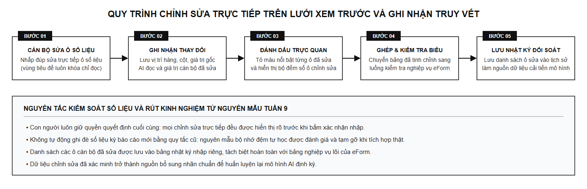
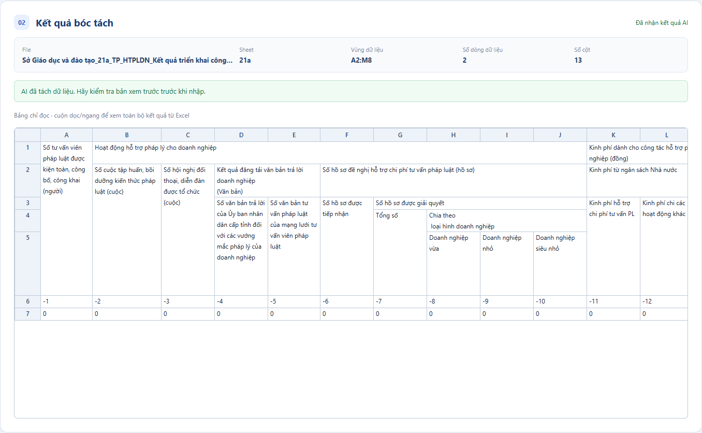
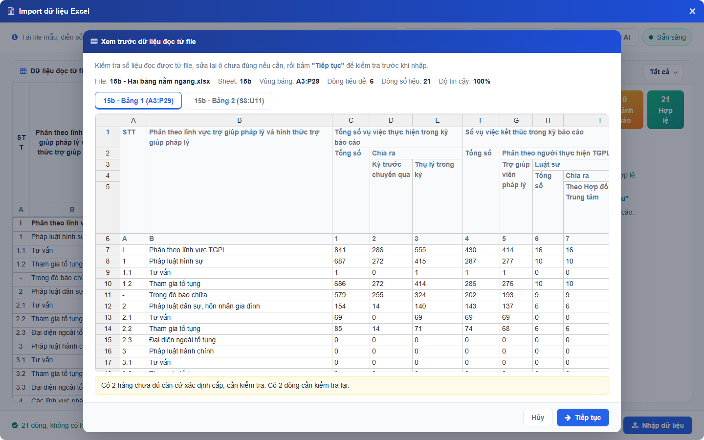

# TÀI LIỆU TỐI ƯU GIAO DIỆN XEM TRƯỚC, CHỈNH SỬA TRỰC TIẾP VÀ TRUY VẾT THAY ĐỔI

**Đề tài:** Module AI Import file Excel thông minh cho Hệ thống Báo cáo thống kê eForm BTP 
**Giai đoạn:** Tuần 9 (Cập nhật đồng bộ theo kiến trúc tích hợp thực tế trên eForm)

---

## 1. Mục tiêu tối ưu trải nghiệm người dùng và phạm vi kiểm soát

Qua rà soát cùng cán bộ hướng dẫn, một yêu cầu đặc biệt quan trọng trong môi trường báo cáo thống kê nhà nước là **tính minh bạch và kiểm soát tuyệt đối của con người trước khi ghép số liệu**. Mọi thao tác trên màn hình xem trước cần ngắn gọn, không gây nhầm lẫn với quy trình phê duyệt của eForm và **không tự ý ghi đè số liệu từ bộ nhớ đệm trình duyệt của lần nhập trước** (tránh rủi ro mang nhầm số liệu của kỳ báo cáo cũ sang kỳ mới).

Do đó, trong Tuần 9, em đã tinh gọn phạm vi giao diện xem trước và hoàn thiện luồng chỉnh sửa trực tiếp có truy vết thay đổi ngay trên lưới bảng tính.

---

## 2. Các cải tiến trọng tâm trên màn hình xem trước

1. **Tinh gọn luồng thao tác cốt lõi:** Loại bỏ các nút chức năng phụ dễ gây nhầm lẫn, gom trải nghiệm về đúng chuỗi 3 bước mạch lạc: **Chọn tệp Excel → Kiểm tra & chỉnh sửa trực tiếp trên bản xem trước → Xác nhận tiếp tục sang bước ghép và đối soát biểu mẫu**.
2. **Chỉnh sửa trực tiếp và đánh dấu trực quan ô thay đổi:** Cho phép cán bộ nhấp đúp sửa bất kỳ ô số liệu nào ngay trên lưới Handsontable trong khi vẫn khóa cứng vùng tiêu đề. Mỗi ô đã chỉnh sửa đều được lưu lại giá trị gốc trong phiên làm việc, đánh dấu nổi bật trực quan và cho phép hoàn tác về kết quả AI gốc nếu cần.
3. **Cảnh báo cấu trúc rõ ràng ngay tại màn hình xem trước:** Hiển thị nổi bật các cảnh báo phát hiện bởi mô hình AI (như cột bị đảo thứ tự, bảng có độ tin cậy thấp hoặc hàng chưa đủ căn cứ xác định cấp) để cán bộ soát nhanh trước khi bấm **Tiếp tục**.
4. **Hỗ trợ chuyển đổi thẻ khi tệp có nhiều bảng:** Cho phép xem trước từng vùng bảng riêng biệt (ví dụ bảng số liệu chính và bảng phụ nằm ngang) để lựa chọn chính xác bảng cần ghép vào báo cáo eForm.

---

## 3. Minh chứng giao diện thực tế

 
*Hình 1: Màn hình xem trước tinh gọn hiển thị đầy đủ siêu dữ liệu vùng bảng và cấu trúc ô gộp tiêu đề.*

 
*Hình 2: Cửa sổ xem trước tích hợp trực tiếp trong eForm hỗ trợ chuyển đổi thẻ nhiều bảng và cho phép sửa trực tiếp số liệu trước khi bấm Tiếp tục.*
